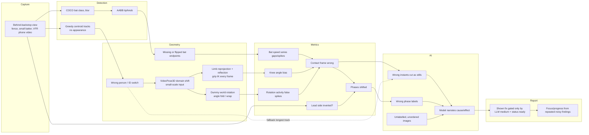

# HitterLoop: Forensic Codebase and AI Video Architecture Audit

- **Repository:** `jonmcurry/player-scouting-report`, branch `master`
- **Baseline:** HEAD was `8046354` (`0.49.0`) at audit start. A parallel work session committed `e115a86`, `a7c65fd` and `2f88018` and began uncommitted drill-library work while the audit ran. Files were read as the tree stood during the audit. All cited line numbers were re-checked against HEAD `2f88018` (`package.json` `0.51.0` with uncommitted changes) at the end of the audit.
- **Audit date:** 2026-10-11
- **Live pipeline version stamp:** `pose3d-live-1.0.0` (`scripts/pose3d/run_pipeline.py:68`)
- **Audience:** the independent architecture reviewer (GPT-6 Astra) who will plan the redesign
- **Scope:** read-only static analysis. No code was executed against video; no application file was changed.

## How to read this report

Every significant statement carries one of these labels:

| Label | Meaning |
|---|---|
| **[FACT]** | Directly observable in the source at the cited file and line. |
| **[INFERENCE]** | Follows from the cited code by reasoning, but was not executed or measured. |
| **[HYPOTHESIS]** | A plausible failure mode that needs real annotated video to confirm or reject. |
| **[REC]** | A recommendation. None has been validated empirically. |

**Runtime limit of this audit [FACT].** The machine used for the audit has no `.venv_pose3d`, no `scripts/models/` weights, and empty `videos/` and `frames/` directories. The pose pipeline therefore could not be run, so no accuracy number in this report comes from execution. Where the repository's own comments report measurements (for example, "measured on Emily_C_AB11"), they are quoted as the repository's claims, not as verified results.

---

## 1. Executive summary

HitterLoop is a static-HTML/Capacitor coach and family app backed by Supabase (Postgres, Auth, Edge Functions) and Google Cloud Storage. A Node worker shells out to a Python computer-vision pipeline: YOLO11-pose, then a COCO-pretrained YOLOv8 "baseball bat" detector, then VideoPose3D, then hand-tuned heuristics. That pipeline locates one swing per clip. The worker then cuts stills from the located phase frames and sends them to Gemini, which writes the parent-facing report.

The product layer (consent, RLS, deletion, sharing, fail-closed report assembly, a strict response validator) is mature and heavily engineered. **The analysis engine is not.** Its main problems are structural and compounding, not isolated bugs:

1. **Nothing in the CV pipeline has been measured against ground truth [FACT].** There is no annotated footage, no keypoint, bat, or phase-timing benchmark, and no Python test for any pose3d stage. The "validation" runner (`scripts/process-validation-batch.ts`) reports coverage percentages, not accuracy. Thresholds were tuned on roughly 11 clips that, by the repository's own naming, are mostly one athlete ("Emily_C_*"). **Accuracy has not been established for any stage.**
2. **The swing location that drives everything downstream is a fragile heuristic chain.** Contact is `argmax(bat-tip speed × knee extension × shoulder-rotation activity)` (`scripts/pose3d/metrics.py:263-313`). Each input carries a defect or an unvalidated assumption:
   - bat "tip" is the midpoint of an axis-aligned box edge;
   - knee angle comes from monocular 3D;
   - rotation activity contains a confirmed angle-wrap bug.

   The contact frame then picks which stills Gemini sees.
3. **The 3D reconstruction is optimized for visual plausibility rather than measured correctness.** The judgment is [INFERENCE]; each mechanism below is [FACT].
   - Wrists are forced together by IK on every frame (`correct_limb_depth.py:253-306`).
   - The similarity fit can produce reflections (`correct_limb_depth.py:157`).
   - World "up" is a fixed dummy rotation borrowed from Human3.6M, not this camera (`lift_3d.py:68`).
   - The viewer re-levels the torso (`coach/components/skeletonScene.js:420-436`).
   - The rendered bat is synthesized from forearm direction, not from bat detections (`skeletonScene.js:458-470`).
4. **The AI layer is better isolated than the problem statement assumes.** Pose and 3D metrics are *not* sent to the model: `metrics: {}` and `reconstructionSupplied: false` (`src/cli/analyze.ts:115-116`). The model sees only images. So "unreliable 3D metrics contaminate the prompt" is **not** occurring in the live path. The contamination is indirect: the pipeline decides *which frames* the model sees and *which phase each frame is labelled as*. In addition, images go to Gemini without per-image labels and in alphabetical rather than temporal order (`analyze.ts:24-27`, `geminiAnalyzer.ts:203-206`). No temperature is set. No usage or cost is recorded.
5. **The display gate does not use any CV quality signal [FACT].** A report is shown when the clip is `ready` and the LLM labelled its own finding `medium` with `basis: "video"`:
   - `qualityPassed: clip.status === "ready"` (`supabase/functions/get-simplified-report/index.ts:366`);
   - `shownFix` (`src/services/development/focus.ts`).

   Contact confidence `low`, poor pose coverage, or `reconstruction_reliable=false` do not block a parent-facing report. "Confidence" shown to families is the LLM's self-rating, not a calibrated quantity.

**Recommended direction (Section 15): Option B, a selective re-architecture of the analysis engine.** Keep the application, data model, consent and privacy machinery, the queue, and the validator. Do it in this order:

1. Build an annotated evaluation set first.
2. Replace contact localization and bat geometry.
3. Demote or remove 3D-derived claims.
4. Make CV quality gate what parents see.
5. Give the vision model temporally ordered, labelled evidence (or short video).

A full rebuild (Option C) is not justified by the evidence. The application layer is the healthiest part of the system.

---

## 2. Current system architecture

### 2.1 Languages, frameworks, entry points [FACT]

| Layer | Technology | Entry points |
|---|---|---|
| Coach/family client | Static HTML + ES modules (no bundler), Three.js viewer, PWA service worker | `coach/simple.html` + `coach/components/simpleApp.js` (current default "simplified" app); legacy coach screens `coach/player.html`, `review.html`, `compare.html`, `team.html`, `lab.html`, etc. |
| Mobile | Capacitor 6 Android shell serving `coach/` | `mobile/capacitor.config.json`, `mobile/android/` |
| Admin | Static HTML methodology admin | `admin/*.html`, `admin/methodologyApi.js` |
| Edge API | Supabase Edge Functions (Deno/TS) | `supabase/functions/*/index.ts` (10 functions) |
| Database | Postgres via Supabase, 62 committed migrations (counted at 00061: ~107 tables, 105 `enable row level security` statements) | `supabase/migrations/00001…00062` |
| Worker / CLI | Node 22 + TypeScript (`tsx`), commander CLIs | `src/cli/*.ts`; `package.json` `scripts` |
| CV pipeline | Python, PyTorch, Ultralytics, OpenCV, VideoPose3D (cloned research repo) | `scripts/pose3d/run_pipeline.py` |
| AI | `@google/genai` (Gemini Developer API, API key); local-only Claude CLI and Antigravity (`agy`) CLI backends | `src/services/ai/*.ts` |
| Storage | Google Cloud Storage (raw video), local disk `frames/` (all derived artifacts) | `src/services/storage/gcs.ts` |
| Notifications | Firebase push + Resend email via outbox | `src/services/notifications/*`, `src/cli/dispatchNotifications.ts` |

### 2.2 Subsystem inventory

| Subsystem | Primary files | Responsibilities | Dependencies | Execution status | Known risks |
|---|---|---|---|---|---|
| Upload client | `coach/components/videoUpload.js` `uploadRawClip`; `coach/components/uploadPolicy.js`; `coach/components/captureQueue.js` | Extension/MIME allowlist, request signed URL, PUT to GCS, insert `video_clips` row (coach) or `guardian_register_clip` RPC (guardian) | Supabase JS, `get-upload-url` | **Live** | No byte-size limit; the 3-minute limit is enforced client-side and in the worker only after download |
| Signed upload URL | `supabase/functions/get-upload-url/index.ts` | AuthZ via `can_upload_for_entry`, reservation quota (`reserve_simple_upload`), V4 signed PUT, 15-min expiry | GCS SDK, Postgres RPCs | **Live** | No `x-goog-content-length-range`; arbitrary-size objects possible |
| Queue | `src/services/db/uploadQueue.ts` `claimNextPendingClip`, `markClip*` | Atomic conditional-UPDATE claim, stale reclaim after 15 min, retry backoff (max 3) | Supabase service role | **Live** | No heartbeat refreshes `claimed_at`; long runs can be double-claimed |
| Worker orchestrator | `src/cli/processUploadQueue.ts` `processOnePendingClip`, `runPipeline` | Download, duration check, capture assessment, spawn Python, ingest, smooth/rigidify 3D, mark ready, AI diagnosis | GCS, Python venv, ffmpeg | **Live on a developer machine** (`npm run dev:local` per `NEXT_STEPS.md`); no hosted GPU worker exists | No subprocess timeout; derived files persist on local disk |
| Swing locate (audio) | `scripts/pose3d/locate_swing.py` | For >60 s clips: high-pass audio onset peak → ~12 s window; ambiguous → up to 4 ranked candidates | ffmpeg, scipy | **Live** | Crowd/glove/foul transients; ambiguity handled by trial-and-error over candidates |
| Decimation | `scripts/pose3d/decimate.py` | >120 fps → ~30 fps by index | ffmpeg/OpenCV | **Live** (usually a no-op) | Index-based subsampling of VFR video |
| Person + bat detection | `scripts/pose3d/detect_2d.py` `run`, `build_person_tracks`, `build_batter_track`, `select_bat_box`, `bat_tip_and_knob` | YOLO11m-pose on all frames; YOLOv8m COCO class 34 + ByteTrack; batter selection; One-Euro smoothing | Ultralytics (unpinned), weights auto-downloaded | **Live** | See Section 5 |
| 3D lift | `scripts/pose3d/lift_3d.py` `run`, `frame_angles`; `scripts/pose3d/correct_limb_depth.py` | VideoPose3D TemporalModel (243-frame RF), limb depth "correction", bat-grip IK, fixed world rotation, per-frame angles | VideoPose3D cloned at HEAD (`--depth 1`), `pretrained_h36m_detectron_coco.bin` | **Live** | See Section 6 |
| Metrics / phases | `scripts/pose3d/metrics.py` `run` and `find_*` | Contact detection, 5 other phases, summary metrics, movement flags | — | **Live** | See Section 7 |
| Full-rate bat speed | `scripts/pose3d/refine_bat_speed.py` | Re-measure bat speed at native fps near contact | Ultralytics | **Live only when decimated** | Same AABB tip geometry |
| QA overlay | `scripts/pose3d/overlay.py` | Draw skeleton/bat/contact on video | OpenCV | **Live** (artifact kept on local disk) | Not reviewed by anyone in the automatic flow |
| Phase/metric ingest | `src/cli/ingestPhases.ts`; `src/services/db/videoClipUpsert.ts`; `src/services/db/analysisQuality.ts` `computeAnalysisQuality` | Upsert `swing_phases`, `video_clip_metrics`, quality ratings | Supabase | **Live** | Quality ratings stored but do not gate reports |
| 3D post-processing (TS) | `src/services/pose3d/smoothJoints.ts`, `rigidifySkeleton.ts`, `trackedFrames.ts` | One-Euro (3D-tuned), median bone-length rigidification, longest tracked run ≥30 frames | — | **Live** | Further smoothing on already-IK'd joints |
| Reconstruction module (TS) | `src/services/reconstruction/*.ts` (`coordinates.ts`, `stabilization.ts`, `temporal.ts`, `handedness.ts`) | Canonical coordinate contract, bone stabilization, foot-plant lock | — | **Unwired**: imported only by its own test | Documentation (`docs/PIPELINE_AUDIT.md`) describes it as the "canonical flow"; production does not use it |
| AI stills extraction | `src/cli/extract.ts` `extractAnalysisInputs`; `src/services/pose3d/subjectBox.ts`; `src/services/pose3d/analysisWindow.ts` | Map analyzed frames to raw PTS; write `phase_*.png`, `zoom_*.png`, up to 24 `swing_seq_NN.png` | ffmpeg/ffprobe | **Live** | Correct only if phase frames are correct |
| AI analysis | `src/cli/analyze.ts` `buildAnalysisInput`, `analyzeAndSync`; `src/services/ai/geminiAnalyzer.ts` `analyzeSwing`; `swingAnalysisShared.ts`; `semanticValidation.ts` | Prompt, Gemini call, schema and semantic validation, persist run/issues | Gemini API, methodology snapshot | **Live (Gemini)**; Claude CLI and agy CLI are local-test backends | See Section 8 |
| Report read path | `supabase/functions/get-simplified-report/index.ts`; `src/services/development/reportAssembly.ts` `assembleReport`; `focus.ts` `shownFix`, `advanceFocus` | Authorize viewer, assemble summary/strengths/one fix/drills, focus progression | Service-role client | **Live** | Gate is LLM self-confidence and clip status only |
| 3D viewer | `coach/components/skeletonScene.js`, `skeletonComparison.js`, `compModal.js`, `fkCorrection.js` | Mixamo FBX retargeting, synthetic bat, leveling, "corrected pose" FK | Three.js | **Live in legacy coach screens only** (not in `simple.html`) | Visually plausible, not evidential |
| Metrics panel | `coach/components/swingMetricsPanel.js` | Bat speed (2D), attack angle (2D), stride, movement flags | — | **Live in legacy `review.html` / `compare.html`** | Labelled "(2D)", but attack angle from a behind-plate view is not an attack angle |
| Analysis-depth foundation | `src/services/analysisDepth/*`; migrations 00055-00061 | Capture assessment, attempts, fingerprints, comparison sets, instruments lab | — | **Partially wired**: capture assessment and attempt snapshot are written by the worker; nothing reads them for reports | Additive; not yet influencing output |
| Methodology knowledge | `src/services/knowledge/methodologyRepository.ts`; migrations 00029/00030; `admin/` | Versioned, reviewed coaching claims rendered into the prompt | Supabase | **Live** (fail-closed if no active snapshot) | Claims are text; no link to measurable signals |
| Privacy tooling | `scripts/privacy/*.py`; `src/services/demoExport/*` | Demo fixture anonymization and validation | OpenCV, OCR | **Offline tooling** | Out of the live path |
| Legacy | `knowledge/claims.json` + `src/services/knowledge/knowledgePack.ts` (still imported for `CONCEPTS`); MediaPipe path (deleted); `pose3d_to_checklist.py` | — | — | **Mostly dead**; `CONCEPTS` still live | `KNOWLEDGE_VERSION` is retained only for a legacy check |

### 2.3 Documented versus connected [FACT]

- `docs/PIPELINE_AUDIT.md` describes a "canonical reconstruction flow" with "low-velocity foot-plant correction" and a "pluggable lifter boundary". Those live in `src/services/reconstruction/`, which no production code imports.
- `scripts/pose3d/README.md` says the stack includes `--legacy-mediapipe`; that path was removed in `359d7f3`.
- `src/services/ai/geminiAnalyzer.ts:6-16` says the file "has NOT been exercised against a real API call". `geminiAnalyzer.ts:124` records a "First live run (2026-09-25)". The header is stale.
- `processUploadQueue.ts` reads `metrics.swing_detection` and `metrics.detector_version` (`:272-274`, `:309-315`). `metrics.py` never writes either key. So `swingDetectionState` (`src/services/development/swingDetection.ts`) can never return `confirmed_no_swing` from the live pipeline, and `detectorVersion` is always null.
- The Dockerfile containerizes only the Node CLI. The Python pipeline has no container, no `requirements.txt`, and no pinned versions (`scripts/pose3d/README.md:41-55`).

---

## 3. End-to-end video-processing execution trace

### 3.1 Mermaid execution diagram (grounded in source)

```mermaid
flowchart TD
  A[simpleApp / videoUpload.js uploadRawClip<br/>acceptedVideoUpload ext+MIME] --> B[Edge fn get-upload-url<br/>can_upload_for_entry, reserve_simple_upload<br/>V4 signed PUT 15 min]
  B --> C[(GCS raw object<br/>opaque UUID path)]
  A --> D[(video_clips row status=pending<br/>or guardian_register_clip RPC)]
  D --> E[processUploadQueue.ts main loop 10 s poll<br/>claimNextPendingClip: atomic UPDATE]
  E --> F[downloadFile -> videos/_uploads/uuid.ext]
  F --> G[probe duration; uploadDurationRejection > 180 s => permanent fail]
  G --> H[probeCaptureMedia + sha256 + sampleCaptureVisuals<br/>persistCaptureAssessment - additive, never gates]
  H --> I[spawn python run_pipeline.py<br/>no timeout; status via pipeline_status.json]
  subgraph PY[scripts/pose3d - Python]
    I --> J[locate_swing.run: if > 60 s, audio HPF onset -> 12 s window<br/>ambiguous -> <= 4 candidates]
    J --> K[decimate.run: > 120 fps -> ~30 fps by index]
    K --> L[detect_2d.run<br/>quick_trackability_check 30 frames<br/>YOLO11m-pose all frames, conf 0.25<br/>YOLOv8m class 34 + ByteTrack conf 0.15]
    L --> M[build_person_tracks greedy centroid gate 0.18 W<br/>build_batter_track: max wrist-near-bat frames<br/>fallback: longest track]
    M --> N[select_bat_box lock track id<br/>bat_tip_and_knob: AABB long-axis edge midpoints<br/>One-Euro on 17 kps + tip + knob, t = i/fps]
    N --> O[lift_3d.run: fill_missing linear interp<br/>normalize_screen_coordinates full frame<br/>VideoPose3D 243-frame RF]
    O --> P[correct_limb_depth: similarity fit, reproject, bone-length depth<br/>_converge_bat_grip IK all frames, One-Euro]
    P --> Q[camera_to_world fixed H36M dummy rotation<br/>frame_angles: hip/shoulder line XY, tilt from Z, elbow/knee]
    Q --> R[metrics.run: bat_speeds, knee_extension_series, rotation_activity_series<br/>find_contact_frame argmax product, ROTATION_MIN_DEG 3]
    R --> S[find_extension / stride / follow_through / load / stance<br/>front_side_at ankle-lower heuristic<br/>movement_flags]
    S --> T{phases found?}
    T -- no, more candidates --> K
    T -- yes or exhausted --> U[refine_bat_speed if decimated<br/>overlay.mp4<br/>write pipeline_status.json]
  end
  U --> V[ingestPhases: swing_phases, video_clip_metrics, computeAnalysisQuality]
  V --> W[extractLongestTrackedRun >= 30 -> smoothJoints -> rigidifySkeleton -> video_clip_pose3d]
  W --> X[swingDetectionState: readable if ANY phase frame exists<br/>markClipReady]
  X --> Y{readable and window mappable?}
  Y -- yes --> Z[extract.ts extractAnalysisInputs<br/>ffprobe PTS, phase_*.png full res, zoom_*.png 1024 px,<br/>swing_seq_NN.png <= 24 frames if batter in crop >= 80%]
  Z --> AA[analyze.ts buildAnalysisInput<br/>player, pitch row, coach decisions, methodology pack<br/>metrics = empty, reconstructionSupplied=false]
  AA --> AB[geminiAnalyzer.analyzeSwing<br/>prompt text + N inline PNGs, alphabetical order<br/>responseSchema JSON, retry 408/429/5xx x4]
  AB --> AC[validateSwingAnalysisResult + assertSemanticallyValid<br/>throw on any violation]
  AC --> AD[(analysis_runs, issues draft, comps, notes<br/>video_clips.swing_detection_state=readable<br/>refreshPlayerFocus, enqueueReportReady)]
  AD --> AE[get-simplified-report<br/>assembleReport: qualityPassed = status==ready<br/>shownFix: basis=video AND confidence=medium]
  AE --> AF[simpleApp.js renders summary, strengths, one fix, curated drills]
```

### 3.2 Stage-by-stage trace

For each stage: implementation, inputs and outputs, models and algorithms, configuration, error handling and confidence, retry, tests. Information that is discarded, approximated, interpolated, or inferred is marked **⚠ lossy**.

**1. Upload initiation.** [FACT] `coach/components/videoUpload.js:22` `uploadRawClip`. Generates a UUID `clipSlug` client-side. Refuses in demo mode. Guardians cannot attach a pitch or rep.

**2. File validation.**
- [FACT] Client and edge function share `acceptedVideoUpload`, an extension and MIME allowlist for `.mp4 .m4v .mov .webm` (`coach/components/uploadPolicy.js`, `supabase/functions/_shared/uploadPolicy.ts`).
- [FACT] No byte-size limit at either layer (no `content-length-range` in `get-upload-url/index.ts:199-209`).
- [FACT] Duration ≤ 180 s is enforced in the worker *after* download (`processUploadQueue.ts:225-232`, `uploadLimits.ts`).
- [FACT] No codec, resolution, fps, or orientation validation gates processing. Capture assessment records them but never rejects (`processUploadQueue.ts:234-247`).

**3. Video storage.** [FACT] V4 signed PUT, 15-minute expiry, opaque paths (migration `00046_opaque_video_paths.sql`). The emulator path skips signing. Raw objects are retained until clip deletion; no lifecycle rule is defined in the repo.

**4. Database record creation.** [FACT] Coach: direct insert into `video_clips` with `status:'pending'`, `position` = count of existing clips (non-atomic count; `videoUpload.js:93-107`). Guardian: `guardian_register_clip` RPC (00042).

**5. Job scheduling.** [FACT] There is no queue service. Postgres row status is the queue.
- `claimNextPendingClip` does a conditional UPDATE over `pending` (respecting `next_retry_at`) or `processing` rows with `claimed_at` older than `UPLOAD_QUEUE_STALE_CLAIM_MINUTES` (default 15) (`uploadQueue.ts:17, 58-79`).
- `markClipProgress` updates only `processing_progress` (`uploadQueue.ts:96-99`). It does **not** refresh `claimed_at`.

**6. Worker execution.**
- [FACT] A single process handles one clip at a time and polls every 10 s (`processUploadQueue.ts:78, 425-459`).
- [FACT] It spawns Python with no timeout (`runPipeline`, `:95-201`).
- [FACT] Success is read from `pipeline_status.json` (atomic write) rather than the exit code, which works around a documented Windows/CUDA teardown crash.
- [FACT] The downloaded raw copy is deleted in `finally`. `frames/<player>/<clip>/` (pose JSON, overlay.mp4, stills, AI results) is retained on local disk.

**7. Video decoding and frame extraction.**
- [FACT] OpenCV `CAP_PROP_FPS` (fallback 30) and frame count (`detect_2d.py:408-413`).
- [FACT] Ultralytics streams the file **twice**, once for pose and once for bat tracking (`:449-483`). Frame-count mismatch is guarded (`:525`) but alignment is assumed.
- [FACT] Time is `t = i / fps` (`:502`). **⚠ lossy.** The same repo documents that phone video is VFR and that `n / fps` "landed several frames away from frame n" (`src/cli/extract.ts:77-80`). Only the AI-still extraction uses true PTS. All Python kinematics (speeds, One-Euro clock, onset timing, `wrist_lead_ms`) use the constant-rate assumption.
- [FACT] Stage 0 trims by re-encoding a window. Stage 0.5 decimates by index. Both working copies are deleted at the end of the run.

**8. Batter identification.** [FACT] `build_batter_track` (`detect_2d.py:191-248`) scores each person track by how many frames have a wrist within 0.15 × frame width of a bat-box centroid with confidence ≥ 0.3. Tracks shorter than 0.5 s are ineligible. If no track has evidence, it falls back to the **longest track** (`:227-242`). The fallback is recorded in `bat_evidence.used_fallback` but does not stop processing. See Section 5.A.

**9. Multi-object tracking.** [FACT] `build_person_tracks` (`:142-188`) does greedy nearest-centroid assignment. The centroid comes from the keypoint bbox (≥4 keypoints at conf ≥ 0.15). The gate is 0.18 × frame width, gap tolerance is 8/30 s, and the larger skeleton is matched first. There is no appearance model, no motion model, and no Hungarian assignment. Ultralytics' own pose tracker is not used for people. **⚠ inferred identity.**

**10. Bat detection and tracking.**
- [FACT] `yolov8m.pt`, COCO class 34, conf 0.15, `bytetrack.yaml` (`:469-474`).
- [FACT] `select_bat_box` locks a ByteTrack ID: acquire at conf ≥ 0.35, keep at ≥ 0.12, within 0.35 × frame width of a wrist (`:296-331, 496`).
- [FACT] `bat_tip_and_knob` places tip and knob at the **midpoints of the two short edges of the axis-aligned box**. The knob is whichever end is nearer `hand_pts[0]` (`:334-351`). **⚠ approximated geometry.**
- [FACT] Tip and knob are then One-Euro filtered (`mincutoff 0.6, beta 0.9`).

**11. 2D pose estimation.** [FACT] `yolo11m-pose.pt`, conf 0.25, COCO-17, batch 16 on GPU. Every keypoint is One-Euro filtered per axis (`mincutoff 0.8, beta 0.4`) regardless of its confidence (`:493, 507-509`). Raw confidence is stored next to the smoothed coordinate. **⚠ smoothed positions paired with unsmoothed confidences.**

**12. 3D pose reconstruction.** [FACT] `lift_3d.run`, in order:
1. Untracked frames are linearly interpolated per joint (`fill_missing`, `:196-209`). **⚠ interpolated.**
2. Coordinates are normalized to full-frame screen coordinates (`:244`).
3. Edge padding is applied, then the VideoPose3D TemporalModel runs (`:251-258`).
4. `correct_limb_depth` runs (`:269`). **⚠ replaces model output with 2D-reprojected and IK-constrained joints.**
5. `camera_to_world` applies the fixed H36M dummy rotation (`:274`).
6. `frame_angles` computes per-frame angles (`:128-166`).

**13. Swing-event identification.** [FACT] `find_contact_frame` (`metrics.py:263-313`): min-max normalize three series over the whole analyzed window, require rotation ≥ 3°, and take the argmax of the product. Confidence is `"high"` if the speed and knee percentiles are both ≥ 0.7 and the rotation gate is met (`:914-917`). Up to 3 audio candidates are tried. The first with any phase wins (`run_pipeline.py:155-188`). **⚠ inferred event.**

**14. Swing-phase segmentation.** [FACT] All five non-contact phases come from contact-relative heuristic windows (`find_extension_frame` :411, `find_stride_frame` :441, `find_follow_through_frame` :502, `find_load_frame` :560, `find_stance_frame` :620). They return `null` with a reason when the signal is absent, and confidence is never above `"low"` (extension can be `"high"`). There are no fixed percentages and no AI-based segmentation. **⚠ inferred.**

**15. Metric calculation.** See Section 7.2. Units are body-relative pixels or degrees. No calibration exists.

**16-18. AI invocation, prompt construction, response parsing.**
- [FACT] Gemini is called through `ai.models.generateContent` with `responseMimeType: application/json` and `responseSchema` (`geminiAnalyzer.ts:209-216`).
- [FACT] The prompt is `renderSwingAnalysisPrompt` (`swingAnalysisShared.ts:40-88`). Images are inline base64.
- [FACT] Retries: 4 attempts on HTTP 408/429/5xx (`:125-171`). Parse and validation errors are not retried.
- Details in Section 8.

**19. Report validation.** [FACT] `validateSwingAnalysisResult` (`swingAnalysisShared.ts:150-242`) does structural, taxonomy, claim-ID, phase-has-still, and basis-was-supplied checks. `assertSemanticallyValid` (`semanticValidation.ts:271-354`) uses regex to reject pitch location, pitch type, and outcome assertions unsupported by recorded data, plus confidence `"high"` and contradictory flags. Any violation throws. Nothing is persisted and the clip stays `ready` with no report. **It does not check biomechanical or numeric claims** (policy rule 7 is not enforced; there is no numeric or degree regex).

**20. Persistence and rendering.**
- [FACT] `analyzeAndSync` writes `analysis_runs` (with `input_manifest`, prompt/policy/knowledge/pipeline versions), `issues` (draft), comps, notes, and drills (`analyze.ts:187-248`).
- [FACT] It sets `swing_detection_state='readable'` (`:250-253`) and refreshes focus.
- [FACT] `get-simplified-report` authorizes the viewer and calls `assembleReport` (`reportAssembly.ts`). `shownFix` needs `basis==='video'`, `confidence==='medium'`, a mechanical concept, and no context flags (`focus.ts`).
- [FACT] Focus progression (`advanceFocus`) counts a concept's appearances across the last five readable game swings: ≥3 makes it a focus; absent from the last four marks it "looks fixed".

### 3.3 Inventory of lossy transformations

| # | Location | What is lost, approximated, or invented |
|---|---|---|
| L1 | `locate_swing.py` | Everything outside a ~12 s window for long clips; audio peak, not vision, chooses the window |
| L2 | `decimate.py` | Frames dropped by index on >120 fps input |
| L3 | `detect_2d.py:502` | True presentation timestamps (CFR assumed) |
| L4 | `detect_2d.py:142-188` | Identity (appearance-free greedy association) |
| L5 | `detect_2d.py:227-242` | The batter itself, when the fallback picks the longest track |
| L6 | `detect_2d.py:334-351` | Bat orientation (AABB edge midpoints ≠ bat endpoints unless the bat is axis-aligned) |
| L7 | `detect_2d.py:507-509` | Per-keypoint confidence is ignored by the smoother; low-confidence joints are smoothed as if real |
| L8 | `lift_3d.py:196-209` | Untracked frames become linear interpolations fed to a temporal model |
| L9 | `correct_limb_depth.py:309-399` | Model depth is replaced by bone-length root selection; in-plane coordinates are replaced by reprojection |
| L10 | `correct_limb_depth.py:253-306` | Both wrists are forced to one grip point on **every** frame |
| L11 | `lift_3d.py:274` | Real camera orientation is replaced by a fixed H36M dummy rotation |
| L12 | `lift_3d.py:85-95` | Line direction folded to (−90°, 90°] |
| L13 | `smoothJoints.ts`, `rigidifySkeleton.ts` | Second smoothing plus median bone-length rigidification before storage |
| L14 | `trackedFrames.ts` | Only the longest contiguous tracked run is stored |
| L15 | `skeletonScene.js:420-436, 458-470` | Average early torso tilt is removed; the bat is synthesized from forearms |
| L16 | `extract.ts` | Video becomes ≤6 phase stills + ≤6 crops + ≤24 crop frames; no motion between samples |
| L17 | `analyze.ts:115-116` | All quantitative pose evidence is withheld from the model (by design) |
| L18 | `assembleReport` | Only one fix and two strengths are shown |

---

## 4. Computer vision model inventory

| Model | File / weight | Source | Version pinning | Training domain | Used for |
|---|---|---|---|---|---|
| YOLO11m-pose | `scripts/models/yolo11m-pose.pt` | Ultralytics auto-download | **Unpinned** (no `requirements.txt`; weights not checksummed) | COCO keypoints (general people) | All-person 2D pose |
| YOLOv8m detector | `scripts/models/yolov8m.pt` | Ultralytics auto-download | **Unpinned** | COCO 80 classes; class 34 "baseball bat" | Bat boxes |
| ByteTrack | Ultralytics `bytetrack.yaml` | Ultralytics | **Unpinned** | n/a (Kalman + IoU) | Bat track IDs only |
| VideoPose3D TemporalModel | `.venv_pose3d/VideoPose3D_src/checkpoint/pretrained_h36m_detectron_coco.bin`; architecture reverse-engineered from tensor shapes (`lift_3d.py:17-20`) | facebookresearch, `git clone --depth 1` (HEAD, unpinned) | **Unpinned repo**; checkpoint by URL, no checksum | Human3.6M (adult actors, studio, 4 fixed cameras, everyday actions) with Detectron COCO 2D inputs | 2D → 3D lift |
| (none) | — | — | — | — | No ball detector, no plate or field model, no hand or bat-keypoint model, no re-ID model |

Substitutions are documented in `scripts/pose3d/README.md:65-76`. RTMPose/RTMDet and MotionBERT were rejected for **installability on one Windows machine**, not for accuracy.

---

## 5. Tracking and pose analysis

### A. Batter detection and tracking

| Question | Answer |
|---|---|
| How is the batter selected? | [FACT] The person track with the most frames where a confident wrist lies within 0.15 × frame width of a bat-box centroid (bat conf ≥ 0.3) (`detect_2d.py:191-248`). |
| Detection on every frame? | [FACT] Yes, pose runs on every analyzed frame. A 30-frame pre-check aborts when <15% of samples contain a person ≥8% of frame height (`:354-394, 420-445`). |
| How is identity maintained? | [FACT] Greedy nearest-centroid with a 0.18 × frame-width gate (≈346 px at 1920 wide). No appearance, velocity, or IoU cost. A detection that fails the gate starts a new track. |
| Partial occlusion? | [INFERENCE] Occlusion that drops a person below 4 keypoints at ≥0.15, or longer than 8/30 s, ends the track. The batter's frames then split across tracks and only one track is kept. The rest of the frames become `keypoints: None`, which `lift_3d.fill_missing` linearly interpolates. |
| Multiple athletes? | [FACT] Every person gets a track. Catcher and umpire overlap the batter in behind-the-backstop footage; this is the stated reason earlier heuristics failed (`:196-205`). |
| Identity switches? | [FACT] The repo itself records that "the tracker can jump to another player mid-clip (seen on real clips: a fielder, the catcher)" (`src/services/pose3d/subjectBox.ts:77-78`). The only guard is in the **crop** code for AI stills (`MAX_JUMP`, `:90`). The pose → 3D → metrics path has no switch detection. |
| Can coaches correct identification? | [FACT] No. No UI, table, or worker input selects or corrects the batter track. Append-only *phase* corrections exist (`swing_phase_events`, migration 00057), but nothing re-drives stills, metrics, or AI from them (`NEXT_STEPS.md`: "no report/focus/share/demo consumer moved"). |
| Calibrated, propagated confidence? | [FACT] No. Batter-selection evidence (`bat_evidence_frames`) is stored in `pose_2d.json` meta and used only for an error message (`metrics.py:877-892`) and `computeAnalysisQuality.bat_coverage`. Neither gates the AI or the report. |
| Can tracker failures silently corrupt downstream? | [INFERENCE] **Yes.** (a) The fallback-to-longest-track path continues to 3D, metrics, and AI. (b) A mid-clip switch makes one "track" contain two people. VideoPose3D's 243-frame temporal receptive field then smears the switch across ±121 frames. Bone-length medians and rotation series absorb it. |

[HYPOTHESIS H-A1] In behind-the-backstop video, the catcher's centroid often falls within 0.18 × frame width of the batter's. The larger-skeleton-first ordering (`:167`) can then assign the batter's detection to the catcher's track on frames where the batter is partially occluded. Validate with identity-annotated clips.

### B. Bat detection and tracking

| Question | Answer |
|---|---|
| Which model? | [FACT] COCO-pretrained YOLOv8m class 34. No fine-tuning and no bat-specific data (`README.md:74`). |
| Temporally consistent? | [FACT] ByteTrack IDs plus a lock in `select_bat_box`. When the lock is lost, it re-acquires the nearest box ≥0.35 conf within 0.35 × frame width of a wrist. |
| Motion blur modelled? | [FACT] No. [INFERENCE] During the fastest part of the swing the bat is a translucent smear. A COCO detector trained mostly on static bats is least likely to fire exactly when bat speed matters most. |
| Geometry? | [FACT] Axis-aligned box → endpoints at short-edge midpoints (`:341-344`). [INFERENCE] For a bat at angle θ to the image x-axis, the true endpoints are box *corners*. The reported endpoints are wrong by up to ~½ the box's short side, and fully wrong in direction at θ ≈ 45° (square box: long-axis choice flips between horizontal and vertical on 1-px changes). This is a **mathematical defect** that hits common swing orientations. |
| Tip/knob disambiguation | [FACT] Uses only `hand_pts[0]`, the **left** wrist when it is confident (`:347`). Its choice can flip frame to frame, then feeds a One-Euro filter that blends across the flip. |
| Missing detections? | [FACT] `tip: None`. `bat_speeds` returns `None` for any frame whose neighbours lack a tip (`metrics.py:201-210`). The contact search then skips those frames. |
| Occlusion? | [FACT] Not modelled beyond the ByteTrack lock tolerance. |
| Bat inferred from hands? | [FACT] Not in the 2D metrics; the bat comes from detections. **In the 3D viewer, yes**: the bat is synthesized along the forearm direction from the hand bones (`skeletonScene.js:458-470`), not from any bat detection. |
| Robust across camera angles? | [FACT] The code is tuned for "behind the backstop". A baseline view is acknowledged as failing (`metrics.py:877-892`). `docs/ANALYSIS_DEPTH_PHASE_2.md` keeps the catcher view disabled. |

**Assumptions that can produce wrong bat paths:**

1. AABB long axis = shaft.
2. The left wrist decides which end is the knob.
3. A wrist within 0.35 × frame width marks "the batter's bat" (generous; a bat on the on-deck circle or the catcher's mitt can qualify).
4. Blur-free detection at peak speed.
5. Constant frame rate for speed.
6. One-Euro lag on a 0.6 Hz base cutoff.
7. Image-plane motion stands in for 3D motion.

### C. 2D pose estimation

| Aspect | Finding |
|---|---|
| Model and config | [FACT] YOLO11m-pose, conf 0.25. Batched GPU inference changes keypoints by up to ~19 px vs batch=1 on low-confidence detections and ~5 px on confident ones (repo's own measurement, `detect_2d.py:59-72`). |
| Landmarks | [FACT] COCO-17: no hands, fingers, feet, toes, or bat grip. Wrist is the most distal upper-limb point. |
| Left/right | [FACT] Model-assigned. Not checked against `players.bats`. [HYPOTHESIS] Self-occluded side views produce left/right swaps; nothing detects or repairs a swap. |
| Confidence use | [FACT] Gates the bbox (≥0.15), the batter evidence (≥0.15 wrist), subject boxes (≥0.3), and the 3D correction (≥0.5). It is not used to down-weight smoothing or to mask joints going into VideoPose3D. |
| Temporal smoothing | [FACT] One-Euro per axis; filter state survives gaps. [INFERENCE] With `mincutoff 0.8 Hz` at 30 fps, α ≈ 0.14 during slow motion, a heavy lag that delays slow onsets (load, stride start) by several frames. `beta 0.4` on px/s velocity means the cutoff opens almost fully during the swing, so fast-phase jitter passes through. |
| Interpolation | [FACT] None in 2D. Linear interpolation happens at the 3D stage. |
| Camera perspective | [FACT] Not modelled. Body-relative units use the clip-median shoulder or hip pixel width, which changes with body rotation and with distance from camera. |
| False associations / identity switching | See 5.A. |
| Frame rate | [FACT] Time constants were converted from frame counts to seconds (good). CFR is assumed (L3). |

**Verdict [INFERENCE]:** the 2D stage can give temporally smooth tracks for a well-separated, well-lit batter. Nothing in the code checks physical plausibility (limb-length consistency in 2D, left/right consistency, identity consistency). No measurement establishes accuracy.

### D. Summary judgment on the CV front end

The upstream failures reported by users (wrong person, bad bat path) map onto concrete design choices: appearance-free greedy tracking, a COCO generic bat class, and AABB endpoint geometry. They are **not** isolated bugs that one patch fixes.

---

## 6. 3D reconstruction analysis

### 6.1 Model, inputs, coordinate systems [FACT]

- **Model:** VideoPose3D TemporalModel, `filter_widths=[3,3,3,3,3]`, 1024 channels, 243-frame non-causal receptive field. Trained on Human3.6M from Detectron COCO keypoints (`lift_3d.py:176-193`).
- **Input:** full-frame `normalize_screen_coordinates` (`:169-173`). [INFERENCE] The batter is "often under a tenth of a 4K frame's area" (`subjectBox.ts:3-5`), so normalized keypoints occupy a far smaller range than in H36M training, where the subject fills much of a ~1000 px frame. **[HYPOTHESIS H-D1]** This scale and position shift degrades depth regression. Test by re-normalizing around a stable subject box and comparing against ground truth.
- **Output:** root-relative "metric-ish" camera space, then a fixed `custom_camera_params['orientation']` quaternion, "taken from Human3.6M, only for visualization purposes" (`lift_3d.py:34-47, 68, 274`).
- **World frame:** [FACT] X = lateral, Y = depth, Z = "vertical" under that dummy rotation (`src/services/reconstruction/coordinates.ts:3`). [INFERENCE] That Z is vertical only if the real camera is level and positioned like an H36M camera. A phone tilted down from a fence, or held at an angle, rotates true vertical away from Z.

### 6.2 Transformations that make the skeleton look plausible without making it correct

| Transform | Code | Effect | Classification |
|---|---|---|---|
| Limb in-plane reprojection | `correct_limb_depth.py:355-381` | Elbows, wrists, knees, and ankles are pushed to match 2D, and depth is re-solved from median bone length. | Unvalidated scientific assumption (weak-perspective similarity between model space and image; median length = true length) |
| **Reflection allowed in similarity fit** | `_fit_similarity_2d`, `:152-160`: `R = Vt.T @ U.T` with no `det(R)` correction. The docstring (`:137`) says "rotation/reflection", so this is intended. | The fit may return a mirror transform, which no real human pose needs. The repo saw "two near-mirror-image rotations" and patched symptoms with an eigenvalue-ratio gate (`:84-112`). | **Mathematical modelling defect.** The code matches its docstring, but the model it implements is wrong for anatomy. How often it fires on real frames is not established. |
| **Bat-grip IK on every frame** | `_converge_bat_grip`, `:253-306`, called unconditionally at `:386` | Both wrists are forced to one point on all frames, including stance, walk-up, interpolated frames, and one-handed finishes. Elbow positions are re-solved by 2-bone IK. **Lead-elbow angle at contact becomes a function of IK bone lengths and grip distance, not of observation.** | **Architectural design flaw** plus an unvalidated assumption ("both hands stay together … essentially this entire clip", `:268-270`) |
| One-Euro on corrected limbs | `:392-397` | Smooths the mix of corrected and uncorrected frames. | Approximation |
| Fixed world rotation | `lift_3d.py:68, 274` | "Vertical" is a convention, not a measurement. | **Mathematical / coordinate-system issue.** The repo acknowledges this by excluding tilt from AI input (`analyze.ts:19-22`) but still computes and stores tilt (`metrics.py:958-964`). |
| Node 3D smoothing + rigidification | `smoothJoints.ts` (mincutoff 10, beta 2), `rigidifySkeleton.ts` | A second filter plus median bone lengths. | Cosmetic |
| Viewer leveling | `skeletonScene.js:420-436` | The mean torso "up" over the first 20% of frames is rotated to +Y. **Erases any real (or erroneous) forward lean in the display.** | Design choice that hides error |
| Synthetic bat | `skeletonScene.js:458-470` | The bat is drawn along summed hand-minus-forearm vectors. | Display fabrication (not measured) |
| FK "corrections" | `coach/components/fkCorrection.js` | Draws an altered pose for checklist teaching. | Synthetic, by design |

### 6.3 Angle computations

- **Hip–shoulder separation** [FACT] `frame_angles` (`lift_3d.py:131-133`): the difference of line orientations in world X-Y (depth plane), folded to [0°, 90°]. [INFERENCE] From a behind-the-plate view, hip and shoulder rotation happens largely *in depth*, the axis monocular lifting estimates worst. Values above 90° fold back.
- **Torso tilt / pelvis tilt** [FACT] Angle to dummy Z, sign-agnostic (`:115-125, 139-151`). [INFERENCE] Confounded by camera pitch and roll.
- **Elbow / knee angles** [FACT] Rotation-invariant 3D interior angles (`:103-112`). [INFERENCE] Invariant to the world rotation, but **not** to depth error or to the IK override (elbows).
- **Rotation activity** [FACT] `rotation_activity_series` uses `abs(b - a)` on `shoulder_line_deg` (`metrics.py:243-247`). That value is already folded into (−90°, 90°] by `line_orientation_xy` (`lift_3d.py:85-95`). **No wrap handling** (contrast `orientation_diff`, `lift_3d.py:98-100`, which is used for separation). A line jittering around ±90° yields jumps of ~178°. [INFERENCE] With Y = depth, a closed stance seen from behind the plate (shoulders aimed at the pitcher, i.e. along depth) sits at exactly ±90°. So stance jitter can produce large false "rotation activity". From an open-side view, the wrap is crossed near contact instead. **Confirmed implementation defect; downstream impact requires real-video validation.**

### 6.4 Which 3D measurements are defensible from single-camera footage

| Measurement | Defensible? | Reason |
|---|---|---|
| Elbow and knee flexion when the limb is roughly parallel to the image plane | **Partially** | Monocular depth error is small when the limb is in-plane; the IK override still contaminates elbows. |
| Gross body orientation sequence (e.g. "shoulders opened after hips") | **Weak / qualitative only** | Depends on depth, the least observable axis; needs validation. |
| Hip–shoulder separation in degrees | **Not defensible** as a number | Depth-dominated, folded at 90°, no ground truth. |
| Torso or pelvis tilt | **Not defensible** | No real gravity reference; the repo already excludes it from AI. |
| Bat speed or attack angle in 3D | **Not produced in 3D**; the 2D versions are discussed in Section 7 | — |
| Absolute distances | **Not defensible** | Root-relative, uncalibrated (the repo states this). |
| Lead elbow angle at contact | **Not defensible** | IK-derived (Section 6.2). |

### 6.5 Disconnected or inactive implementations [FACT]

- `src/services/reconstruction/*`: coordinate contract, `stabilizeBoneLengths`, `lockPlantedFoot`, `footSlidingScore`. Tested, but imported by nothing in production.
- `refine_bat_speed.py`: live only when Stage 0.5 decimates. Per `run_pipeline.py:14-20`, that has never happened on real clips.

---

## 7. Swing-phase and metric analysis

### 7.1 How phases are identified [FACT]

| Phase | Method | Source signal | Confidence ceiling |
|---|---|---|---|
| Contact | argmax(speed_norm × knee_norm × rot_norm), rotation ≥ 3° | 2D bat tip speed; 3D max(L,R) knee angle; 3D shoulder-line change | "high" if speed and knee percentiles ≥ 0.7 |
| Extension | argmax front-knee angle in [contact, contact + 2 s] | 3D knee angle | "high" if ≥ 155° and not at the window edge |
| Stride (plant) | Last frame of a sustained run of front-ankle speed ≥ 6 hip-widths/s, within 2.5 s before contact | 2D ankle | "low" |
| Follow-through | First sustained run of rotation activity < 3° after contact | 3D shoulder line | "low" |
| Load | Lead-wrist retraction extremum within 2.5 s before contact | 2D wrist | "low" |
| Stance | Last quiet run (rotation < 3°, hip translation < 0.5 hip-widths/s, facing ratio ≥ 0.7) before load or stride | 3D + 2D | "low" |

All phases are **heuristic and contact-anchored**. No percentages, ML, or AI segmentation are used. Every threshold was calibrated on a handful of clips of one athlete (comments at `metrics.py:95-138`).

### 7.2 Metric inventory

| Metric | Source data | Calculation | Required assumptions | Units | Validation | Reliability concern |
|---|---|---|---|---|---|---|
| `contact.frame/time_s` | bat tip 2D, knee 3D, shoulder line 3D | `find_contact_frame` (`metrics.py:263`) | Bat detected near contact; knee near-max at contact; rotation series valid | frame / s (CFR) | Visual overlay review on ~11 clips; no annotated timing | Wrap bug, blur-driven missing speed, IK-affected knee; anchors every other phase |
| `max_bat_speed` | 2D tip | max centered difference within ±1 s of contact ÷ median shoulder px (`:939-952`) | AABB tip = barrel; shoulder px stable; CFR | shoulder-widths/s | None | AABB endpoint error, tip/knob flips, One-Euro lag, perspective (behind-plate swing moves largely in depth) |
| `max_bat_speed_full_rate` | same, at native fps | `refine_bat_speed.py` | same | shoulder-widths/s | None | Rarely runs |
| `attack_angle_at_contact_deg` | 2D tip | atan2 of image-plane tip displacement over ±2/30 s (`:331-346`) | Image plane contains the swing plane | ° "in the image" | None | **From behind the plate the pitch direction is the camera's depth axis, so this is not attack angle.** It measures lateral/vertical image motion. |
| `hip_shoulder_separation_at_contact_deg` | 3D | `orientation_diff` of folded XY lines | Correct depth, dummy rotation | ° | None | Depth-dominated; folded ≤ 90° |
| `torso_tilt_at_contact_deg` | 3D | angle to dummy Z | Camera level like H36M | ° | None; repo marks it unreliable | Camera-pitch confound |
| `pelvis_tilt_at_contact_deg` | 3D | 90 − tilt of hip line | same | ° | None; repo marks it unreliable | same |
| `lead_elbow_angle_at_contact_deg` | 3D + `front_side_at` | interior angle, side chosen by heuristic | Lead side correct; elbow observed | ° | None | IK-derived; lead side possibly inverted (below) |
| `front_knee_angle_at_contact_deg` | 3D + `front_side_at` | interior angle | same | ° | None | Side heuristic |
| `l/r_elbow_angle_at_contact_deg` | 3D | interior angle | — | ° | None | IK-derived |
| `lead_side_guess` | 2D ankles | "whichever ankle sits lower in frame = closer to camera" (`:316-328`) | The front foot is nearer the camera | l / r | None | **[HYPOTHESIS H-M1, High]** Behind the plate, the front foot (toward the pitcher) is *farther* from the camera and appears *higher*, so the heuristic would choose the back leg. It is never checked against `players.bats`. |
| `stride.length_hip_widths/direction_deg` | 2D ankle | first tracked frame → contact displacement (`:990-1014`) | Clip contains one pitch | hip-widths, ° | None | Self-documented as possibly spanning earlier pitches |
| `phases.*` | see 7.1 | — | — | frame / s | Visual spot checks | Contact cascade |
| `movement_flags.lateral_sway` | 2D hip midpoint x | stance → contact x-drift ÷ hip px (`:756`) | Stance is correct; image x is lateral | hip-widths | None | Behind the plate, "lateral" toward the pitcher is depth, not x |
| `movement_flags.rotation_pattern` | knee and rotation percentiles at contact | difference of percentiles (`:778-800`) | — | label | None | **Circular**: these are the same two series whose product chose the contact frame. The label partly describes how contact was selected. |
| `movement_flags.wrist_lead_ms` | 2D wrist speed vs rotation onset | onset at 50% of the window range (`:815`) | CFR; lead side; rotation valid | ms | None | Wrap bug, side heuristic, CFR |
| `reconstruction_reliable` | 2D torso anchors | eigenvalue ratio ≥ 0.02 | — | bool | Repo-observed on one clip | Not used as a gate for AI or reports |
| `analysis_quality.*` | various | `computeAnalysisQuality` | — | ratings | None | Not used as a gate |
| Capture assessment | ffprobe/ffmpeg sampling | `src/services/analysisDepth/captureAssessment.ts` | — | — | Unit tests only | Not used as a gate |

### 7.3 What can and cannot be inferred from typical single-camera footage

| Event or quantity | Current implementation | Feasibility from one phone camera |
|---|---|---|
| Swing start | Not detected as such (load heuristic) | Feasible from 2D hand/bat motion onset with ≥60 fps and a visible bat; needs a validated detector |
| Stride initiation | Not detected (only plant) | Feasible from 2D front-foot lift when feet are visible |
| Foot plant | `find_stride_frame` ("low") | Feasible in 2D; side view better than behind the plate |
| Hip rotation | 3D hip line (depth-dominated) | Qualitative at best from behind the plate; open-side view helps |
| Shoulder rotation | 3D shoulder line, wrap bug | Same |
| Hip/shoulder separation | 3D, folded | **Not reliably measurable** as degrees from one view |
| Bat lag | Not computed | Needs bat endpoints and the forearm; blur limits it |
| Bat path | 2D tip trail | 2D image-plane path is feasible with good bat keypoints; 3D path is not |
| Hand path | Not computed (wrists exist) | 2D feasible |
| Contact timing | Heuristic triple product | Feasible via audio onset + ball/bat proximity + blur; needs a validated detector |
| Follow-through | Rotation decay | Qualitative feasible |
| Weight transfer | Not computed | **Not measurable** without force plates; only proxy head/hip drift |
| Head stability | Not computed (nose/eyes exist) | 2D head drift feasible; depth component not |
| Posture change | Tilt (unreliable) | Only relative 2D trunk-angle change, view-dependent |

### 7.4 Cascade

Contact is the single anchor. A wrong contact frame:
1. shifts every phase search window;
2. changes which frame's angles become "at contact" metrics;
3. changes which stills and crops are cut;
4. relabels the sequence window (from load to last phase);
5. leads Gemini to describe the wrong instant under the wrong phase label.

The prompt tells the model labels "can be wrong" (`swingAnalysisShared.ts:61`). The model has no independent way to tell, because the images are unlabelled and out of temporal order (Section 8).

---

## 8. AI prompt and model analysis

### 8.1 Invocation inventory

| Property | Gemini (production) | Claude CLI (local test) | agy CLI (local test) | Roster screenshot (separate) |
|---|---|---|---|---|
| File | `src/services/ai/geminiAnalyzer.ts` `analyzeSwing` | `src/services/ai/claudeCliAnalyzer.ts` `analyzeSwingViaClaudeCli` | `src/services/ai/agyCliAnalyzer.ts` | `supabase/functions/extract-roster-screenshot/index.ts` |
| Provider / SDK | Google Gemini Developer API, `@google/genai ^2.13.0`, API key | `claude -p --output-format json --allowedTools Read` | `agy --mode plan` | Gemini via fetch |
| Model ID | `GEMINI_MODEL` env, required; no fallback (`:53-57`). Value not inspected (`.env` deliberately not read). | `CLAUDE_CLI_MODEL` env | `AGY_ANALYZER_MODEL` env | `GEMINI_MODEL` env |
| Modality | Text + inline base64 PNGs | Text + file paths the agent reads | Text + ≤1280 px JPEG copies | Image |
| Number of images | phase stills (≤6) + zooms (≤6) + `swing_seq` (≤24, only if load & contact found and batter-in-crop ≥80%) → **≤36** | same files | same, downscaled | 1 |
| Resolution | Phase stills: **full source resolution PNG** (repo notes ~10 MB each, `agyCliAnalyzer.ts:43-46`). Zooms/sequence: crop upscaled bilinearly to 1024 px long side (`extract.ts:69, 102-109`) | same | ≤1280 px | bounded |
| Temporal ordering | **Alphabetical filename order** (`analyze.ts:26`): `phase_contact, phase_extension, phase_follow_through, phase_load, phase_stance, phase_stride, swing_seq_01…24, zoom_*`. Phase stills are not in swing order. | same | same | — |
| Per-image labels | **None interleaved.** The prompt lists `frame_names` in JSON, then the images follow as bare `inlineData` parts (`geminiAnalyzer.ts:203-206`). The model must match the n-th name to the n-th image by position. | Paths given by name | Names given | — |
| Real video submitted? | No | No | No | — |
| Timestamps supplied? | No | No | No | — |
| Motion / biomechanical context | None. `metrics: {}`, `reconstructionSupplied: false` (`analyze.ts:115-116`); tilt explicitly excluded with a reason | same | same | — |
| Confidence info supplied | No phase confidence and no `reconstruction_reliable` | same | same | — |
| System prompt | `SWING_ANALYSIS_SYSTEM_PROMPT` is exported (`swingAnalysisShared.ts:90`) but **not passed** as `systemInstruction`; the policy is the first block of user text | in stdin | in argv | — |
| Output schema | `responseSchema` (`:74-119`); confidence enum `medium/low`; concept enum `CONCEPTS`; basis enum | Prompt-enforced (`SWING_ANALYSIS_JSON_SHAPE_INSTRUCTIONS`) + `extractJson` | same | — |
| Tools | None | `Read` only | `view_file` | — |
| Retry | 4 attempts, exponential + jitter, on 408/429/500/502/503/504 (`:125-171`) | none; 5-min timeout | none; 300 s | — |
| Model fallback | None (deliberate) | — | — | — |
| Temperature / settings | **Not set** (provider defaults; non-deterministic) | CLI defaults | CLI defaults | — |
| Token / cost tracking | **None.** `usageMetadata` ignored; `analysis_runs` stores model and version only | `modelUsage` keys only, for model IDs | none | — |
| Data-terms gate | `requirePaidGeminiService` (`GEMINI_PAID_SERVICE_CONFIRMED==="true"`) | **No gate** | `AGY_ANALYZER_DATA_CONFIRMED==="true"` | Same paid gate |
| Error handling | Throws; worker logs, queues a failure notification, clip stays `ready` with no report | same | same | — |

### 8.2 Prompt templates (verbatim locations)

- **Policy** (18 rules): `src/services/ai/swingAnalysisShared.ts:14-34`. Key rules: video outranks pose/metrics (1); never invent a flaw (2); ≤2 issues (3); single swing never "high" (4); no numbers or angles unless calibrated values were supplied (7); no medical claims (8); youth simplification (9); unknown pitch/outcome stays unknown (15, 16); no drill writing (17).
- **User prompt renderer:** `renderSwingAnalysisPrompt`, `:40-88`. Sections B (player/pitch JSON, marked "untrusted"), C (methodology knowledge pack, "untrusted"), D (evidence JSON: `frame_names`, `image_kinds`, `phases_supplied`, `whole_swing_frames_supplied`, `reliable_metrics_supplied: {}`, `reconstruction_supplied: false`, `excluded_measurements`), then the output instructions.
- **JSON shape instructions** (CLI backends): `:248-256`.
- **Methodology pack:** `src/services/knowledge/methodologyRepository.ts` `renderMethodologyPack`, from the active `methodology_versions` snapshot (migrations 00029/00030).

### 8.3 Assessment

| Concern | Finding |
|---|---|
| Enough visual evidence for dynamic mechanics? | [INFERENCE] **Marginal.** At best: 6 single instants (whose timing may be wrong) plus ≤24 evenly spaced crops across ≤3 s (≈8 fps effective for a 3 s window; denser for short windows). Sequencing questions (hips before hands, bat lag) need ordered, closely spaced frames around the 150-250 ms launch-to-contact interval. When the sequence is skipped (load or contact missing, or crop check fails), the model sees only isolated stills. |
| Asked to infer movement from insufficient evidence? | [INFERENCE] **Yes, implicitly.** The issue schema requires `likelyCause` and `effect` (`geminiAnalyzer.ts:97-114`). That invites causal biomechanical narratives from a few stills. `seenInAtBats` invites cross-swing claims from one swing. |
| Unreliable pose/3D metrics presented as facts? | [FACT] **No** in the live path; metrics are withheld. Indirect contamination exists through phase labels and frame selection. |
| False numerical precision | [FACT] Rule 7 forbids numbers, but **no validator enforces it** (no numeric or degree regex in `semanticValidation.ts`). [HYPOTHESIS] The model will occasionally emit degrees or "inches". |
| Camera-perspective interpretation | [FACT] Camera position or profile is not in the prompt (capture assessment exists but is not passed). [HYPOTHESIS] The model misreads foreshortened behind-the-plate views (for example, judging "stride direction" or "bat path" from a depth-dominated view). |
| Image-ordering defect | [FACT] Out-of-order, unlabelled images. [INFERENCE] Increases the risk of attributing an observation to the wrong phase; the validator only checks that a phase *still exists*, not that the observation came from it. |
| Payload size | [FACT] Full-resolution PNG phase stills are inlined. [HYPOTHESIS, needs check against current provider limits] Many inline 10 MB PNGs may exceed Gemini's per-request inline-data limit, causing a non-retried 4xx. Downscaled or File-API upload would avoid it. |
| Conflicting instructions | [INFERENCE] Minor: rule 13 (plain words for parents) vs the required `likelyCause` field; rule 14 (start with what went well) is enforced only by `summary` and `strengths` shape. |
| Determinism | [FACT] No temperature or seed. [INFERENCE] Reruns of the same clip can change the shown fix; focus progression counts concept appearances across swings, so sampling noise becomes "progress" noise. |
| Self-reported confidence as a gate | [FACT] The parent-facing threshold is the model's own `confidence === "medium"` (`focus.ts` `shownFix`). There is no calibration study. |
| Hallucination defenses that work | [FACT] Strong structural defenses: enum taxonomy, claim-ID allowlist, phase-has-still, basis-was-supplied, pitch/outcome regex rejection, no free-form drills (curated library only), coach-hidden findings stay suppressed (`findingIdentity`). These are good and should be kept. |

### 8.4 Observation vs inference vs measurement

The schema's `basis: "video" | "metric" | "reconstruction"` is the right idea. In practice only `video` is ever allowed (`validationContext`, `swingAnalysisShared.ts:142-148`). Everything the model says is therefore a **visual interpretation of a few frames**, labelled as "video", with no machine-measured corroboration and no human review before display (the spec says "Nobody reviews, approves, or edits findings before they're shown", `docs/SIMPLIFIED_APP_SPEC.md` §1).

---

## 9. Error propagation map

**Alternative failure paths:**

1. **Audio-window miss.** A loud non-contact transient wins Stage 0. All candidates fail or produce a plausible-but-wrong swing (`run_pipeline.py:146-188`) → wrong instant → confident-sounding report.
2. **No bat evidence.** Fallback longest track (e.g. the catcher) → 3D → metrics → contact found on the catcher's motion → stills of the catcher, cropped by the subject box → report about the wrong child. [HYPOTHESIS; the crop guard keys on the first frame, not on batter identity.]
3. **Readable-on-any-phase.** `swingDetectionState` returns `readable` if *any* phase has a frame (`swingDetection.ts`), regardless of contact confidence → AI runs on a `low`-confidence contact.
4. **Non-determinism.** No temperature → different shown fixes on rerun → focus status drifts without any change in the athlete.
5. **Validator rejection.** A good analysis containing a regex-matched pitch word is rejected in full → "We couldn't analyze this video." Fails closed, but reduces coverage.
6. **Double-claim.** A run longer than 15 minutes with two workers → second claim on the same `frames/<player>/<clip>` directory → mixed artifacts. [INFERENCE; only with more than one worker.]

---

## 10. Confirmed defects and unvalidated assumptions

Severity: Critical / High / Medium / Low. Confidence is the auditor's confidence that the finding is real *as classified*.

| ID | Severity | Classification | Evidence | Impact | Confidence | Recommended investigation |
|---|---|---|---|---|---|---|
| F-01 | Critical | Missing testing or observability | No annotated ground truth; no Python tests for `scripts/pose3d/*`; `process-validation-batch.ts` measures coverage only; tuning set ≈11 clips of one athlete (`metrics.py:95-138` comments) | No stage's accuracy is known; every downstream claim is unverifiable | High | Build an annotated set (Section 11.3) before changing models |
| F-02 | Critical | Architectural design flaw | Parent-facing gate = `clip.status === "ready"` + LLM `confidence==="medium"` (`get-simplified-report/index.ts:366`; `focus.ts` `shownFix`); `readable` if any phase exists (`swingDetection.ts`) | Low-confidence contact, fallback batter, unreliable reconstruction can all reach families | High | Log CV quality next to every shown fix; measure the unsupported-finding rate by quality bucket |
| F-03 | High | Confirmed implementation defect (math) | `rotation_activity_series` `abs(b - a)` on folded angles (`metrics.py:247`) vs `orientation_diff` (`lift_3d.py:98-100`) | False rotation spikes at the ±90° wrap; affects contact, follow-through, stance, wrist-lead, rotation_pattern | High (defect) / Medium (magnitude) | Replay stored `pose_3d.json` with a wrap-safe difference; compare contact frames |
| F-04 | High | Inappropriate algorithm / math | `bat_tip_and_knob` AABB edge midpoints (`detect_2d.py:334-351`); left-wrist-only disambiguation | Bat endpoints wrong for diagonal bats; tip/knob flips; bat speed and attack angle corrupted; contact input corrupted | High | Annotate bat endpoints on 200+ frames; measure endpoint error |
| F-05 | High | Architectural design flaw | `_converge_bat_grip` on every frame (`correct_limb_depth.py:253-306, 386`) | Elbow/wrist geometry is constructed, not observed; elbow metrics and 3D display are artefacts on non-grip frames | High | Compare reprojected 3D wrists to 2D wrists; check one-handed finishes |
| F-06 | High | Mathematical / coordinate-system issue (by design: docstring `:137` says "rotation/reflection") | `_fit_similarity_2d` returns `Vt.T @ U.T` without a determinant check (`correct_limb_depth.py:157`) | Mirror-image limb reprojection; the eigenvalue gate is a symptom patch | High (code behaviour) / Medium (frequency) | Count `det(R) < 0` frames over the existing clips |
| F-07 | High | Hypothesis requiring real-video validation | `front_side_at`: lower ankle = front (`metrics.py:316-328`); behind-the-plate geometry suggests the opposite; `players.bats` not consulted | Lead elbow/knee, stride, load, wrist_lead, `leadSide` in the 3D viewer may be on the wrong side | Medium | Compare to `players.bats` for every processed clip with known handedness |
| F-08 | High | Inappropriate model | YOLOv8m COCO class 34, no fine-tuning, no blur modelling (`detect_2d.py:56-57, 469-474`) | Bat missing at peak speed; contact biased to detectable frames | Medium | Per-frame bat recall vs speed on annotated clips |
| F-09 | High | Architectural design flaw | Greedy appearance-free person tracking, gate 0.18 W; identity switches acknowledged (`subjectBox.ts:77-78`); no coach correction | Wrong child analysed; ID switches smeared by the 243-frame lifter | Medium | Identity-annotated clips; IDF1/ID-switch counts |
| F-10 | High | Integration defect | Images sent unlabelled and alphabetically ordered (`analyze.ts:24-27`; `geminiAnalyzer.ts:203-206`) | Phase misattribution; no temporal reasoning across phase stills | High | A/B: interleaved labels + temporal order vs current, on a coach-rated set |
| F-11 | High | Unvalidated scientific assumption | Fixed H36M dummy world rotation (`lift_3d.py:34-47, 68`); tilt still computed and stored (`metrics.py:958-964`) | Tilt and "vertical" meaningless; separation in an arbitrary plane | High | Estimate the gravity vector per clip (ground/plate lines or IMU); quantify deviation |
| F-12 | Medium | Unvalidated scientific assumption | `attack_angle_at` from image-plane tip motion (`metrics.py:331-346`) shown as "Attack Angle (2D)" (`swingMetricsPanel.js:59`) | Behind-the-plate view: not an attack angle; misleading to coaches | High | Remove or relabel; validate only for an open-side capture profile |
| F-13 | Medium | Confirmed implementation defect | CFR time `t=i/fps` (`detect_2d.py:502`) despite documented VFR (`extract.ts:77-80`) | Speed/timing error proportional to frame-interval jitter; One-Euro clock wrong | High (defect) / Low-Med (magnitude) | Compare PTS deltas vs 1/fps on real uploads |
| F-14 | Medium | Architectural design flaw | `rotation_pattern` uses the same percentiles that chose contact (`metrics.py:778-800, 1069-1072`) | Circular "movement flag" shown to coaches | High | Drop, or derive from independent signals |
| F-15 | Medium | Integration defect | `swing_detection` / `detector_version` read but never written (`processUploadQueue.ts:272-274, 309-315`; absent in `metrics.py`) | `confirmed_no_swing` unreachable; takes show as "unreadable"; provenance null | High | Grep confirms; decide on a real no-swing detector |
| F-16 | Medium | Missing testing / AI | No temperature, no usage/cost capture (`geminiAnalyzer.ts:209-216`) | Non-reproducible reports; unknown cost per swing | High | Record `usageMetadata`; fix temperature; rerun-stability study |
| F-17 | Medium | Missing validation | Rule 7 (no numbers/angles) not enforced (`semanticValidation.ts`) | Numeric claims can reach parents | Medium | Add a numeric/unit detector; measure the violation rate |
| F-18 | Medium | Hypothesis | Full-resolution PNG inline payloads (`extract.ts:150`; `agyCliAnalyzer.ts:43-46`) | Possible provider rejection or latency/cost | Low-Med | Measure the request size on a real clip against current Gemini limits |
| F-19 | Medium | Infrastructure defect | Stale reclaim at 15 min without heartbeat (`uploadQueue.ts:17, 96-99`); no subprocess timeout (`processUploadQueue.ts:95-201`) | Double processing with more than one worker; hung run blocks the worker forever | High (code) / Low (current exposure, single worker) | Add heartbeat + timeout |
| F-20 | Medium | Unvalidated assumption | VideoPose3D domain shift (H36M adults, full-frame normalization of a tiny subject) (`lift_3d.py:169-173, 244`) | Depth bias the repo itself measured (`correct_limb_depth.py:2-12`) | Medium | Subject-crop normalization; MPJPE on a mocap-annotated subset |
| F-21 | Medium | Privacy / integration | Claude CLI backend sends minors' stills without a data-terms gate (`claudeCliAnalyzer.ts`; contrast `agyCliAnalyzer.ts:80-87`) | Child imagery processed under a personal subscription | High | Add a gate equivalent to agy/Gemini |
| F-22 | Medium | Infrastructure | No upload byte limit (`get-upload-url/index.ts:199-209`) | Storage and compute abuse; long downloads | High | Signed `content-length-range` |
| F-23 | Low | Documentation drift | Stale Gemini header (`geminiAnalyzer.ts:6-22`); `PIPELINE_AUDIT.md` canonical flow uses an unwired module; README mentions MediaPipe flag | Misleads maintainers | High | Doc cleanup |
| F-24 | Low | Dependency risk | No Python lockfile; VideoPose3D cloned at HEAD; weights not checksummed | Non-reproducible pipeline | High | Pin and hash |
| F-25 | Low | Data-quality limitation | One-Euro on low-confidence joints (`detect_2d.py:507-509`); heavy static lag (mincutoff 0.8) | Onset timing bias | Medium | Confidence-weighted filtering; measure onset lag on annotated data |

---

## 11. Testing and validation gaps

### 11.1 What exists [FACT]

- `npm test`: ~272 Node tests (per `NEXT_STEPS.md`), covering DB safety, upload policy, notification outbox, report assembly, focus logic, semantic validator, Gemini retry (mocked), analysis window mapping, subject box, the unwired reconstruction math, and coach UI pure functions.
- Supabase integration suites (`supabase/tests/*.test.ts`): guardians, evidence, capture, attempts, comparison sets.
- Python tests: **only** `scripts/privacy/test_*.py`. **Zero** for `scripts/pose3d/`.
- Visual QA: the `overlay.mp4` review is manual and ad hoc (README "Known issues" narrative).
- `scripts/process-validation-batch.ts`: expects exactly five clips in `videos/game1`; outputs coverage and a qualitative "overall_reconstruction_quality". No labels.

### 11.2 Coverage against the required capabilities

| Capability | Reliable test? |
|---|---|
| Correct batter identity | **No** (manual overlay viewing on a few clips) |
| Bat detection quality | **No** |
| Pose landmark accuracy | **No** |
| Tracking stability | **No** (coverage % only) |
| Swing-phase identification | **No** (frame-image spot checks cited in comments) |
| 3D orientation accuracy | **No** |
| Metric consistency | **No** (no repeatability study) |
| AI report validity | **Structural/semantic only** (mocked provider) |
| Recommendation quality | **No** (no coach-agreement study) |
| Regression prevention | **Partial**: app logic yes; CV and AI outputs no golden files |

**Accuracy has not been established for any CV or AI stage.** No claim in the repository about detection, pose, phase, or metric accuracy is backed by annotated footage.

### 11.3 Proposed evaluation framework [REC]

Prerequisite: a consented, access-controlled, versioned **HitterLoop Eval Set**. Target ≥150 swings, ≥30 athletes, both sports, ages 8-18, both handedness, the two supported capture profiles (backstop, open-side), multiple phones and frame rates, day and night. Store the original files, SHA-256, and the capture profile.

| Dimension | Annotation | Metric | Gate idea |
|---|---|---|---|
| Athlete identity | Batter box/ID every 5th frame | IDF1, ID-switch count, % frames on the correct athlete | Fail closed if the batter track's purity is below a threshold |
| Bat tracking | Knob + barrel-end keypoints, blur flag | Endpoint error (px and % bat length), recall vs bat speed bin | Bat geometry used only where recall is validated |
| Keypoint precision | COCO-17 on sampled frames (by phase) | PCK@0.1 torso, per-joint error | Per-joint masks for downstream use |
| Phase timing | Frame of load onset, stride lift, foot plant, launch, contact, finish | Median/P90 absolute error (ms), detection rate | Contact error ≤ 1-2 frames at 60 fps before stills are trusted |
| Reprojection / geometric consistency | Derived (no labels) | 3D→2D reprojection error, bone-length CV, left/right swap rate, `det(R)<0` rate | Automatic per-clip QA gate |
| Biomechanical error | Subset with marker mocap or multi-camera triangulation | Joint-angle RMSE; separation/tilt error | Only measurements under a pre-agreed error get shown as numbers |
| Coach agreement | ≥2 qualified coaches rate each AI finding: true / plausible / false, phase correct? | Precision of shown fixes, Cohen's κ between coaches, κ coach-vs-AI | Release gate: shown-fix precision |
| Unsupported recommendation rate | Coaches flag findings not visible in the video | % shown findings unsupported | Track by CV quality bucket |
| Analysis failure rate | Outcome per clip | % unreadable / failed / wrong-athlete | Product SLO |
| Latency | Timestamps per stage | P50/P95 upload→report | — |
| Cost per analyzed swing | `usageMetadata` tokens, GPU seconds, storage | $/swing | Budget alarm |
| Determinism | Re-run each clip 3× | Shown-fix agreement across reruns | Required before progress tracking is trusted |

---

## 12. Infrastructure, performance, security, and privacy risks

| Area | Finding | Risk |
|---|---|---|
| Processing location | [FACT] The worker runs on a developer workstation (`NEXT_STEPS.md` 2026-10-11, `npm run dev:local`). The Docker image excludes Python. There is no hosted GPU worker. | Availability and scaling depend on one machine; minors' derived data sits on a personal disk |
| GPU/CPU | [FACT] Auto device selection. The repo measured 37 s of video processed in 53 s on an RTX 5070 Ti (`NEXT_STEPS.md`). CPU path untested for latency. | Cost/latency unknown for cloud |
| Model init overhead | [FACT] Every clip spawns a new Python process that loads YOLO ×2 + VideoPose3D. | Seconds of overhead per clip; acceptable at current volume |
| Concurrency / queue | [FACT] Postgres-row queue, single worker, stale reclaim without heartbeat; no timeout | F-19 |
| Idempotency | [FACT] Status-file freshness check (`processUploadQueue.ts:158-170`); `extractAnalysisInputs` clears earlier stills; reruns insert new `analysis_runs`/issues with finding-key suppression for reviewed items | Reasonable |
| Retry safety | [FACT] Max 3 auto retries with backoff; duration rejection is terminal | Reasonable |
| Resource limits | [FACT] 3-minute duration (post-download); no byte cap; 10 uploads/24 h reservation | F-22 |
| Observability | [FACT] Console logs only; progress % in DB; no metrics, traces, or alerting; stage errors in `error_message` | Failures invisible at scale |
| Secrets | [FACT] `.env` (gitignored) for service-role key, Gemini key, Resend; Gemini error/stack messages are key-redacted (`geminiAnalyzer.ts:141-159`). `geminiAnalyzer.ts:6-9` records a previously leaked-and-rotated key. | Service-role key on a workstation |
| RLS / authorization | [FACT] 105 RLS enables; Edge Functions use the caller's JWT for authorization RPCs, then the service-role client for reads; guardian access via RPCs; signed URLs 15 min. Individual policies were **not** audited line by line in this review. | Correctness of each policy unverified here |
| Minors' footage | [FACT] Raw video in GCS (opaque paths); derived stills, overlay video, and pose on local disk until deletion purge (`purgeDeletedClips.ts`); deletion flow exists (`00043_clip_deletion.sql`, `delete-clip`) | Local copies outside cloud access controls and backups |
| External AI | [FACT] Gemini gated by `GEMINI_PAID_SERVICE_CONFIRMED`; agy gated; **Claude CLI not gated** (F-21); roster screenshots also to Gemini | Provider retention/training terms depend on the account tier, not on code |
| Consent | [FACT] Guardian consent versioning and reconsent (00041, 00048, 00053); report blocked until all linked guardians are current (`all_linked_guardians_current`, `get-simplified-report/index.ts:82`) | Strong |
| Retention | [FACT] No GCS lifecycle or retention policy in repo | Indefinite retention of child video unless deleted |

---

## 13. Keep / refactor / replace matrix

| Subsystem | Verdict | Rationale |
|---|---|---|
| Supabase schema, RLS, consent, guardian, deletion, sharing | **Keep** | Mature, tested, product-critical |
| Edge Functions (upload URL, reports, delete) | **Keep**, add a byte cap | Sound |
| Postgres-row queue | **Refactor** (heartbeat, timeout, lease ownership) | Small changes |
| Worker orchestrator | **Refactor** into a containerized GPU job with stage-level telemetry | Leaves the workstation |
| `locate_swing.py` audio pre-pass | **Keep as a candidate generator**; validate | Cheap, useful prior |
| Person tracking (`build_person_tracks`) | **Replace** (appearance-aware MOT + explicit batter selection + coach confirm) | F-09 |
| Bat detection/geometry | **Replace** (bat keypoint/segment model trained on youth swing data) | F-04, F-08 |
| 2D pose model | **Re-evaluate** against labelled data (YOLO11-pose may be fine; measure first) | No evidence either way |
| VideoPose3D + `correct_limb_depth` + grip IK | **Demote** to display-only or remove from metric path | F-05, F-06, F-11, F-20 |
| `metrics.py` contact/phases | **Replace** with a validated event detector (2D + audio) | F-01, F-03, F-04 |
| `metrics.py` summary numbers | **Remove from UI** until validated; keep internal | F-12, F-14 |
| `src/services/reconstruction/*` | **Decide**: wire it in or delete it | Dead code with a canonical-sounding name |
| 3D viewer (Three.js retargeting) | **Keep only as illustration**, clearly labelled; never as evidence | Fabricated bat, leveling |
| Stills extraction (`extract.ts`, `subjectBox.ts`, `analysisWindow.ts`) | **Keep and extend** (PTS-correct, crop logic good) | Good engineering |
| Gemini analyzer | **Refactor** (ordering/labels, temperature, usage, File API/video, capture profile in prompt) | F-10, F-16, F-18 |
| Validator (`swingAnalysisShared.ts`, `semanticValidation.ts`) | **Keep and extend** (numeric claims, phase-evidence linkage) | Best defense layer in the system |
| Report assembly / focus | **Refactor gate** to include CV quality | F-02 |
| Methodology knowledge system | **Keep** | Governance is good |
| Analysis-depth foundation (00055-00061) | **Keep**, use as the home for validated measurements | Built for exactly this |

---

## 14. Comparison of three architectural alternatives

| Dimension | A. Repair existing | B. Selective re-architecture of the analysis engine | C. Full rebuild |
|---|---|---|---|
| Scope | Fix F-03, F-06, F-13, F-15; gate on contact confidence; relabel images; set temperature | Keep app/DB/consent/queue/validator; build the eval set; new tracking + bat model + event detector; 3D demoted; CV-quality-gated reports; model sees ordered/labelled frames or short video | Rewrite app, backend, pipeline |
| Technical benefits | Removes clear bugs fast; cheap | Addresses root causes (identity, bat geometry, event timing, gating) while preserving the strongest code | Clean slate |
| Risks | Leaves architectural flaws (F-04, F-05, F-08, F-09, F-11); improvements unmeasurable without an eval set | Requires data annotation and ML expertise; model-training risk | Discards mature consent/privacy/RLS work; long period with no product; same CV questions remain |
| Implementation complexity | Low | Medium-High | Very High |
| Migration difficulty | None | Low-Medium (pipeline contract is JSON files + `swing_phases`/`video_clip_metrics`; `pipeline_version` already stamped) | High (data, auth, families) |
| Expected reliability improvement (qualitative) | Small-moderate; unknown without measurement | Potentially large on identity, bat, and contact; must be measured | Unknown; not inherently better |
| Cost | Low | Medium (annotation, GPU hosting, possibly a commercial pose/tracking model) | High |
| Testing burden | Low (but the core remains untested) | High up front (eval set), then lower | Highest |
| Maintainability | Unchanged heuristics debt | Improved: fewer hand-tuned thresholds, explicit gates | Depends on execution |
| Reversibility | High | High (versioned pipeline, keep old path behind a flag) | Low |

---

## 15. Recommended architectural direction [REC]

**Option B, sequenced so every change is measurable.** Do not adopt newer models until the evaluation set exists to show they help.

1. **Measure first.** Build the eval set and annotation protocol (Section 11.3). Freeze the current pipeline as the baseline (`pose3d-live-1.0.0`). Record `usageMetadata`, set temperature, store CV quality next to every shown finding.
2. **Gate on evidence now (cheap, product-level).** Show a parent-facing fix only when:
   - contact confidence is high;
   - the batter track did not use the fallback;
   - pose coverage and `reconstruction_reliable` pass;
   - the swing sequence was supplied.

   Otherwise report "couldn't read clearly". Expect coverage to drop; that is the honest state.
3. **Fix confirmed math and modelling defects** (F-03 wrap, F-06 reflection, F-13 PTS time, F-15 dead state). Re-measure contact error against the baseline.
4. **Replace identity and bat geometry.** Use appearance-aware tracking with an explicit batter-selection step that a coach or parent can confirm with one tap on a thumbnail. Use a bat keypoint or oriented-segment model trained on annotated swing frames, with blur-aware handling.
5. **Replace contact and phase detection** with a detector validated against annotated event frames. Fuse audio onset, bat-endpoint kinematics, and hand kinematics in 2D. Report per-event uncertainty in milliseconds.
6. **Demote 3D.** Remove grip IK and reprojection from any measurement path. Keep 3D only as an illustrative animation, labelled as such. Introduce any 3D-derived number only after it passes a biomechanical-error threshold on a mocap or multi-view subset.
7. **Improve the vision-model contract.** Send temporally ordered, interleaved-labelled frames with timestamps, or a short trimmed video clip, plus the capture profile. Enforce rule 7 with a numeric-claim detector. Drop or soften `likelyCause`. Make shown-finding eligibility depend on coach-agreement calibration rather than the model's self-rating.
8. **Operationalize.** Containerized GPU worker, heartbeat and timeouts, per-stage telemetry, Python lockfile with hashed weights, GCS retention policy.

The reviewer should test this recommendation against one alternative inside Option B: replacing the bespoke CV front end with a commercial or managed sports-pose API. That is a build-vs-buy question this audit cannot settle without the evaluation set.

---

## 16. Top 15 priority findings

1. **F-01 (Critical)**: No ground-truth evaluation exists for any CV or AI stage; accuracy is unknown.
2. **F-02 (Critical)**: Parent-facing findings are gated only by clip status and the LLM's self-confidence; CV quality signals are computed but ignored.
3. **F-03 (High)**: The rotation-activity angle-wrap bug corrupts a contact-detection input and three phase detectors.
4. **F-04 (High)**: Bat endpoints come from axis-aligned box edge midpoints, which is geometrically wrong for diagonal bats.
5. **F-10 (High)**: Gemini receives unlabelled images in alphabetical, non-temporal order.
6. **F-05 (High)**: Bat-grip IK fabricates wrist and elbow geometry on every frame.
7. **F-09 (High)**: Appearance-free greedy tracking with a longest-track fallback; identity switches are acknowledged in the repo; no correction path.
8. **F-08 (High)**: A generic COCO bat class with no blur handling is least reliable at peak bat speed.
9. **F-07 (High, hypothesis)**: The lead-side heuristic may be inverted for behind-the-plate footage.
10. **F-06 (High)**: The similarity fit permits reflections.
11. **F-11 (High)**: The world frame is a fixed dummy rotation; tilt and "vertical" are not measurements.
12. **F-16 (Medium)**: No temperature or cost tracking; reports are non-reproducible and focus progress inherits that noise.
13. **F-12 (Medium)**: "Attack angle" from a behind-the-plate view is not an attack angle but is shown to coaches.
14. **F-19 (Medium)**: Queue reclaim without heartbeat and pipeline without timeout.
15. **F-21 (Medium)**: The Claude CLI backend sends child imagery without a data-terms gate.

---

## 17. Questions that cannot be answered without real video

1. What fraction of clips select the wrong athlete, and how many take the longest-track fallback?
2. How often do identity switches occur inside the batter track, and in which capture profiles?
3. What is the bat detection recall as a function of bat speed and blur?
4. What is the endpoint error of `bat_tip_and_knob` relative to annotated knob and barrel points?
5. What is the contact-frame error distribution (ms) of `find_contact_frame`, before and after fixing F-03?
6. Does `front_side_at` agree with known batter handedness in backstop footage (F-07)?
7. How often does `_fit_similarity_2d` return a reflection?
8. What are the real VFR frame-interval deviations on target phones, and their effect on speeds?
9. Does subject-crop normalization reduce VideoPose3D depth error (H-D1)?
10. How do joint angles compare to mocap or multi-view ground truth for youth hitters?
11. What is the precision of Gemini's shown fixes as rated by qualified coaches, and how does it vary with CV quality?
12. How stable is the shown fix across reruns at default temperature?
13. What is the actual request size and latency for a typical clip, and does any request exceed provider limits?
14. What fraction of uploads are takes or no-swing, and how are they currently surfaced?
15. Do audio-located windows miss the real swing in game footage with crowd noise or multiple contacts?

## 18. Proposed next investigation steps [REC]

1. **Replay study on existing artifacts (no new models).** Re-run `metrics.py` over stored `pose_3d.json` / `bat_path.json` with (a) a wrap-safe rotation difference and (b) a reflection-safe fit. Diff the contact frames against the current output.
2. **Handedness check.** For every processed clip whose player has `players.bats` recorded, compare `lead_side_guess` to the expected front side. This is a few SQL queries plus `metrics.json`.
3. **Annotate 30 swings** (10 athletes, both capture profiles) for batter ID, bat endpoints, and event frames. Compute the Section 11.3 metrics for the frozen baseline.
4. **Prompt ordering A/B.** Same clips, current vs ordered+labelled+timestamped frames, fixed temperature. Two coaches rate the findings blind.
5. **Gate simulation.** Retroactively apply the stricter CV-quality gate from Section 15, step 2, to existing runs. Measure how many shown fixes would be withheld and whether coaches rated those worse.
6. **Cost/latency capture.** Enable `usageMetadata` logging, measure tokens and bytes per request on real clips, and confirm provider inline limits.
7. **Bat-model feasibility.** Estimate annotation volume for a bat keypoint model. Compare against an off-the-shelf sports-specific or commercial option on the annotated 30 swings.
8. **Decide the fate of `src/services/reconstruction/`** and the 3D viewer's role (illustration vs evidence) before investing further in 3D.

---

## Appendix: Facts the next reviewer should not have to rediscover

- The live AI path sends **no** pose or 3D metrics to the model (`analyze.ts:115-116`).
- `swing_detection` and `detector_version` are never produced by the Python pipeline.
- Only one swing per clip is analyzed (the first candidate window with any phase).
- The 3D bat in the viewer is synthesized from forearms, and the torso is re-leveled for display.
- The Python pipeline has no dependency lockfile, and VideoPose3D is cloned at HEAD.
- The worker currently runs on a developer workstation, not in the cloud.
