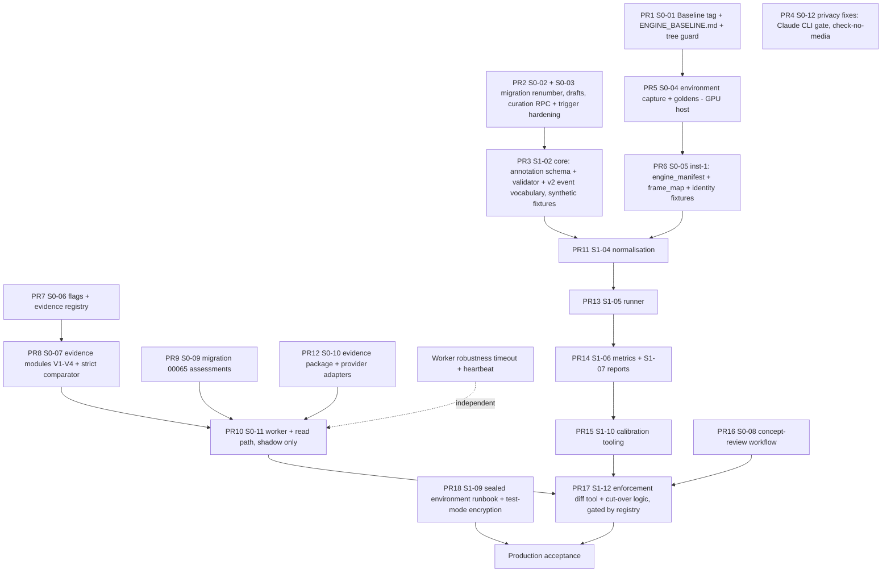

# HitterLoop Analysis Engine v2: Implementation Plan, Stages 0 and 1 (Revision 2)

- **Status:** Revised planning baseline that incorporates the independent reviewer's conditional approval (decisions D1-D9 and seven architectural corrections). Nothing in this document has been implemented.
- **Date:** 2026-10-11
- **Repository state planned against:** `master` at `f79b09e` (pushed to `origin/master`), `package.json` `0.51.0`, working tree clean apart from this file.
- **Inputs:** [`HITTERLOOP_FORENSIC_AUDIT.md`](HITTERLOOP_FORENSIC_AUDIT.md) (finding IDs `F-xx`); reviewer decisions D1-D9; reviewer corrections RC1-RC7.
- **Out of scope:** any code, migration, dependency, deployment, or model change. Stage 2 (CV replacements) is referenced only where Stages 0/1 must prepare for it.

## Contents

0. Reviewer resolution
1. Principles and refinements
2. Current-state facts the plan depends on
3. Evidence model (four dimensions, availability vs correctness, event semantics)
4. Data-flow and privacy map
5. Stage 0: Baseline preservation and non-behavioural safety foundations
6. Stage 1: Evaluation foundation, calibration, and the enforcement decision
7. Statistical reporting and release criteria
8. Dependency sequencing and PR plan
9. Rollback strategy
10. Unresolved design conflicts
11. Remaining human decisions
12. Risks
13. Appendix A: file map
14. Appendix B: exit criteria

---

## 0. Reviewer resolution

### 0.1 Approved decisions

| ID | Reviewer decision | How the plan implements it | Section |
|---|---|---|---|
| D1 | Import all 90 drills as drafts. Approval needs a verifiable, authorised reviewer. No placeholder curators. | Renumbered migration inserts drafts only. Importer cannot approve. Approval only through an RPC executed under the reviewer's own session, checked against a service-managed reviewer allowlist, bound to a content hash, and recorded append-only. The 00054 trigger's NULL-role bypass is closed. | S0-03 |
| D2 | Preserve historical behaviour during shadow mode. After enforcement, unassessable legacy runs show only content supported by safe legacy evidence. | `REPORT_LEGACY_RUN_POLICY=show_as_before` until enforcement. After enforcement: `legacy_safe_only`, which shows original video, clip metadata, and coach-attested content. No AI summary, strengths, or fix. | §3.6, S0-11, S1-12 |
| D3 | Withhold unsupported AI coaching content when evidence fails. Keep clip metadata and state the reason. | A withheld clip keeps its `video_clips` row, phases, metadata, and video. The report shows `state: "analysis_unavailable"` with a plain reason code. AI-generated text is never shown for a failed claim or clip. | §3.5, S0-11 |
| D4 | Skip external AI calls for withheld production clips. Keep diagnostic evaluation separate. | In enforce mode, a clip-level withhold means no provider call. Diagnostic AI runs happen only in the evaluation environment, on evaluation-consented clips (S1-11). | S0-10, S1-11 |
| D5 | Evaluation-specific consent; external-provider processing separately authorised | Two separate consent scopes, `eval_annotation` and `eval_external_ai`, checked by the runner per clip | S1-01 |
| D6 | Prefer self-hosted CVAT; tool-independent data model | CVAT local instance is the default. `ClipAnnotation` schema plus an importer adapter keep the data model tool-independent. | S1-03 |
| D7 | A qualified reviewer approves concept evidence requirements before enforcement | `claimEvidence` table ships `status: "proposed"`. Enforcement refuses to run unless each enforced concept has a recorded approval by a named, allowlisted reviewer. | S0-08, S1-12 |
| D8 | 5% unsafe-pass is a provisional design ceiling, not release evidence. Report observed rates and athlete-clustered bounds. | §7 reporting contract. Pass/fail/inconclusive outcomes. No release claim when the bound is not supported by sample size. | §7 |
| D9 | Preserve the exact original baseline commit before instrumentation. Version environment and instrumentation separately. | Tag `engine-baseline-1.0.0` on `f79b09e` **first** (PR 1). Separate `engine_code_version`, `instrumentation_version`, `environment_version`. Golden outputs come from uninstrumented code. | S0-01, S0-04 |

### 0.2 Architectural corrections

| # | Concern | Resolution | Section |
|---|---|---|---|
| RC1 | Separate evidence-quality dimensions; contact confidence not universal; keep the strict gate as a shadow baseline | Four dimensions: Subject validity (V1), Event-localisation validity per event (V2), Claim evidence sufficiency (V3), Claim evidence reliability (V4). A claim depends only on the events its concept requires. The former single gate is kept unchanged as `strict-0.1.0`, computed in shadow on every clip for comparison. | §3.1-3.3, S0-07 |
| RC2 | Availability ≠ correctness; state what is measurable vs needs ground truth; validators cannot establish coaching accuracy | §3.4 table separates availability signals (deterministic) from correctness (ground truth only). V4 is `unmeasured` until Stage 1 calibration. The response validator is described as a consistency check only. Coaching accuracy is estimated by coach agreement, which is itself agreement, not truth. | §3.4, S1-11 |
| RC3 | Correct contact semantics | Event vocabulary separates `contact_confirmed`, `impact_estimate`, `swing_miss`, `no_swing`/`take`, `checked_swing`. Baseline "contact" normalises to `impact_estimate` (never `contact_confirmed`). Legacy field names are preserved through an explicit mapping. Schema, adapter, and metrics are updated. | §3.5, S1-02, S1-04, S1-06 |
| RC4 | Stronger statistical release criteria | 150 swings = first development milestone only. Every report includes unsafe-pass rate, athlete-clustered CI, one-sided upper bound, pass coverage, per-athlete and per-camera-profile breakdowns, and explicit "insufficient sample / inconclusive" outcomes. A sample-size rule shows when a release claim is impossible. | §7 |
| RC5 | Sequencing: freeze baseline before behaviour changes; evaluation before enforcement; small reversible PRs | Stage 0 now contains **no parent-visible analysis behaviour change** except D1 (drafts). Enforcement moved to S1-12, after scoring infrastructure, calibration, and D7. 18 PRs, each with its own rollback. | §5, §6, §8 |
| RC6 | Privacy and evaluation isolation; exact data transfers; sealed release testing mandatory | §4 hop-by-hop data map. Sealed test evaluation is a hard prerequisite for "production acceptance" (S1-09, §7.4). | §4, S1-09 |
| RC7 | Interface contradictions | Each point is resolved explicitly in §0.3 | §0.3 |

### 0.3 Interface contradictions (RC7) and resolutions

| Question | Previous plan (revision 1) | Problem | Resolution |
|---|---|---|---|
| How are withheld runs persisted? | An `analysis_runs` row with `backend='pose3d'`, `summary=null`; `swing_detection_state` set to `inconclusive` | Conflated "AI run" with "evidence decision"; overwrote a pipeline fact; `backend='pose3d'` is misleading | Evidence decisions go in a new append-only table `clip_evidence_assessments` (one row per clip × engine × gate tuple). `analysis_runs` is written **only when a provider actually ran**, and references the assessment. `swing_detection_state` is never changed by the gate. Withheld = latest active assessment `withhold` with no AI run. (S0-09) |
| How are legacy runs handled? | `legacyRunPolicy` with `summary_only` | `summary_only` shows unverified AI prose, contradicting D2 | Shadow: `show_as_before`. After enforcement: `legacy_safe_only` (video, metadata, coach-attested content) unless a backfilled assessment makes the run eligible. AI summary, strengths, and fixes of unassessable legacy runs are not shown. (§3.6) |
| Do coach-reviewed findings bypass evidence gates? | Implicitly yes (family report shows coach-reviewed findings) | Unstated; could be mistaken for machine validation | **Yes for display, as human-attested content**: attributed "From your coach", requires a verified `coach_team_access` actor, recorded as an override. Never labelled as machine-verified. Never counted as evidence in reliability metrics. Whether it counts toward automated focus is decision H6 (default: it counts only if the coach approved it after seeing the video; that is recorded). |
| Is historical focus/progress recomputed or preserved? | Not specified | Retroactive recomputation would silently change what families already saw | **Preserved, never rewritten.** At enforcement cut-over the active `player_focus` record is kept. New qualifying evidence comes only from gate-eligible findings. Historical findings from unassessable legacy runs stop contributing to new transitions ("improving", "fixed"). Cut-over rules are in S1-12, with a dry-run diff report before switching. |
| How do engine versions map to gate versions? | A single `SUPPORTED_ENGINES` list inside the gate | Gate, claim table, and reliability profile could drift independently | Explicit registry `src/services/development/evidenceRegistry.ts` of **active tuples** `(engine_code_version, instrumentation_version, gate_version, claims_version, reliability_profile_version)`. The read path accepts an assessment only if its tuple is active. Unknown tuples are treated as unassessable (fail closed). (S0-06) |
| Do original PTS and frame identity survive every transformation? | Assumed via `analysisWindow.ts` | Stage 0 trim re-encodes and rebases timestamps (`locate_swing.py:255-262`); decimation selects by index; `detect_2d` uses `i/fps`; one-to-one correspondence is unverified for VFR | Instrumentation `inst-1` writes a **frame identity map** (analysed index → raw presentation index + raw PTS) verified by frame-content comparison. Synthetic burned-in-counter test videos prove the mapping. Assessments and evaluation results use only mapped raw PTS. An unverifiable map → `event_localisation: unmappable` (fail closed). (S0-05, §3.7) |
| Can public aggregate reports leak small-cohort information? | Aggregate-only rule | Small slices can still identify a child (e.g. one 8U left-handed softball batter) | Publication rules (§7.5): cell suppression below 5 athletes or 20 swings; dominance rule (no athlete > 50% of a cell); no per-athlete rows; no cross-tabulation of rare attributes; rounded rates; publication only after human review. |
| Can a migration's or importer's curator identity be spoofed? | Importer with `--curator-email` | [FACT] `importCuratedDrills.ts` `findCuratorUser` returns any `--curator-id` unchecked and defaults to the first auth user; the 00062 migration uses the oldest user or a fixed demo UUID; the 00054 trigger is bypassed when `auth.role()` is NULL | Approval moves out of migrations and importers entirely: `approve_drill` RPC under the reviewer's own JWT, `curated_by := auth.uid()` (not a parameter), reviewer must be in `curation_reviewers`, content hash required, trigger hardened to fail on NULL role. (S0-03) |

---

## 1. Principles and refinements

| # | Refinement | Where satisfied |
|---|---|---|
| R1 | Evidence quality determines display | §3, S0-07, S1-12 |
| R2 | 3D is not a prerequisite for visual-only reports | §3.3: no V1/V2/V3 rule reads a 3D field. 3D-derived claims are a separate (currently empty) requirement class. |
| R3 | Different claims need different evidence | §3.2 per-concept requirements, including the events each concept depends on |
| R4 | Preserve the existing pipeline as a versioned baseline | S0-01 (tag on original commit), S0-04 (environment), S0-05 (instrumentation, separately versioned) |
| R5 | No new models before evaluation | No model is added in Stages 0/1 |
| R6 | Preserve original footage, timestamps, provenance | §3.7 frame identity, §4 data map, S1-02 PTS-keyed ground truth |
| R7 | Provider-neutral AI | S0-10 |
| R8 | Reuse validated schemas, consent, methodology | §2; `validateSwingAnalysisResult`, consent gates, 00055 evidence/measurement tables, 00056 capture profiles reused |

**Operating rule for this plan:** with every new flag at its default, the product behaves exactly as at `f79b09e`. The single intended exception is D1 (drills become drafts until a real reviewer approves them).

---

## 2. Current-state facts the plan depends on

All facts were verified in source on `f79b09e`.

| Fact | Location | Consequence |
|---|---|---|
| Parent report gate = clip `ready` + LLM `confidence === "medium"` + `basis === "video"` | `supabase/functions/get-simplified-report/index.ts:366`; `src/services/development/focus.ts` `shownFix` | Gate integration point |
| Edge Functions import pure TS from `src/services/development/` | `get-simplified-report/index.ts:6-15` | Shared pure modules give one implementation for the worker and the Edge Function |
| Practice progress counts raw practice issues (no confidence filter, no gate) | `src/services/development/progressPractice.ts` `practiceEvidence`; caller `get-simplified-report/index.ts:244-255` | A surface to gate |
| Notification copy uses `reportHasFix` and focus fields | `src/services/notifications/outbox.ts` `buildNotificationDeliveries` | A surface to gate |
| Family report shows coach-reviewed findings only | `supabase/functions/_shared/familyReport.ts:24` | Coach-attested path (§0.3) |
| `analysis_runs.backend` check: `gemini`, `claude`, `pose3d` | `00028_continuous_knowledge_foundations.sql:17` | Withheld decisions must not masquerade as runs (§0.3) |
| A clip is `readable` if any phase has a frame | `src/services/development/swingDetection.ts` | The gate must not use `readable` |
| AI receives images only | `src/cli/analyze.ts:113-116` | V1/V2 inputs come from pipeline JSON |
| Stage 0 trim re-encodes with `-ss` before `-i`, libx264, `-avoid_negative_ts make_zero` | `scripts/pose3d/locate_swing.py:255-262` | Timestamps rebased; frame correspondence assumed, not verified (§3.7) |
| Decimation selects by index with `-vsync vfr` | `scripts/pose3d/decimate.py:111-121` | Index map is deterministic but must be recorded |
| Kinematics use `t = i / fps` | `scripts/pose3d/detect_2d.py:502` | F-13 |
| Evidence/measurement governance tables exist, unused by reports | `00055_analysis_evidence_foundation.sql` | Reliability profiles and validation decisions land here |
| Capture profiles exist | `00056_capture_profiles_and_assessments.sql` | Annotation enums align |
| Cloud has migrations through 00054 | `NEXT_STEPS.md` | 00055+ are local only; renumbering is safe |
| Duplicate `00062` | `00062_video_processing_progress.sql` (`a38c99b`), `00062_approved_drill_library.sql` (`f79b09e`) | S0-02 |
| Drill migration approves all 90 with oldest user or demo UUID | `00062_approved_drill_library.sql:12-17, 4759-4761` | D1 |
| Importer curator identity is unverified | `src/cli/importCuratedDrills.ts:22-39` (`--curator-id` returned as-is; default first user) | D1 / RC7 |
| Curation trigger bypassed when `auth.role()` is NULL | `00054_drill_curation_gate.sql:44` (`auth.role() <> 'service_role'`) | [INFERENCE, confirmed by Gemini review] Hardened in S0-03 |
| `claudeCliAnalyzer.ts` lacks a data-terms gate | F-21 | S0-12 |

---

## 3. Evidence model

### 3.1 Four evidence dimensions (RC1)

| Dimension | Question | Scope | Inputs (baseline engine) | Deterministic? |
|---|---|---|---|---|
| **V1 Subject validity** | Is the analysed person the batter, continuously, through the window that matters? | Clip | `bat_evidence.used_fallback`; bat-holding frames; batter tracked fraction; identity-jump fraction (`subjectBox.ts` rule); batter crop exists | Availability: yes. Correctness: needs ground truth (identity purity). |
| **V2 Event-localisation validity** | Was each specific event located, and how well? | Per event | `metrics.json.phases.<event>` frame, method, confidence; frame identity map status | Availability: yes. Timing error: ground truth only. |
| **V3 Claim evidence sufficiency** | Was the evidence this claim needs actually supplied (images, events, visible body parts)? | Per claim | Concept requirement (§3.2); supplied stills, zooms, sequence; 2D visibility fractions over the needed frames | Yes (deterministic availability) |
| **V4 Claim evidence reliability** | Given sufficient evidence, how often is that evidence actually correct for this kind of claim, engine, and camera profile? | Per (claim requirement × engine tuple × capture profile) | **Reliability profile** from Stage 1 calibration: unsafe-pass rate with athlete-clustered bounds | No. Estimated from ground truth only. `unmeasured` until calibrated. |

**Composition** (pure function, §3.3):

```
displayable(claim) =
  V1.status == pass
  AND for every event e in requirement(claim).events: V2[e].status == pass
  AND V3(claim).status == sufficient
  AND V4(claim).status ∈ allowed_reliability_statuses(mode)
```

- In **shadow**, all four are computed and recorded, and nothing changes.
- In **enforce** (Stage 1 exit only), `allowed_reliability_statuses = {"within_ceiling"}`. A requirement whose reliability is `unmeasured`, `inconclusive`, or `exceeds_ceiling` is not displayable. This makes "no enforcement on uncalibrated thresholds" structural, not procedural.

**The strict baseline gate (`strict-0.1.0`)** is the revision-1 rule set (G1-G8), unchanged. It is computed in shadow on every clip and stored next to the dimensional decision, so Stage 1 can compare the two gates' coverage and unsafe-pass rates on the same swings.

### 3.2 Concept requirements: events, views, visibility (R3, D7)

Contact is **not** universal. Each concept lists the events whose localisation it depends on. Status: `proposed`, pending D7 approval.

| Concept | Required events (V2) | Required supplied evidence (V3) | Visibility (2D, over required frames) | Stage 0/1 display eligibility |
|---|---|---|---|---|
| `contact` | `impact_estimate` or `contact_confirmed` | zoom + still at that event | batter, bat ≥ 0.5 | eligible when V1-V4 pass |
| `extension` | `impact_estimate`/`contact_confirmed`, `extension` | sequence ≥ 8 frames covering both; zoom:extension | arms visible | eligible |
| `load` | `load_start`, `swing_launch` (or sequence start/end bounds) | sequence covering load → launch | hands visible | eligible |
| `stride_plant` | `stride_foot_lift` or `foot_plant` | sequence covering lift → plant | feet ≥ 0.8 | eligible |
| `hand_path`, `barrel_path`, `barrel_depth` | `swing_launch` and `impact_estimate`/`contact_confirmed` | sequence covering launch → impact | bat ≥ 0.5 | eligible |
| `head_visual_stability` | `swing_launch`, `impact_estimate` | sequence | head ≥ 0.8 | eligible |
| `finish_balance` | `finish` | still or sequence covering finish | lower body visible | eligible |
| `front_side_stability`, `posture` | `foot_plant`, `impact_estimate` | sequence | torso + lead leg | eligible |
| `hip_shoulder_sequencing` | — | — | — | **not eligible** (depth-dominated from backstop view; audit §6.4); revisit per capture profile in Stage 2 |
| `stance_setup` | `stance_set` | still | — | **not eligible** until the stance detector is measured (`find_stance_frame` known to mislocate) |
| `timing` | — | — | — | **not eligible** (pitch timing not observable) |
| `swing_decision`, `pitch_location_adjustment`, `game_approach` | — | — | — | not mechanical (existing `focus.ts`) |

**Baseline engine coverage fact:** baseline produces no `swing_launch` or `stride_foot_lift` (S1-04). Concepts requiring them get V2 `not_produced` under baseline, so they cannot pass until either Stage 2 adds the event or the reviewer approves (D7) a substitution such as "sequence bounds stand in for launch".

### 3.3 Interfaces (pure; Node and Deno)

`src/services/development/evidence/types.ts`:

```ts
export type DimensionStatus = "pass" | "fail" | "not_produced" | "unmappable";
export type ReliabilityStatus = "within_ceiling" | "exceeds_ceiling" | "inconclusive" | "unmeasured";

export interface SubjectValidity {            // V1
  status: "pass" | "fail";
  reasons: Array<"batter_selection_fallback" | "insufficient_bat_holding_evidence" | "batter_not_tracked_in_window"
    | "possible_identity_switch" | "no_batter_crop" | "window_unavailable">;
  signals: { usedFallback: boolean; batEvidenceFrames: number; trackFrames: number;
             trackedFraction: number | null; identityJumpFraction: number | null; batterCropAvailable: boolean };
  thresholds: Record<string, number>;
}
export interface EventLocalisation {          // V2, one per event slug
  event: SwingEventSlug;                      // §3.5 vocabulary
  status: DimensionStatus;
  rawFrame: number | null; rawPtsS: number | null;           // original-file identity (§3.7)
  sourceField: string | null;                 // e.g. "metrics.phases.contact" (legacy mapping)
  method: string | null; engineConfidence: string | null;    // engine's own label, recorded not trusted
  uncertaintyMs: number | null;               // null = unquantified (baseline)
  reasons: string[];
}
export interface ClaimSufficiency {           // V3
  concept: Concept; status: "sufficient" | "insufficient";
  missing: string[];                          // e.g. ["sequence", "zoom:extension", "feet_visibility"]
}
export interface ClaimReliability {           // V4
  concept: Concept; status: ReliabilityStatus;
  profileVersion: string | null;              // reliability profile id from Stage 1
  observedUnsafeRate: number | null; upperBound95: number | null; sampleSwings: number | null; sampleAthletes: number | null;
}
export interface EvidenceTuple {
  engineCodeVersion: string; instrumentationVersion: string; environmentVersion: string;
  gateVersion: string; claimsVersion: string; reliabilityProfileVersion: string | null;
}
export interface ClipEvidenceAssessment {
  tuple: EvidenceTuple;
  subject: SubjectValidity;
  events: Record<SwingEventSlug, EventLocalisation>;
  clipStatus: "eligible" | "withhold";        // eligible iff subject.status == pass (V1 is the only clip-wide prerequisite)
  familyReason: "batter_unclear" | "swing_unclear" | "analysis_version_unavailable" | null;
  strictBaseline: { version: "strict-0.1.0"; status: "eligible" | "withhold"; reasons: string[] }; // RC1 comparator
}
export interface ClaimDecision {
  concept: Concept; phase: PhaseSlug | null;
  sufficiency: ClaimSufficiency; reliability: ClaimReliability;
  displayable: boolean;                       // §3.1 composition under the mode in effect
  mode: "off" | "shadow" | "enforce";
}
```

**Functions:**

| Function | File | Purpose |
|---|---|---|
| `assessSubject(signals)` | `evidence/subject.ts` | V1 |
| `localiseEvents(metrics, frameMap)` | `evidence/events.ts` | V2, including the legacy → v2 event mapping (§3.5) |
| `assessSufficiency(concept, phase, supplied, visibility)` | `evidence/sufficiency.ts` | V3 |
| `lookupReliability(concept, tuple, captureProfile, profiles)` | `evidence/reliability.ts` | V4. Returns `unmeasured` when no profile exists. |
| `assessClip(...)` | `evidence/assessClip.ts` | Builds `ClipEvidenceAssessment`, including `strictBaseline` |
| `decideClaim(...)` | `evidence/decideClaim.ts` | §3.1 composition |

**Design notes:**
- V1 is the only clip-wide prerequisite. A wrong person invalidates every claim.
- V2 failures affect only the claims that depend on the failed event (RC1).
- No V1/V2/V3 rule reads `reconstruction_reliable`, `pose3d_coverage`, or any 3D angle (R2).

### 3.4 Availability versus correctness (RC2)

| Signal | Proves availability of | Does **not** prove | Measurable now (deterministic) | Requires ground truth to judge correctness |
|---|---|---|---|---|
| Batter track exists, not fallback | A tracked person who held something bat-like | That the person is the batter, or the same person throughout | Yes | Identity purity, wrong-athlete rate |
| Identity-jump fraction low | Spatial continuity of the track | Absence of a smooth switch between overlapping people | Yes | ID-switch count |
| Event located with engine "high" confidence | The heuristic's own agreement criteria were met | That the frame is the true event | Yes (as a label) | Timing error distribution |
| Frame identity map verified | Analysed frames correspond to raw frames | Event correctness | Yes (content comparison) | — |
| Still/zoom/sequence supplied | An image exists at the claimed instant | That it shows the claimed moment or person | Yes | Phase-attribution accuracy |
| Joint visible (2D conf ≥ x) | The detector produced a confident point | That the point is anatomically correct | Yes | Keypoint error (PCK/OKS) |
| Bat detected | A bat-class box exists near the hands | Correct endpoints or orientation | Yes | Endpoint error, swap rate |
| Response passed `validateSwingAnalysisResult` | Structure, taxonomy, permitted claim IDs, no unsupported pitch/outcome wording | That the coaching observation is true or useful | Yes | Coach agreement (S1-11) |
| Coach agreement on a finding | Agreement between qualified humans and the model | Biomechanical truth | — | Inter-coach κ bounds this |

**Explicit limits:**
- No deterministic validator in this plan establishes coaching accuracy. Validators only reject inconsistent or unsupported *form*.
- V4 is the only dimension that speaks to correctness, and it is a population estimate per requirement class, not a per-clip guarantee.

### 3.5 Event semantics, including contact (RC3)

**v2 event vocabulary** (`SwingEventSlug`):

| Slug | Meaning | Observable basis |
|---|---|---|
| `stance_set` | Batter set, before load for this pitch | Body stillness |
| `load_start` | First rearward hand/weight shift | Body motion (often ambiguous) |
| `stride_foot_lift` | Front foot leaves the ground / starts the slide | Foot motion |
| `foot_plant` | Front foot weight-bearing contact re-established | Foot motion |
| `swing_launch` | Hands/barrel start forward | Hand/bat motion |
| `impact_estimate` | **Estimated** instant the barrel passes through the hitting zone; no claim that ball contact occurred | Bat and body kinematics, audio |
| `contact_confirmed` | Ball-bat contact **observed** (ball visible at the bat, or ball deflection visible) | Visual ball-bat evidence; audio alone is supporting only |
| `finish` | Stable post-swing posture | Body stillness |

**Swing outcome classification (per swing, not an event):**
`outcome ∈ { contact_confirmed_fair, contact_confirmed_foul, contact_unconfirmed, swing_miss, checked_swing, no_swing_take, unknown }`.

**Rules:**
- `contact_confirmed` exists only when the outcome is a confirmed contact.
- `swing_miss` and `checked_swing` swings have `impact_estimate` but no `contact_confirmed`.
- `no_swing_take` swings have neither, and must not produce a swing report.

**Legacy mapping (backward compatibility):**

| Baseline output | v2 normalised event | Notes |
|---|---|---|
| `metrics.json.contact` / `phases.contact` | `impact_estimate` (method `baseline_triple_product`) | **Never** `contact_confirmed`. The baseline has no ball evidence. |
| `phases.stance` | `stance_set` | — |
| `phases.load` | `load_start` | Baseline's method is a lead-wrist extremum, closer to "load peak" than "load start"; recorded as `method: baseline_wrist_extremum` and scored against `load_start` with that caveat noted in reports |
| `phases.stride` | `foot_plant` | Baseline's stride phase is the plant |
| `phases.extension` | `extension` (auxiliary event; not in the v2 core list) | Kept for continuity |
| `phases.follow_through` | `finish` | — |
| (none) | `stride_foot_lift`, `swing_launch` | `not_produced` |

**Compatibility guarantees:**
- `metrics.json`, `swing_phases.phase_type` slugs, the `phase_contact.png` file names, `ISSUE_PHASES`, and the prompt's phase vocabulary are unchanged.
- The v2 vocabulary exists in the evidence and evaluation layers only, through `src/services/development/evidence/eventMapping.ts`.
- Family-facing copy never says "contact" for an `impact_estimate` unless `contact_confirmed` exists. Wording such as "at the hitting moment" is subject to H7.

**No-swing semantics:** the baseline cannot produce `no_swing_take` (audit F-15). A clip with no located events stays `inconclusive` (unchanged). Evaluation measures false-swing rate on takes (S1-06).

### 3.6 Legacy runs (D2)

| Phase | Legacy run (no assessment) | Legacy run with backfilled assessment |
|---|---|---|
| `off` / shadow | `show_as_before` | `show_as_before` (assessment recorded only) |
| enforce | `legacy_safe_only`: original video (owner-authorised playback), clip metadata (date, at-bat, status), coach-attested findings (§0.3), and the reason "This at-bat was analysed by an earlier version; detailed feedback isn't available." No AI summary, strengths, fix, or drills derived from that run. | Treated like a new run: displayable claims only |

"Safe legacy evidence" means: original footage, user-entered metadata, and human-attested coach content. This definition requires product-owner confirmation (H5).

### 3.7 Frame and timestamp identity across transformations (R6, RC7)

| Transformation | File | Effect on identity | Plan |
|---|---|---|---|
| Upload → GCS | `get-upload-url`, `videoUpload.js` | Bytes preserved | SHA-256 recorded at worker download (already done in the capture assessment); inst-1 copies it into the manifest |
| GCS → worker disk | `processUploadQueue.ts` `downloadFile` | Bytes preserved | Hash compared with the stored hash; mismatch → fail |
| Stage 0 trim | `locate_swing.py` `trim_video` | Re-encode; timestamps rebased to 0; frame correspondence assumed (`analysisWindow.ts` comment) | inst-1 writes `frame_map.json`: analysed index → raw presentation index + raw PTS. Verified by decoding sampled frame pairs and comparing content (PSNR ≥ threshold or perceptual-hash distance ≤ threshold). Unverified → `unmappable`. |
| Decimation | `decimate.py` | Index selection | Map composed with the factor; verified by the same sampling |
| Two decode passes (pose and bat) | `detect_2d.py` | Possible count mismatch | inst-1 records both frame counts; a mismatch is surfaced in the manifest |
| Kinematic time `i/fps` | `detect_2d.py:502` | CFR assumption | Not changed in the baseline (behavioural). inst-1 records the max PTS deviation so evaluation can stratify. Stage 2 fixes it. |
| AI stills | `extract.ts` | Uses raw PTS via `probePts` | Evidence package carries `rawFrame` and `rawPtsS` per image (S0-10) |

**Verification test:** `scripts/pose3d/environment/make_identity_fixtures.py` generates synthetic videos with a burned-in frame counter: CFR 30, VFR (jittered PTS), 240 fps, and a long clip that forces a Stage 0 trim. The test asserts the recovered `frame_map.json` equals the burned-in counter for every sampled frame. These videos are synthetic, so no child data is involved.

---

## 4. Data-flow and privacy map (RC6)

Each row is one hop. "Child data" means video or images of a minor, or a name. Controls marked "existing" are in code today; "planned" are introduced by this plan.

| # | From → To | Data | Purpose | Trigger / consent basis | Retention | Deletion propagation | Controls |
|---|---|---|---|---|---|---|---|
| 1 | Device → GCS (production bucket) | Original video bytes (child data) | Storage | Coach or linked guardian with current consent (existing guardian/consent gates) | Until clip deletion (no lifecycle rule today; H8) | `delete-clip` + worker purge (existing) | V4 signed PUT, 15 min, opaque path (existing); byte cap (planned S0-12) |
| 2 | Device → Supabase | Clip metadata, at-bat context | App function | Same | Until deletion | `clip_deletions` flow (existing) | RLS (existing) |
| 3 | GCS → local worker disk `videos/_uploads/` | Original bytes | Processing | Queue claim | Deleted in `finally` (existing) | n/a | Workstation disk; planned hosted worker is out of scope |
| 4 | Worker → local `frames/<player>/<clip>/` | Pose JSON, `overlay.mp4` (child video), phase stills, zooms, sequence frames, AI result JSON, `engine_manifest.json`, `frame_map.json` (planned) | Analysis, audit, re-run | Same | Until clip deletion (existing purge) | `purgeDeletedClips` (existing); extended to new files (planned) | Local only; never in git (`check-no-media`, planned) |
| 5 | Worker → Supabase | Phases, metrics, pose3d frames, `analysis_runs`, `issues`, **`clip_evidence_assessments`** (planned) | Reports | Same | Until deletion (cascades) | FK cascades (existing; verified for new table in S0-09) | Service role writes; families never read assessment signals (planned RLS test) |
| 6 | Worker → external AI provider (Gemini API) | Phase stills, zooms, sequence frames (child images); age band, sport, handedness; **no names** | Report text | `GEMINI_PAID_SERVICE_CONFIRMED` (existing); in enforce mode, only clip-level-eligible clips (D4, planned) | Provider terms (paid tier) | Not recallable once sent; minimise by D4 | Paid-terms gate (existing); data-terms gate for Claude CLI (planned); agy gate (existing) |
| 7 | Edge Function → Firebase / Resend | Player first name + status text | Notifications | Guardian notification settings (existing) | Provider logs | n/a | No images or findings text sent |
| 8 | Device → Edge → Gemini (roster screenshot) | Roster image (names) | Roster import | Coach action, disclosure (existing) | Transient | n/a | Paid-terms gate (existing) |
| 8a | GCS → coach/guardian device (playback) | Original video via 15-min V4 signed GET (issued by `get-simplified-report` / `get-video-url`) | Viewing | Authorised viewer (RPC checks, existing) | Device cache only | Signed URL expiry | Existing; the gate does not change playback (D3: video is kept) |
| 8b | Edge Function → anonymous share-link holder (browser) | Redacted report or progress payload + signed video URLs (`sharedSimplePayload.ts`) | Sharing | Guardian share consent and token (00053, existing) | Link expiry/revocation | Revocation (existing) | Under enforcement the shared payload follows the same gate (S0-11 parity test) |
| 8c | Supabase → client device | Child profile, at-bat metadata, report payloads | App function | RLS / authorised RPCs (existing) | Device session | n/a | Assessment signals never included (C7) |
| 9 | Production → evaluation store | Original bytes copied under a new opaque eval ID | Evaluation | **Per-clip guardian opt-in** with `eval_annotation` consent (D5) | Per evaluation consent | Withdrawal → delete from eval store, mark registry withdrawn, recompute aggregates | No automatic code path (planned test: worker and Edge code cannot reach the eval store) |
| 10 | Purpose-recorded clips → evaluation store | Original bytes | Evaluation | Evaluation consent (D5) | Per consent | Same as #9 | Same |
| 11 | Evaluation store ↔ CVAT (self-hosted, local) | Dev/validation media + annotations | Annotation | `eval_annotation` consent | Annotation project lifetime | Delete task + media on withdrawal | Local network only; annotator accounts least-privilege; no CVAT cloud (D6) |
| 12 | Evaluation store → benchmark runner (local) | Dev/validation media, annotations | Measurement | `eval_annotation` | Results per consent | Recompute on withdrawal | Clean-tree and lock checks (S1-05) |
| 13 | Evaluation store → external AI (diagnostic AI evaluation) | Stills from eval clips | AI-layer evaluation | **Separate `eval_external_ai` consent** per clip (D5) | Provider terms | Not recallable | Runner refuses clips without the scope (S1-11) |
| 14 | Sealed archive → sealed test environment | Test media, labels, registry | Release testing | `eval_annotation` (+ `eval_external_ai` only if AI tested) | Decrypted copy destroyed after run | Withdrawal → archive rebuilt | Key held by product owner; no agent access (S1-09) |
| 15 | Sealed environment → repository | Aggregate metrics only, after review | Transparency | — | Permanent (public repo) | Re-publish on withdrawal-driven recompute | Suppression rules §7.5 |

**Hard constraints:**
- No hop moves child data into git, CI logs, PR text, or AI coding-agent context.
- AI coding agents (Claude, Gemini, AGY) never receive evaluation media or per-clip results, only aggregate numbers (S1-09).

---

## 5. Stage 0: Baseline preservation and non-behavioural safety foundations

**Goal:** preserve the exact baseline, fix the drill-curation integrity problem (D1), and build the evidence, versioning, and provenance plumbing in **off/shadow** only.

Nothing in Stage 0 changes what a parent sees about swing analysis. The one intended exception is that drills disappear until a real reviewer approves them (D1).

### S0-01: Preserve the original baseline commit (D9), first, before anything else

**Tasks:**
1. Create an annotated tag `engine-baseline-1.0.0` on **`f79b09e`** (the exact commit whose `scripts/pose3d/` produced `pose3d-live-1.0.0`). No file changes. Tag message: baseline definition, `PIPELINE_VERSION`, and the freeze rule.
2. Add `docs/architecture/ENGINE_BASELINE.md` recording:
   - the engine code version, commit SHA, and tree hash of `scripts/pose3d/` (`git rev-parse f79b09e:scripts/pose3d`);
   - the freeze rule: `scripts/pose3d/` receives only instrumentation (separately versioned, S0-05) or security/crash fixes (patch versions), and new engine work goes to `scripts/engine_v2/` in Stage 2;
   - how to check out and run the baseline.
3. Golden outputs (private, S0-04) are produced from this **uninstrumented** commit.

**Acceptance tests:**
- `git rev-parse engine-baseline-1.0.0^{commit}` = `f79b09e`.
- `git rev-parse engine-baseline-1.0.0:scripts/pose3d` equals the tree hash recorded in `ENGINE_BASELINE.md`.
- A new test `scripts/check-baseline-tree.mjs` (in `npm test`) fails if `scripts/pose3d/` differs from the tag **except** for files listed in an instrumentation allowlist recorded in `ENGINE_BASELINE.md`.

**Rollback:** delete the tag (only before it is pushed; pushing needs user approval, H9).

**Size:** XS.

### S0-02: Migration numbering repair

**Tasks:**
1. Record each local DB's state first (SQL as in revision 1: the `schema_migrations` rows ≥ 00060; the `processing_progress` column; drill `curation_status` counts).
2. `git mv supabase/migrations/00062_approved_drill_library.sql supabase/migrations/00063_approved_drill_library.sql`. Its content is changed by S0-03.
3. `scripts/check-migration-versions.mjs` (+ test) in `npm test`: unique numeric prefixes only.
4. Local repair matrix (revision 1, unchanged): `00062` recorded + progress column present → nothing; drill file applied as 00062 → `db reset` (local data loss; needs user approval) or `migration repair`.

**Acceptance tests:**
- The guard passes and fails correctly on a fixture.
- A clean `supabase db reset` applies 00001-00063 once each.
- The actual CLI behaviour with the duplicate files is recorded on a scratch stack.

**Rollback:** `git revert`.

**Size:** S.

### S0-03: Drill curation integrity (D1, RC7)

**Facts:**
- The 00062 drill file approves rows with the oldest auth user or a fixed demo UUID.
- The importer's `--curator-id` is unchecked, and it defaults to the first user.
- The 00054 trigger does not fire when `auth.role()` is NULL.

**Design:**
1. **`00063_approved_drill_library.sql` → drafts only.** Rename the content to `00063_drill_library_candidates.sql`, so the name no longer says "approved". Insert all 90 into `public.drill_library` and `demo.drill_library` with `curation_status = 'draft'`, `curated_at = null`, `curated_by = null`. Remove the curator lookup and the demo UUID. Re-running is idempotent and **never changes** `curation_status`/`curated_*` on existing rows.
2. **New migration `00064_drill_curation_reviewers.sql`:**
   - `curation_reviewers(user_id uuid primary key references auth.users, role text check (role in ('drill_curator','concept_reviewer')), qualification text not null, added_by uuid not null, added_at timestamptz, revoked_at timestamptz)`. Service-role writes only. Populated by the product owner through a documented SQL runbook, never by migration.
   - `drill_curation_decisions` (append-only): `id`, `drill_id`, `decision ('approved','rejected')`, `content_sha256` (hash of the drill's displayed fields), `reviewer_id = auth.uid()`, `decided_at`, `notes`.
   - RPC `approve_drill(p_drill_id uuid, p_content_sha256 text, p_decision text, p_notes text)`, `security definer`, `set search_path=''`. It:
     - requires `auth.uid()` non-null;
     - requires the caller to be an active `drill_curator`;
     - recomputes the content hash server-side and requires equality;
     - inserts the decision;
     - sets `curation_status`/`curated_at`/`curated_by := auth.uid()` through a transaction-local setting the trigger recognises.
   - **Trigger hardening** (`protect_drill_curation_fields`): curation fields may change only when the transaction-local flag set by `approve_drill` is present. `coalesce(auth.role(), '')` replaces the NULL-unsafe comparison. A NULL role (migrations, psql) can insert drafts only. `service_role` can no longer approve directly.
   - Content-change rule: any update to a displayed field of an approved drill resets it to `draft` (the hash no longer matches).
   - **Demo schema.** `00054` installed the protection trigger on `public.drill_library` only. Before `00062`, demo drills (seeded in `00034`) had the default `draft` status, so the public demo showed no drills. Drafts-only therefore restores the pre-`00062` demo state rather than breaking it. Changes:
     - install the same hardened trigger on `demo.drill_library`;
     - `approve_drill` mirrors a decision to the matching `demo.drill_library` row by `slug`, in the same transaction, recording the same reviewer, but only when the demo row's content hash matches;
     - add a test that the demo report shows exactly the drills approved through the RPC.
3. **Importer** (`src/cli/importCuratedDrills.ts`):
   - can only insert or update drafts;
   - `--curator-id`, `--curator-email`, and the first-user default are removed;
   - `--sql` mode emits drafts only.
4. **Approval tooling:** a minimal reviewer flow. It can be the existing `admin/` methodology UI pattern or a CLI that authenticates **as the reviewer** (Supabase email OTP sign-in), never with the service-role key. It shows each drill's content and content hash and calls `approve_drill`.

**Acceptance tests** (`supabase/tests/drillCuration.test.ts`, real local DB):
- After reset, 90 drafts and 0 approved.
- `approve_drill` as a non-reviewer → error.
- As a revoked reviewer → error.
- With a wrong content hash → error.
- As an active reviewer → approved, with `curated_by` = that user and a decision row written.
- A service-role direct update of `curation_status` → error.
- A NULL-role (psql superuser session without JWT claims) update to `approved` → error.
- Editing `instructions` on an approved drill resets it to draft.
- The importer's `--apply` never produces an approved row.
- `selectDrills` returns nothing for drafts (the existing behaviour is retained).

**Rollback:** revert the importer and RPC PRs. Existing approvals made through the RPC remain valid data.

**Size:** M.

### S0-04: Environment capture (`environment_version`)

This is the revision-1 S0-02 environment content, now versioned separately from the code (D9). No installs.

- On the existing GPU host: `scripts/pose3d/environment/capture_environment.py` writes `requirements.lock.txt` (`pip freeze --all`) and `models.lock.json` (weight SHA-256 and bytes, VideoPose3D repo commit, Python/torch/CUDA/GPU/OS).
- `environment_version` = `env-` + the first 12 hex digits of SHA-256 over both files.
- **Golden outputs:** baseline (tag `engine-baseline-1.0.0`, **uninstrumented**) run twice per available consented dev clip. Stored privately under `$HITTERLOOP_EVAL_ROOT/golden/engine-baseline-1.0.0/<env>/<clip_sha256>/`.
- `src/eval/golden/compareEngineOutputs.ts`: tolerance comparison (contact frame identical; phases ±1 frame; keypoint median ≤ 1 px, P99 ≤ 8 px on conf ≥ 0.5; bat presence agreement ≥ 99%; metrics ±1% / ±0.5°). Tolerances are provisional and reset to 2× the observed run-to-run P99.

**Acceptance tests:**
- The schema test for `models.lock.json`.
- Determinism measured on ≥5 clips and recorded (aggregate) in `docs/evaluation/baseline-determinism.md`.
- A fresh venv from the lock and the hashed weights reproduces the goldens within tolerance.

**Rollback:** inert files.

**Size:** M (GPU-host access).

### S0-05: Instrumentation `inst-1` (`instrumentation_version`)

Additive output files only. It must be proven non-behavioural against the S0-04 goldens.

- `run_pipeline.py` and helpers write:
  - `engine_manifest.json`: engine code version (tag), instrumentation version `inst-1`, environment version, git SHA plus dirty flag, weight-hash check result, input SHA-256, decoded fps, both decode-pass frame counts, max `|pts_i - i/fps|`;
  - `frame_map.json` (§3.7): analysed index → raw index + raw PTS, with verification status and sampled-frame similarity scores.
- These files are listed in the S0-01 instrumentation allowlist.
- The worker copies the manifest summary into `clip_evidence_assessments.tuple` (S0-09).

**Acceptance tests:**
- With inst-1, the four core outputs remain within tolerance of the uninstrumented goldens (proves non-behavioural).
- The burned-in-counter identity fixtures (§3.7) recover exact maps for CFR, VFR, 240 fps, and trimmed cases.
- A deliberately corrupted map fixture → `unmappable`.

**Rollback:** remove the writer; outputs unchanged.

**Size:** M.

### S0-06: Versions, evidence registry, and flags

**Version identifiers:**

| Identifier | Owner | Initial |
|---|---|---|
| `engine_code_version` | `ENGINE_BASELINE.md` / `run_pipeline.py` | `engine-baseline-1.0.0` (the legacy `pipeline_version` string `pose3d-live-1.0.0` is preserved and mapped) |
| `instrumentation_version` | `run_pipeline.py` instrumentation module | `inst-1` |
| `environment_version` | `models.lock.json` + `requirements.lock.txt` hash | `env-<hash>` |
| `gate_version` | `src/services/development/evidence/version.ts` | `gate-1.0.0` (dimensional) |
| `strict_gate_version` | same | `strict-0.1.0` (comparator) |
| `claims_version` | `evidence/claimRequirements.ts` | `claims-0.1.0-proposed` |
| `reliability_profile_version` | Stage 1 output | none in Stage 0 (`unmeasured`) |
| `evidence_package_version` | `src/services/ai/evidencePackage.ts` | `evpkg-1.0.0` |
| `prompt_version` | existing `analysisVersions.ts` | unchanged |

**Evidence registry:** `src/services/development/evidenceRegistry.ts`:

```ts
export interface ActiveTuple extends EvidenceTuple { status: "shadow" | "enforce_candidate" | "enforced" | "retired"; approvedBy?: string; approvedAt?: string }
export const EVIDENCE_REGISTRY: readonly ActiveTuple[];
export function resolveTuple(t: EvidenceTuple): ActiveTuple | null; // exact match only; null = unassessable (fail closed)
```

Adding an `enforced` tuple requires the S1-12 checklist. A pure test asserts that every `enforced` tuple has a non-null reliability profile and a D7 approval reference.

**Flags** (`src/services/config/analysisFlags.ts`, plus the Deno shim `supabase/functions/_shared/analysisFlags.ts`):

```ts
export type GateMode = "off" | "shadow" | "enforce";
export interface AnalysisFlags {
  evidenceGateMode: GateMode;     // EVIDENCE_GATE_MODE (worker), default "off"
  reportGateMode: GateMode;       // REPORT_EVIDENCE_GATE_MODE (Edge), default "off"
  legacyRunPolicy: "show_as_before" | "legacy_safe_only"; // REPORT_LEGACY_RUN_POLICY, default "show_as_before"
  engine: string;                 // ANALYSIS_ENGINE, default "engine-baseline-1.0.0"
}
```

- Unknown values throw (fail closed).
- **`enforce` is rejected by the parser while `EVIDENCE_REGISTRY` contains no `enforced` tuple.** This makes "no enforcement before calibration" a code invariant.
- Flags are recorded on every assessment.

**Acceptance tests:**
- Parser defaults, enums, and failures.
- Node/Deno parity table.
- `enforce` refused when the registry has no enforced tuple.
- Registry invariants.

**Rollback:** unset variables.

**Size:** S.

### S0-07: Evidence modules (V1-V4 + strict comparator), pure, shadow-ready

**Files:** `src/services/development/evidence/{types,subject,events,eventMapping,sufficiency,reliability,assessClip,decideClaim,claimRequirements,strictBaseline}.ts` with tests.

- `strictBaseline.ts` holds revision 1's G1-G8 unchanged.
- `claimRequirements.ts` holds the §3.2 table with `status: "proposed"` and a `reviewApproval: null` field per concept (filled after D7).
- `reliability.ts` returns `unmeasured` for every concept in Stage 0.

**Acceptance tests:**
- One test per V1 reason and its boundaries.
- V2 legacy mapping for every baseline phase key, including `contact` → `impact_estimate` (never `contact_confirmed`).
- V2 `unmappable` when `frame_map.verified = false`.
- V3: each concept's missing-evidence cases.
- **R2:** a fixture with 3D fields degraded or absent produces identical V1-V3 results.
- **RC1:** a clip with a low-confidence `impact_estimate` but a valid `foot_plant` and sequence → `stride_plant` sufficiency and V2 pass. `contact` fails V2.
- `decideClaim` in shadow never returns `displayable` based on V4 `unmeasured` without recording it.
- In an enforce simulation, an `unmeasured` V4 → not displayable.
- The strict comparator reproduces revision-1 decisions on its fixtures.
- Determinism: stable output ordering.
- Fixtures: synthetic JSON at `src/services/development/evidence/fixtures/`.

**Rollback:** unused while flags are off.

**Size:** M.

### S0-08: Concept-requirement review workflow (D7)

- `docs/architecture/CONCEPT_EVIDENCE_REQUIREMENTS.md` renders the §3.2 table with each concept's rationale, examples of sufficient and insufficient evidence (synthetic diagrams only), and an approval block per concept.
- Approval is recorded as a `measurement_validation_decisions`-style row, or in a new `concept_requirement_approvals` table: `concept`, `claims_version`, `reviewer_id = auth.uid()` (reviewer must be an active `curation_reviewers` row with role `concept_reviewer`), `decision`, `notes`, `decided_at`. Same RPC pattern as S0-03, same migration (00064) to keep PR count low.
- `claimRequirements.ts` carries the approval reference IDs once they exist. The S0-06 registry test enforces their presence for `enforced` tuples.

**Acceptance tests:** RPC tests mirror S0-03 (non-reviewer refused; reviewer identity is the session user).

**Size:** S (code) + reviewer time.

### S0-09: Persistence: `clip_evidence_assessments` (RC7)

**Migration `00065_clip_evidence_assessments.sql`** (additive):

```sql
create table public.clip_evidence_assessments (
  id uuid primary key default gen_random_uuid(),
  video_clip_id uuid not null references public.video_clips(id) on delete cascade,
  engine_code_version text not null, instrumentation_version text not null, environment_version text not null,
  gate_version text not null, claims_version text not null, reliability_profile_version text,
  mode text not null check (mode in ('off','shadow','enforce')),
  clip_status text not null check (clip_status in ('eligible','withhold')),
  family_reason text check (family_reason in ('batter_unclear','swing_unclear','analysis_version_unavailable')),
  subject jsonb not null, events jsonb not null, strict_baseline jsonb not null,
  source_sha256 text not null check (source_sha256 ~ '^[a-f0-9]{64}$'),
  backfilled boolean not null default false,
  created_at timestamptz not null default now()
);
create index clip_evidence_assessments_latest on public.clip_evidence_assessments(video_clip_id, created_at desc);
alter table public.clip_evidence_assessments enable row level security;   -- no client policies: service role only
alter table public.analysis_runs add column evidence_assessment_id uuid references public.clip_evidence_assessments(id) on delete set null,
                                 add column provider_usage jsonb check (provider_usage is null or jsonb_typeof(provider_usage)='object');
alter table public.issues add column claim_decision jsonb check (claim_decision is null or jsonb_typeof(claim_decision)='object');
-- demo schema: mirror nullable columns only (no demo assessments table; demo uses legacy policy)
```

**Rules:**
- Append-only: no update or delete except cascade.
- Families never read this table. The Edge Function maps it to `familyReason` server-side.

**Acceptance tests:**
- `supabase/tests/clipEvidenceAssessments.test.ts`: cascade on clip delete (with the `clip_deletions` flow); guardian/coach JWT cannot select; append-only (update refused by trigger); check constraints.
- `npm run test:demo-real-fixture` passes.

**Rollback:** unused while flags are off; a later migration can drop it.

**Size:** S.

### S0-10: Provider-neutral evidence package and adapters (no behaviour change)

As revision 1's S0-10, with these changes:
- `EvidenceImage` carries `rawFrame`, `rawPtsS`, and the frame-map verification status.
- `EvidencePackage` carries `assessment: ClipEvidenceAssessment | null`.
- Providers record `usage` into `analysis_runs.provider_usage`.
- `render-2.1` stays byte-identical to today (golden test).
- `render-2.2` (ordered + labelled) is prepared but not enabled.
- **D4 hook:** `analyzeAndSync` skips the provider when `evidenceGateMode === "enforce"` and `clip_status === "withhold"`. This is unreachable in Stage 0, because the parser refuses `enforce` (S0-06).

**Acceptance tests:**
- The Gemini `contents` golden equals today's.
- `orderInSwing` is monotone in raw PTS.
- A package with an unverified frame map marks images `identity: "unverified"`.
- Existing analyzer tests are unchanged.

**Size:** M.

### S0-11: Worker and read-path integration in shadow

**Worker** (`src/cli/processUploadQueue.ts`, `src/cli/analyze.ts`):
- In `shadow`: after `extractAnalysisInputs`, build signals → `assessClip` → insert into `clip_evidence_assessments`.
- The AI call proceeds exactly as today (D2: historical behaviour preserved).
- After validation, compute a `ClaimDecision` per issue into `issues.claim_decision`.
- Link `analysis_runs.evidence_assessment_id`.
- Never touch `swing_detection_state`, focus, or notifications in shadow.

**Read path:**

| Surface | File | Shadow behaviour | Enforce behaviour (enabled only at S1-12) |
|---|---|---|---|
| At-bat report | `get-simplified-report/index.ts`, `reportAssembly.ts` `assembleReport` | Unchanged output; decision computed and logged (`would_withhold`, `would_hide_fix`) | Clip `withhold` → `state: "analysis_unavailable"` + reason, clip metadata and video kept, no AI text. Fix shown only if `shownFix` **and** `displayable`. Strengths shown only when their phase's events pass V2 and V1 passes. Summary shown only when V1 passes and at least one claim or strength is displayable; otherwise replaced by the reason. |
| Feed headline | `reportAssembly.ts` `feedAnalysisPresentation` | Unchanged | `analysis_unavailable` |
| Focus | `focus.ts` `mechanicalFinding`, `advanceFocus`; `focusPersistence.ts` | Unchanged | Counts only `displayable` findings from enforced tuples (+ coach-attested per H6); cut-over rules S1-12 |
| Practice progress | `progressPractice.ts` `practiceEvidence` | Unchanged | Readable = run's clip `eligible`; concept counted only if `displayable` |
| Shared links | `sharedSimplePayload.ts` | Unchanged | Same as the at-bat report (parity test) |
| Family report | `_shared/familyReport.ts` | Unchanged (coach-reviewed only) | Unchanged; coach-attested path; regression test that drafts never appear |
| Notifications | `outbox.ts` | Unchanged | `reportHasFix` from the gated result; withheld → `analysis_failed` copy |
| Demo | `get-demo-player-report` | Unchanged | Demo schema always `show_as_before` (fixtures are curated) |

**Acceptance tests:**
- `reportAssembly.test.ts`: a golden equality test that `off` and `shadow` outputs equal today's for a corpus of synthetic report inputs. Enforce-mode cases run against an injected test registry (the real parser still refuses enforce).
- `supabase/tests/evidenceGateParity.test.ts`: report, shared link, practice progress, and notification agree on fix/no-fix.
- `processUploadQueue.test.ts`: shadow inserts an assessment and calls the provider as before.
- `outbox.test.ts`, as above.
- `supabase/demo/demo.test.ts` unchanged.

**Rollback:** `EVIDENCE_GATE_MODE=off`, `REPORT_EVIDENCE_GATE_MODE=off`.

**Size:** M.

### S0-12: Data-handling constraints and quick privacy fixes

| # | Constraint | Implementation |
|---|---|---|
| C1 | No child media or per-clip results in git, CI, or PR text | `.gitignore` (`eval-data/`, `eval-results/`, `**/golden/`); `scripts/check-no-media.mjs` in `npm test` with an allowlist |
| C2 | Evaluation storage separate from production | `HITTERLOOP_EVAL_ROOT`; a separate GCP project/bucket if cloud is used. A test asserts no production code path references eval env vars. |
| C3 | Every child-image AI path has a data-terms gate | `CLAUDE_CLI_DATA_CONFIRMED` in `claudeCliAnalyzer.ts` (F-21) |
| C4 | Data minimisation under enforcement | D4 hook (S0-10) |
| C5 | Logs carry no names, signed URLs, or provider payloads | Review of new log lines; existing redaction reused |
| C6 | Derived files follow deletion | Extend `purgeDeletedClips` to new files (inside the clip dir already) |
| C7 | Assessment signals are staff-only | S0-09 RLS tests |
| C8 | Upload byte cap | `get-upload-url`: signed `x-goog-content-length-range` (F-22). This is the only non-analysis behaviour change in Stage 0, and it is optional: H10. |

Worker robustness (F-19: subprocess timeout and `claimed_at` heartbeat) is kept from revision 1 as a separate small PR.

---

## 6. Stage 1: Evaluation foundation, calibration, and the enforcement decision

Stage 1 builds evaluation and scoring **before** any enforcement (RC5). It ends with a governed decision (S1-12) to enforce provisionally, and later with sealed release testing for production acceptance (S1-09).

### S1-01: Governance, consent, sourcing, splits (D5)

**Consent scopes** (separate from product consent; drafted with counsel; signed by a guardian):
- `eval_annotation`: storage in the eval store, viewing by named annotators, ground-truth labelling, benchmark runs on local hardware, retention period, withdrawal.
- `eval_external_ai`: additionally, sending stills or frames to named external AI providers for AI-layer evaluation. Optional, and separately signed.

**Sourcing and storage** follow revision 1, with:
- the clear registry holding dev/validation only;
- the sealed archive holding test media, labels, and membership;
- salted membership hashes for leakage checks;
- production clips entering only by per-clip guardian opt-in (data map #9).

**Splits:**
- Athlete-group splits: dev 50 / validation 20 / test 30.
- Group by team and game day where possible.
- Athletes behind existing baseline tuning are dev-only.

**Milestones:**
- **M1** (first development milestone): 150 swings / ≥30 athletes total across dev+validation+test.
- **Release-grade test size** is set by the §7.3 sample-size rule, not by M1.

**Acceptance tests:** registry tests (revision 1), plus a consent-scope check: the runner refuses any clip lacking `eval_annotation`; `eval:ai` refuses clips lacking `eval_external_ai`.

**Size:** M (lead time: consent).

### S1-02: Annotation schema (revised for RC3)

Revision-1 schema retained, with these changes:

```ts
type SwingEventSlug = "stance_set" | "load_start" | "stride_foot_lift" | "foot_plant" | "swing_launch"
  | "impact_estimate" | "contact_confirmed" | "finish";
interface SwingAnnotation {
  swing_id: string;
  intent: "conventional_full" | "slap" | "power_slap" | "bunt" | "drag_bunt" | "checked_protective" | "take" | "unknown";
  outcome: "contact_confirmed_fair" | "contact_confirmed_foul" | "contact_unconfirmed" | "swing_miss"
         | "checked_swing" | "no_swing_take" | "unknown";
  outcome_evidence: Array<"ball_visible_at_bat" | "ball_deflection" | "audio_crack" | "fielder_reaction" | "none">;
  batting_side_observed: "L" | "R" | "unknown";
  events: Partial<Record<SwingEventSlug, EventLabel>>; // contact_confirmed only when outcome is contact_confirmed_*
  bat: BatLabel[]; keypoints: KeypointLabel[]; coach_observations?: CoachObservation[];
}
```

**Annotation rules:**
- `impact_estimate` is labelled for every swing that reaches the hitting zone (including misses and checked swings that reach it), as the frame where the barrel is closest to the estimated ball path or plate front. It is often `ambiguous` with `uncertainty_frames`.
- `contact_confirmed` is labelled only with visual evidence. Audio-only cases get `outcome: contact_unconfirmed` plus an `impact_estimate`.
- `no_swing_take` swings have no swing events after `stance_set`.

Validator updates: reject `contact_confirmed` on non-contact outcomes; reject any swing event on `no_swing_take`; require `outcome_evidence` consistency.

**IAA:** 20% double-annotated (unchanged). Per-event IAA is reported separately for `impact_estimate` and `contact_confirmed`.

**Acceptance tests:** revision-1 tests plus the outcome/event consistency cases.

**Size:** M.

### S1-03: Tooling (D6)

- Self-hosted CVAT on the local evaluation machine (an install that needs approval at implementation time).
- No CVAT cloud. Network-local only. Annotator accounts are least-privilege. Test-split tasks are created only inside the sealed environment.
- `src/eval/import/fromCvat.ts` converts exports to `ClipAnnotation`.
- `src/services/media/pts.ts` (factored from `extract.ts` `probePts`) attaches PTS.
- The tool-independence test: a second synthetic importer (`fromGenericJson.ts`) produces identical `ClipAnnotation` from equivalent input.

**Size:** M.

### S1-04: Engine output normalisation (RC3-compatible)

- `src/eval/normalize/engineObservations.ts` uses `frame_map.json` (inst-1) for raw identity.
- Without inst-1 (legacy outputs), it falls back to `analysisWindow.ts` mapping, marked `identity: "assumed"`, and reported as a separate slice.
- Events go through `eventMapping.ts` (§3.5): baseline contact → `impact_estimate`.
- The baseline produces no `contact_confirmed`, `stride_foot_lift`, `swing_launch` → `not_produced`.

**Acceptance tests:**
- Synthetic baseline outputs map as specified.
- An unmappable window → explicit failure.
- Baseline contact never appears as `contact_confirmed`.

**Size:** M.

### S1-05: Benchmark runner

The revision-1 design is retained:
- preflight with clean tree, worktree at tag, environment lock and hash checks, registry and consent checks;
- `BaselineAdapter` spawning the tagged code;
- a cache key over the source hash and the version tuple;
- pure scoring;
- `--repeat`.

**Additions:**
- Runs record the full evidence tuple.
- Each run executes both gates (dimensional and `strict-0.1.0`) on engine outputs, so gate metrics are computed in the same run.
- Test-split execution is only possible inside the sealed environment (S1-09).

**Size:** L.

### S1-06: Metrics (revised for RC1-RC3)

Revision-1 identity, bat, keypoint, lead-side, timebase, coverage, failure, and operations metrics are retained, with these changes and additions:

**Events:**
- Timing error is reported per v2 event.
- **`impact_estimate` timing error** is computed over all swings that reach the zone.
- **`contact_confirmed` metrics:** precision and recall of the engine *claiming* confirmed contact. For the baseline, this is N/A, since it never claims it.
- **Outcome confusion matrix** (engine outcome vs GT outcome): including **false-swing rate on `no_swing_take`** and **false-contact-claim rate on `swing_miss`**.

**Gate dimension metrics:**

| Metric | Definition |
|---|---|
| V1 unsafe-pass rate | Clips with V1 = pass where the GT batter is not the tracked subject (or a switch occurs in the window) ÷ V1 passes |
| V2 unsafe-pass rate, per event | Event V2 = pass and \|t_pred − t_gt\| > tolerance (event-specific: ±2 frames for `impact_estimate`; ±3 for `foot_plant`; provisional) ÷ passes |
| V3 sufficiency vs GT visibility | V3 = sufficient but the GT says the required body part or bat was `not_visible` in the required frames |
| **Claim-level unsafe-pass rate** (the V4 estimator) | For each requirement class: swings where V1 ∧ V2 ∧ V3 pass, but any of their evidence is wrong per GT ÷ such passes. This is the reliability profile. |
| Coverage | Passes ÷ eligible swings, per dimension and per requirement class |
| Strict vs dimensional | Both rates and coverages on identical swings, with paired differences |

**AI-layer metrics** are in S1-11.

**Acceptance tests:**
- Hand-computed synthetic cases for every new metric.
- The outcome confusion matrix on synthetic labels.
- A V2 tolerance boundary.

**Size:** L.

### S1-07: Reports

Revision-1 comparison reports are retained, plus:
- the §7 statistical contract;
- §7.5 publication rules;
- a per-athlete distribution table (private);
- per-camera-profile rows;
- explicit `inconclusive` verdicts.

The template is `eval/templates/comparison-report.md`. `compareRuns.ts` refuses mismatched clip lists.

**Size:** M.

### S1-08: Anti-tuning protocol

Revision-1 rules are retained:
- three-way split, pre-registration, frozen configs, contaminated athletes dev-only;
- AI agents get aggregates only;
- leakage checks against salted hashes;
- test results are pass/fail against pre-registered thresholds;
- refresh the test set after 3 test evaluations, with rotated athletes moving to dev.

**Size:** S.

### S1-09: Sealed release testing (mandatory for production acceptance, RC6)

- Test media, labels, and membership live only in `sealed/test-split.tar.age`. The key is held by the product owner.
- Evaluation runs in a sealed OS account or ephemeral container on the GPU host: no AI agent, no developer shell history, only the pinned engine worktree.
- Per-clip outputs are re-encrypted. Only aggregates leave, after the §7.5 review.
- The access log hash is published in `docs/evaluation/test-access-log.md`.
- **Production acceptance** of any enforced tuple requires a passing sealed test (§7.4). Development-split results never constitute production acceptance.

**Acceptance tests:**
- Outside the sealed environment, no file contains a test `eval_id` (salted-hash scan).
- Test-mode refuses unencrypted per-clip writes.
- Exactly one access-log append per run.

**Size:** M.

### S1-10: Calibration → reliability profiles

**Process:**
1. Run baseline on dev.
2. Compute V1/V2/claim unsafe-pass versus coverage curves per requirement class and capture profile.
3. Choose thresholds on validation.
4. Produce `reliability_profile_version = rel-<engine>-<gate>-<date>`. Each profile entry is `(requirement class, capture profile, engine tuple) → {observed unsafe rate, cluster-bootstrap CI, one-sided upper bound, n swings, n athletes, status}`.
5. Store each entry as a `measurement_definitions` + `measurement_validation_decisions` record (00055): `source_class 'video_estimated'`, `uncertainty_method` = athlete-cluster bootstrap. The decision status is `experimental` until sealed testing, and `validated_internal` only after it.

**Status assignment** (D8):
- `within_ceiling`: the upper 95% bound ≤ 5%, with sample-size adequacy per §7.3.
- `exceeds_ceiling`: the point estimate > 5%.
- `inconclusive`: otherwise, including insufficient sample.

**Size:** M.

### S1-11: AI-layer evaluation (provider-independent; D4, D5)

- Runs only in the evaluation environment, on clips with `eval_external_ai` consent.
- Arms: `render-2.1` (today), `render-2.1` with fixed temperature, and `render-2.2`; additional providers only within consent.
- Metrics: shown-fix precision by coach panel; unsupported-claim rate; phase-attribution accuracy; numeric-claim rate; rerun agreement; validator rejection rate; usage and cost; coach-coach κ.
- **Interpretation limit (RC2):** these measure agreement with qualified coaches, bounded by inter-coach agreement. They do not establish biomechanical truth. A validator pass is not counted as evidence of accuracy.
- No default prompt or provider change in Stage 1.

**Size:** L (coach time).

### S1-12: Provisional enforcement decision and cut-over

**Preconditions (all required):**
1. S1-05/06/07 merged; baseline benchmarked on dev and validation.
2. A reliability profile exists (S1-10). Only requirement classes and capture profiles with `within_ceiling` are allowed to display; all others are withheld.
3. D7 approvals recorded for every concept to be enforced.
4. The shadow diff report (S1-12 tool below) has been reviewed by the product owner: withhold rates, fixes that disappear, focus records affected.
5. A registry entry is changed to `enforced`, with `approvedBy` (product owner) recorded.
6. Explicit user approval to set `EVIDENCE_GATE_MODE=enforce` and `REPORT_EVIDENCE_GATE_MODE=enforce`, and `REPORT_LEGACY_RUN_POLICY=legacy_safe_only`.

**Status after this step:** **provisional enforcement**, not production acceptance. Production acceptance needs S1-09.

**Cut-over rules** (focus and progress, RC7):
- Existing `player_focus` rows are preserved, never rewritten.
- From cut-over, `advanceFocus` counts only displayable findings from enforced tuples (plus coach-attested per H6).
- **Stored and displayed status are never demoted at cut-over.** A focus already marked `active` or `improving` before cut-over keeps that stored status and its display. The cut-over only stops *further* transitions from being computed until ≥3 eligible swings exist after cut-over. Until then, `advanceFocus` returns the stored record unchanged, and the report shows its existing status plus a "re-checking with the latest analysis" note. No historical value is rewritten.
- The dry-run tool `src/cli/enforcementDiff.ts` lists the aggregate effect before cut-over.

**Rollback:** the flags back to `shadow` (assessments retained). Clips withheld under enforce can be re-analysed: re-queue, or `npm run analyze` for clip IDs whose latest assessment is `withhold`.

**Size:** S (code) + review.

---

## 7. Statistical reporting and release criteria (RC4, D8)

### 7.1 Required quantities in every gate report

For each gate (dimensional, strict), dimension, requirement class, and capture profile:

| Quantity | Definition |
|---|---|
| n swings, n athletes | Swings in the denominator; distinct athlete groups |
| Pass coverage | passes ÷ eligible swings |
| Unsafe-pass rate | unsafe passes ÷ passes |
| Athlete-clustered 95% CI | Percentile bootstrap over athlete groups (≥ 2,000 replicates, seed recorded) |
| One-sided 95% upper bound | Upper bound from the cluster bootstrap. When unsafe passes = 0, report instead the cluster-adjusted rule-of-three bound `3 / n_eff`. `n_eff = n_passes / DEFF`, where `DEFF = 1 + (m̄ − 1)·ICC`, ICC estimated from dev data (floor 0.1 when not estimable), m̄ = mean passes per athlete. |
| Per-athlete breakdown (private) | Per-athlete passes and unsafe passes; number of athletes with ≥ 1 unsafe pass; maximum per-athlete unsafe rate |
| Per-camera-profile breakdown | All quantities above, per profile |
| Outcome | `pass` (upper bound ≤ ceiling and adequacy met), `fail` (point estimate > ceiling), `inconclusive` (anything else, including insufficient sample) |

### 7.2 Insufficient sample

- A slice is reported as `insufficient sample / inconclusive` when it has fewer than 5 athletes, or fewer passes than the §7.3 minimum.
- Inconclusive slices are **not displayable** under enforcement (fail closed per capture profile).

### 7.3 Sample-size reality check

[INFERENCE] With zero observed unsafe passes, a one-sided 95% upper bound ≤ 5% needs `n_eff ≥ 60` passing swings. With clustering (e.g. 5 passes per athlete and ICC 0.1 → DEFF 1.4), that is about 84 passing swings from about 17+ athletes, **per requirement class and capture profile**, and more if any unsafe pass is observed.

**Consequences:**
- The 150-swing M1 milestone (about 45 test swings at a 30% split) **cannot** support a release claim for any single slice, and will be reported as inconclusive for release purposes.
- M1 supports development decisions and provisional enforcement only, on whichever slices reach `within_ceiling` on validation.
- The required release test size is computed per slice from the M1 dev ICC and pass rates before test collection, and recorded in a pre-registration.

### 7.4 Production acceptance (per enforced tuple and capture profile)

1. Sealed test (S1-09) with sample adequacy per §7.3.
2. Unsafe-pass upper bound ≤ 5% (provisional ceiling, D8). The product owner may set a stricter value; a looser value requires the reviewer.
3. Pass coverage ≥ a product-owner-set minimum (H4). Otherwise the gate is safe but the product is not useful, which is reported as such.
4. No camera-profile slice that is to be displayed is `fail` or `inconclusive`. Such profiles stay withheld.
5. An AI-layer report (S1-11) for the same tuple, with shown-fix precision and unsupported-claim rate reported (no fixed threshold in Stage 1; H4).
6. Results are recorded as `measurement_validation_decisions` status `validated_internal` for the tuple.

### 7.5 Publication rules for aggregate reports

- Suppress any cell with fewer than 5 athletes or fewer than 20 swings. Show "suppressed (small sample)".
- Dominance rule: suppress a cell where one athlete contributes > 50% of its swings.
- No per-athlete rows, no maximum/minimum per-athlete values, and no clip IDs in any public report.
- Do not cross-tabulate rare attributes (age band × sport × handedness × capture profile). Publish at most two-way breakdowns, each subject to suppression.
- Round rates to whole percent and counts to the nearest 5 for slices under 100 swings.
- Publication into the public repository (`docs/evaluation/`) requires explicit product-owner approval of the specific file.

---

## 8. Dependency sequencing and PR plan



**Recommended first three PRs:**

1. **PR1, baseline preservation (D9).**
   - Contents: tag `engine-baseline-1.0.0` on `f79b09e`; `docs/architecture/ENGINE_BASELINE.md`; `scripts/check-baseline-tree.mjs` + test.
   - No behaviour change. It must land before any file under `scripts/pose3d/` changes.
2. **PR2, migration and curation integrity (S0-02 + S0-03, D1).**
   - Contents: renumber to `00063`, drafts-only content, `00064_drill_curation_reviewers.sql` (reviewer allowlist, append-only decisions, `approve_drill` RPC, trigger hardening, content-hash reset), importer without curator flags, `check-migration-versions.mjs`, `supabase/tests/drillCuration.test.ts`.
   - Parent-visible effect: no drills until a real reviewer approves. This is intended (D1).
3. **PR3, evaluation core schema (S1-02 core).**
   - Contents: `eval/schema/annotation.v1.schema.json`, `src/eval/schema/annotation.ts` + tests, the v2 event vocabulary and legacy mapping types, synthetic examples, `eval/ANNOTATION_GUIDE.md`.
   - Pure, with no product effect. It starts the longest-lead-time track (annotation) while consent (D5) is drafted in parallel.

**Why this order:**
- It freezes the baseline before anything else (RC5, D9).
- It fixes the one live integrity defect affecting parents (drills).
- It starts the critical evaluation path.

PR4 (privacy fixes) is small and can run in parallel. Every PR runs `npm test`, the orchestrated Gemini review, visual QA where UI is affected, and lands only on explicit user approval.

**Critical path to provisional enforcement:** PR1 → PR5 → PR6 → PR11 → PR13 → PR14 → PR15 → PR17. In parallel: PR7 → PR8 → PR9 → PR12 → PR10 (shadow), consent (D5) → annotation of M1, and PR16 + reviewer time (D7).

---

## 9. Rollback strategy

| Layer | Mechanism | Data impact |
|---|---|---|
| Baseline tag | Delete before push only (H9) | None |
| Migration renumber | `git revert`; local reset | Local only |
| Curation RPC / trigger | Revert PR2; drafts remain drafts | Approval decisions remain as audit rows |
| Environment / instrumentation | Inert files / remove writer; goldens prove non-behavioural | None |
| Evidence modules, flags, registry | Flags `off` | None |
| Assessments table | Unused when `off`; append-only rows retained | None |
| Provider adapters | Revert; golden-equal | None |
| Shadow integration | `EVIDENCE_GATE_MODE=off`, `REPORT_EVIDENCE_GATE_MODE=off` | Assessments retained |
| Enforcement | Back to `shadow`; registry entry → `enforce_candidate`; re-queue withheld clips | Focus records preserved; cut-over never rewrote history |
| Evaluation | Outside the product path | None |

**Invariant:** with all new flags at their defaults, output equals `f79b09e` behaviour except drafts-only drills. This is proven by the golden tests in S0-10 and S0-11.

---

## 10. Unresolved design conflicts

| # | Conflict | Why it is unresolved | Recommended resolution (needs a decision) |
|---|---|---|---|
| U1 | **D3 vs RC5.** Withhold unsupported content, but do not enforce uncalibrated thresholds. Until S1-12, parents would see today's ungated reports if families are onboarded. | The two rules leave a window with no gate | **Do not onboard real families before provisional enforcement.** NEXT_STEPS already lists critical release gates as open. If onboarding cannot wait, approve an interim "safety-only" exception: enforce the strict comparator, which only over-withholds and is the safe direction, as a documented exception to RC5. |
| U2 | **D8 vs coverage at M1.** With §7.3 sample sizes, most requirement-class × profile slices will be `inconclusive` at M1. Enforcement then withholds most reports. | Statistically correct but product-limiting | Accept low coverage under provisional enforcement. Prioritise annotation for the backstop profile and the 4-5 most common concepts, so at least those slices can reach adequacy. |
| U3 | **Coach-attested findings vs D3.** A coach-approved finding is often AI-drafted text. | "AI-generated" and "human-attested" overlap | Treat it as coach content (§0.3) only when a verified coach approved it after viewing the clip (record `reviewed_with_video: true`). Otherwise treat it as AI content subject to the gate. Needs confirmation (H6). |
| U4 | **Baseline lacks `swing_launch`/`stride_foot_lift`.** Concepts depending on them cannot pass V2 under baseline. | Concept requirements versus engine capability | Under D7, the reviewer decides per concept whether sequence bounds may substitute, or whether the concept waits for Stage 2 |
| U5 | **Legacy baseline "load" is a wrist extremum, not a load start.** Scoring it against `load_start` understates its accuracy for "load peak". | Vocabulary mismatch | Report it against `load_start` with the caveat, and add an optional `load_peak` annotation if annotation budget allows (H11) |
| U6 | **"Safe legacy evidence" definition** (D2) | Product judgement | §3.6 proposal; needs product-owner confirmation (H5) |

---

## 11. Remaining human decisions

| ID | Decision | Owner | Needed by |
|---|---|---|---|
| H1 | Evaluation consent wording, retention, and counsel review (`eval_annotation`, `eval_external_ai`) | Product owner + counsel | S1-01 |
| H2 | Named qualified softball/baseball reviewers (D7) and drill curators (D1), added to `curation_reviewers` | Product owner | PR2 use, S0-08 |
| H3 | Who holds the sealed-archive key; which machine hosts the sealed environment and CVAT | Product owner | S1-03, S1-09 |
| H4 | Minimum pass coverage for production acceptance; any AI-layer thresholds | Product owner + reviewer | §7.4 |
| H5 | Confirm the definition of "safe legacy evidence" | Product owner | S1-12 |
| H6 | Whether coach-attested findings count toward automated focus | Product owner | S1-12 |
| H7 | Family-facing wording for `impact_estimate` versus confirmed contact | Product owner + D7 reviewer | S1-12 |
| H8 | Raw-video retention policy in production GCS | Product owner | Before hosted release |
| H9 | Approval to push the baseline tag and lock files to the public remote | User | PR1 |
| H10 | Whether to include the upload byte cap in Stage 0 | User | S0-12 |
| H11 | Annotation budget: optional `load_peak`, keypoint density | Product owner | S1-02 |
| H12 | U1: no family onboarding before provisional enforcement, or the strict-gate interim exception | Product owner + reviewer | Before any family invite |
| H13 | Approval of each public aggregate report file | Product owner | Each publication |

---

## 12. Risks

| Risk | Mitigation |
|---|---|
| Enforcement withholds most reports | U2. Prioritised annotation. Report coverage honestly. |
| Consent delays | Build the schema, runner, and metrics on synthetic fixtures; dev-only use of already-consented clips with explicit scope |
| Annotation cost (planning estimate 20-40 min per swing, unvalidated) | Measure on the first 10 swings and re-plan |
| GPU nondeterminism | Measured tolerances (S0-04) |
| Gate signals come from the pipeline they judge | V4 measures exactly this. Inadequate slices stay withheld. |
| Frame identity unverifiable on some uploads | `unmappable` → V2 fail for affected claims; measured as a failure category |
| Worker/Edge drift | Shared pure modules; parity tests |
| Concurrent sessions editing the same files | Small PRs; migration and baseline guards; `git status` checks before each task |
| Curator or reviewer allowlist misuse | Service-role-only writes via runbook; append-only decisions; periodic export review |

---

## 13. Appendix A: file map (all proposals)

```
docs/architecture/ENGINE_BASELINE.md                         S0-01
docs/architecture/CONCEPT_EVIDENCE_REQUIREMENTS.md           S0-08
scripts/check-baseline-tree.mjs (+ test)                     S0-01
scripts/check-migration-versions.mjs (+ test)                S0-02
scripts/check-no-media.mjs                                   S0-12
scripts/pose3d/environment/capture_environment.py            S0-04
scripts/pose3d/environment/requirements.lock.txt             S0-04 (captured)
scripts/pose3d/environment/models.lock.json (+ schema)       S0-04
scripts/pose3d/environment/make_identity_fixtures.py         S0-05 (synthetic)
scripts/pose3d/instrumentation/*.py                          S0-05 (allowlisted)
supabase/migrations/00063_drill_library_candidates.sql       S0-02/S0-03 (renamed, drafts only)
supabase/migrations/00064_drill_curation_reviewers.sql       S0-03 (+ S0-08 concept approvals)
supabase/migrations/00065_clip_evidence_assessments.sql      S0-09
supabase/tests/drillCuration.test.ts                         S0-03
supabase/tests/clipEvidenceAssessments.test.ts               S0-09
supabase/tests/evidenceGateParity.test.ts                    S0-11
src/services/config/analysisFlags.ts (+ test)                S0-06
supabase/functions/_shared/analysisFlags.ts                  S0-06
src/services/development/evidenceRegistry.ts (+ test)        S0-06
src/services/development/evidence/*.ts (+ tests, fixtures)   S0-07
src/services/ai/evidencePackage.ts (+ test)                  S0-10
src/services/ai/providers/{gemini,claudeCli,agyCli}.ts       S0-10
src/services/media/pts.ts                                    S1-03
src/cli/backfillEvidenceAssessment.ts                        S0-11
src/cli/enforcementDiff.ts                                   S1-12
src/eval/golden/compareEngineOutputs.ts                      S0-04
src/eval/registry/registry.ts (+ test)                       S1-01
src/eval/schema/annotation.ts (+ test)                       S1-02
src/eval/import/{fromCvat,fromGenericJson}.ts (+ tests)      S1-03
src/eval/normalize/engineObservations.ts (+ test)            S1-04
src/eval/adapters/baselineAdapter.ts                         S1-05
src/eval/runBenchmark.ts (+ test)                            S1-05
src/eval/score/{identity,bat,events,outcomes,keypoints,gate,ops}.ts  S1-06
src/eval/stats/{clusterBootstrap,upperBound}.ts (+ tests)    S1-06/§7
src/eval/report/{compareRuns,publish}.ts (+ tests)           S1-07/§7.5
src/eval/calibrate/reliabilityProfile.ts                     S1-10
eval/schema/annotation.v1.schema.json, eval/schema/examples/ S1-02
eval/ANNOTATION_GUIDE.md                                     S1-02
eval/templates/comparison-report.md                          S1-07
eval/SEALED_TEST_RUNBOOK.md                                  S1-09
docs/evaluation/{baseline-determinism.md,preregistrations/,test-access-log.md}
```

**Modified files:**
- `package.json` (scripts), `.gitignore`
- `scripts/pose3d/run_pipeline.py` (instrumentation hook only, after PR1)
- `src/cli/{processUploadQueue,analyze,extract,importCuratedDrills,purgeDeletedClips}.ts`
- `src/services/ai/claudeCliAnalyzer.ts`
- `src/services/development/{reportAssembly,focus,focusPersistence,progressPractice}.ts`
- `src/services/notifications/outbox.ts`
- `supabase/functions/get-simplified-report/index.ts`
- `CHANGELOG.md`, `NEXT_STEPS.md`, and the version files per `CLAUDE.md`

---

## 14. Appendix B: exit criteria

**Stage 0:**
1. PR1 merged and the tag pushed (H9) before any `scripts/pose3d/` change.
2. Migrations unique; drills drafts-only; curation RPC tests pass, including the NULL-role and service-role refusal cases.
3. Environment lock captured; goldens and determinism recorded; inst-1 proven non-behavioural; identity fixtures pass.
4. Evidence modules, flags, registry, assessments table, adapters, and shadow integration merged. `off`/`shadow` golden tests prove unchanged reports. Parity tests pass.
5. Shadow running on the local worker, with assessments accumulating.
6. Gemini adversarial review of each PR completed and reconciled.

**Stage 1:**
1. Consent scopes approved (H1). M1 (150 swings / ≥30 athletes) annotated, with IAA on ≥20% double-annotated. Test split sealed.
2. Baseline benchmarked on dev and validation with `--repeat 2`. Every §7.1 quantity reported or explicitly `inconclusive`.
3. Reliability profile produced. Strict versus dimensional gate compared on identical swings.
4. AI-layer baseline measured (S1-11) within consent scope.
5. S1-12 preconditions met and provisional enforcement switched on by explicit user approval, **or** a documented decision not to enforce yet.
6. Production acceptance only after a sealed test with release-adequate sample sizes (§7.3-7.4). M1 alone is reported as insufficient for release.
7. No media, child identifiers, or per-clip results in the repository. Published aggregates pass §7.5 review.
