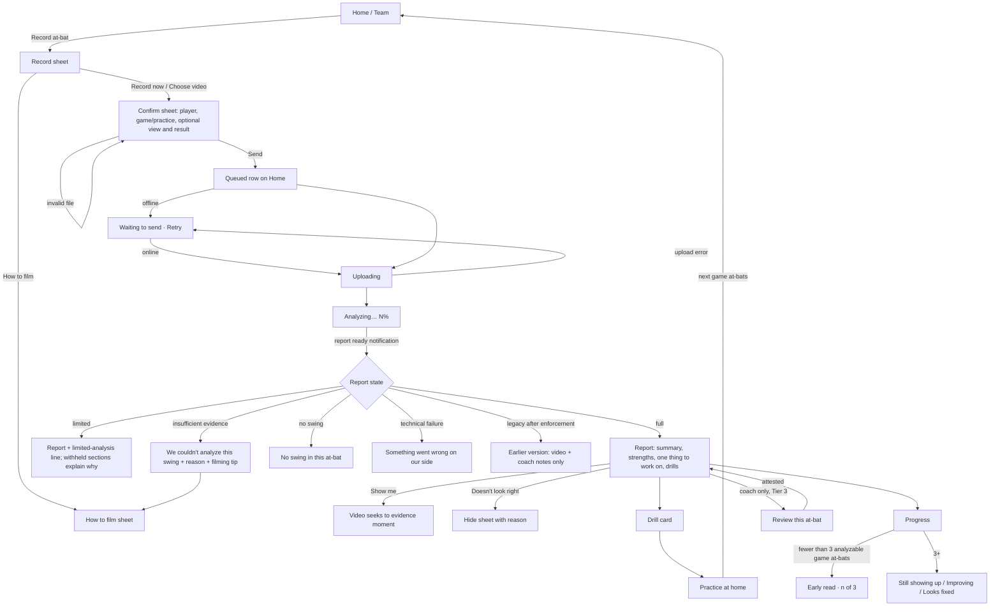

# HitterLoop v2: Mobile UI/UX Redesign and Product Experience Audit

- **Status:** Design specification. As of 0.55.0 nothing below is implemented in the standard report; M5's experimental v2 report partly overlaps (§0.3), and UI-PR1 is in progress (§0.4).
- **Date:** 2026-10-12 (status update §0: 2026-10-20)
- **Repository state audited:** `master` at `fa9b652`, version `0.52.2` (Android `versionCode` 74), with uncommitted PR5/PR6 work in the tree. That work was not read for UI purposes and was not touched.
- **Inputs:** [`HITTERLOOP_FORENSIC_AUDIT.md`](HITTERLOOP_FORENSIC_AUDIT.md) (`F-xx`), [`HITTERLOOP_V2_IMPLEMENTATION_PLAN.md`](HITTERLOOP_V2_IMPLEMENTATION_PLAN.md) (`S0-xx`, `S1-xx`, `D1-D9`, `H1-H13`), [`ENGINE_BASELINE.md`](ENGINE_BASELINE.md), [`PRIVACY_SAFEGUARDS.md`](PRIVACY_SAFEGUARDS.md), [`DRILL_CURATION.md`](DRILL_CURATION.md), `NEXT_STEPS.md`, `DESIGN.md`, and [`docs/SIMPLIFIED_APP_SPEC.md`](../SIMPLIFIED_APP_SPEC.md), the approved product direction.
- **Rendered evidence:** 14 Android emulator screenshots captured on 2026-10-12 from a debug build of `0.52.2` on a local Supabase stack. The screens covered are Home, the at-bat report, Record, How to film, Progress, Settings, Invite parent, the legacy Team screen, and the legacy player page. The screenshots are local only (untracked `screenshots/`). They are not reproduced here because they show a real player's surname and a real invitation token. The video player showed a broken-media icon because the local storage emulator was not running, so video playback was **not** visually verified.
- **Audience:** the product owner, the independent GPT-6 reviewer, and Codex as the implementing agent. Gemini/AGY does code and visual QA.
- **Scope:** read-only audit. The only file this audit writes is this specification.

## 0. Status update for 0.55.0 (2026-10-20)

The design below is unchanged. This section records what changed in the code since the audit, so the
roadmap can be executed without re-auditing.

### 0.1 Decision status (§17)

| ID | Status | Basis |
|---|---|---|
| D-1 | **Owner approval** for the heading rename ("One thing to fix" → "One thing to work on") and the full §8.3 wording review. **Safe default in UI-PR1:** the §8.3 `none_found` and strengths copy replaces today's copy, because today's copy is untrue in some cases (P5; "from this angle"). The heading is not renamed. | P5; CLAUDE.md truth rules |
| D-2 | **Partly resolved:** the rule that family copy never says "contact" for an estimate is binding (plan §3.5, §7.3 rule) and is already followed by the M5 experimental report. **Owner approval** for the final parent wording and for one term across both reports (M5 says "Estimated impact (not confirmed contact)"; this spec recommends "Estimated hitting moment"). **Safe default in UI-PR1:** this spec's recommendation, in the standard report only. | Plan §3.5; M5 |
| D-3 | **Owner approval.** Not used by UI-PR1 (T1-14 is later). | — |
| D-4 | **Owner approval.** Needed before UI-PR4. | — |
| D-5 | **Owner approval.** Status quo: no coach review (`SIMPLIFIED_APP_SPEC.md` §1/§4 removed the approval workflow). Needed before UI-PR8. | Simplified spec |
| D-6 | **Owner approval.** Tier 2. | — |
| D-7 | **Owner/release decision.** Blocks the origin value in UI-PR2; UI-PR2 can ship fail-closed before it. | §13.1 |
| D-8 | **Deferred** by this spec's own recommendation (until retention H8); confirm. | §17 |
| D-9 | **Owner approval.** Tier 3. | — |
| D-10 | **Owner approval** for the standard report. M5 already shows "See it" for estimated events, but only behind the development-only `ENGINE_V2_AI` opt-in and the "Experimental analysis — not yet validated" label. | M5 |
| D-11 | **Owner approval** (new dependency). Needed for UI-PR2. | — |

### 0.2 Source references at 0.55.0 (`96d0d17`)

Line numbers in §2-§16 refer to `0.52.2`. Current locations (before UI-PR1):

| Ref | 0.55.0 location |
|---|---|
| P1 "looking good." | `src/services/notifications/outbox.ts:83` |
| P2 share / invite links from `location.href` | `coach/components/simpleApp.js:491` / `:571` |
| P3 raw transport error | `simpleApp.js:83` (`reportApi`), `:766` (`start` catch) |
| P4 "Jump to contact" | `simpleApp.js:172` (`contactMarker`) |
| P5 "Nothing clear to fix" | `simpleApp.js:259`; fix selection `src/services/development/reportAssembly.ts:86` |
| P8 failure copy | `reportAssembly.ts:45` (`plainFailureReason`); unreadable branch `simpleApp.js:235` |
| P9 Capture check `<details>` | `coach/components/captureGuide.js:54` |
| P11 `say()` / `#simpleMessage` | `simpleApp.js:38` |
| P12 status pill | `coach/simple.css:55` (`.simple-status`) |
| P14 "Refresh video" | `simpleApp.js:251` |
| P16 `confirm()` delete | `simpleApp.js:601` |
| P17 roster row text | `simpleApp.js:103` |
| P7 / T1-16 legacy `team.html` link | `simpleApp.js:105` |
| T1-17 safety note | `simpleApp.js:407` (`guideSheet`) |
| T1-18 hide call without reason | `simpleApp.js:529` |
| P20 "Child" placeholder | `simpleApp.js:735` |
| Analysis hold / 404 / contact time | `supabase/functions/get-simplified-report/index.ts:30` / `:23` / `:434` |
| Coach analysis gate | `simpleApp.js:307` |

### 0.3 What M5 already provides (experimental v2 clips only)

M5 (0.55.0) added a separate report for clips analysed by the development-only v2 engine
(`coach/components/experimentalReport.js`, `src/services/development/experimentalV2Report.ts`). It is
behind `ANALYSIS_ENGINE=v2-exp` and is never shown for standard reports.

| This spec | M5 coverage |
|---|---|
| §7.3 estimate terminology | Partial: "Estimated impact (not confirmed contact)"; never "contact" |
| §7.4 Show me / moments | Partial: "See it" seeks to each event's source frame (frame-exact on the Android WebView); no marker row, no ½× replay |
| §8.1 states | Partial: processing, not assessable (with plain reasons), analysis not enabled, findings, insufficient evidence, no supported issue, withheld, failed (with retry); never presented as a verified clean swing |
| §8.2 presentation contract | Not used: M5 returns its own `experimental` block. UI-PR6 should unify the two rather than keep parallel contracts. |
| §8.1 row 6 retry | M5 adds a coach/guardian retry RPC for experimental clips only (`retry_experimental_v2_clip`); the standard report still has none |
| §9.10 share links | v2 clips are excluded from share links (404) |
| Everything in Tier 1 | Not covered |

### 0.4 UI-PR1 interpretation

§8.1 row 6 gives every `status === "failed"` clip the title "Something went wrong on our side.". Some
failures are properties of the video (for example "We couldn't find the batter clearly."), where that
title would be untrue. UI-PR1 therefore uses the §9.11 title ("We couldn't analyze this swing" + reason +
filming tip) for capture-related failure reasons, "We couldn't analyze this video" + reason for the
3-minute limit, and "Something went wrong on our side." only for unknown failures. Wording review: D-1.

## How to read this document

| Label | Meaning |
|---|---|
| **[FACT]** | Directly observable in source at the cited path, or in the rendered screenshot. |
| **[INFERENCE]** | Follows from cited code by reasoning. Not executed or measured. |
| **[DESIGN RECOMMENDATION]** | A proposed design decision. Not validated with users. |
| **[BACKEND DEPENDENCY]** | Needs data or capability the backend does not provide today. |
| **[UNVERIFIED]** | Plausible but not checked against source or runtime. |

`DESIGN.md` remains the visual source of truth. Any token or component change adopted from §10 must update `DESIGN.md` in the same PR.

---

## 1. Executive design assessment

The simplified app (`coach/simple.html` + `coach/components/simpleApp.js`) is a sound base. It is focused and calm, uses large targets, and follows the approved spec's report order closely. The palette and typography read as athletic and credible. **Do not rebrand.**

The problems are not visual polish. They are **truthfulness, state clarity, and navigation integrity**:

1. **The product speaks with more certainty than its evidence in several places.**
   - [FACT] When no fix is shown, the report-ready notification says the swing is "looking good" (`src/services/notifications/outbox.ts:83`). A missing fix can mean a low-confidence finding, a disputed finding, a non-mechanical concept, or simply nothing found.
   - [FACT] "Jump to contact" and the "Contact marker" (`simpleApp.js:168-172`) point at the baseline's `contact` phase. The v2 plan defines that phase as an `impact_estimate`, never confirmed contact (plan §3.5).
2. **The report collapses distinct states into one sentence.**
   - [FACT] "Nothing clear to fix from this at-bat" (`simpleApp.js:249`) covers every case where `report.fix` is null (`reportAssembly.ts:79-88`).
   - [FACT] "We couldn't analyze this video" covers both technical failure and insufficient evidence unless an error message happens to match a regex (`reportAssembly.ts:46-55`, `:66-75`).
3. **Errors and links break the experience on Android.**
   - [FACT] Any non-2xx Edge Function response is shown verbatim as "Edge Function returned a non-2xx status code" (`simpleApp.js:82`, `:738`). The function's own friendly message (`get-simplified-report/index.ts:420`) never reaches the user.
   - [FACT + INFERENCE] Invite and share links are built from `location.href` (`simpleApp.js:480`, `:548`). In the Capacitor shell that is `https://localhost/...`. **This is a production defect in the native app, not dev-only behaviour.** §13.1 has the evidence.
4. **Navigation leaks into the legacy product.**
   - [FACT] "Add or import players" links to `coach/team.html` (`simpleApp.js:104`). That page has a different shell (Team / Add / Review), a review queue, manual Priorities, and copy that contradicts the simplified report ("No strengths have been coach-verified yet").
   - [FACT] The simplified app pushes no history entries and handles no Android Back. No `@capacitor/app` plugin is installed. In the emulator, Back from a sheet over a report left the app.
5. **The UI has no place yet for Analysis Engine v2's evidence states.** The plan defines them: `analysis_unavailable` with a `familyReason`, `legacy_safe_only`, coach-attested content, and per-claim `displayable`. The client renders none of them, and the planned payload has no way to say **why** a section is empty (§8, §14).

**Recommendation.**
- Ship a small Tier 1 set of UI correctness PRs now, independent of the CV roadmap (§13, §16).
- Define a report presentation contract (`analysisState`, `fixState`, `strengthsState`, `attribution`, `momentLabel`) so Tier 2 can switch on evidence enforcement without redesigning screens (§8).
- Keep the three-tab parent shell.
- Give coaches a roster-first version of the same shell instead of the legacy coach app (§5-6).

---

## 2. Existing screen inventory

| Route / component | Purpose | Status | Reachable from the default app? |
|---|---|---|---|
| `coach/index.html` | Sign-in, team creation, routing | **Active.** Signed-in users go to `simple.html`. `?legacy=1` keeps the rollback route (`index.html:86-153`). | Entry point |
| `coach/simple.html` + `components/simpleApp.js` + `simple.css` | Home, at-bat report, Progress, Record/How to film/Settings/Invite sheets, shared-link view | **Active default** for coaches and guardians (`NEXT_STEPS.md` Critical §family journey) | Yes |
| `components/captureGuide.js` | Filming guide and "Capture check" summary | **Active** | Yes |
| `components/captureQueue.js`, `videoUpload.js`, `uploadPolicy.js` | Offline queue, signed upload, type/duration policy | **Active** | Yes |
| `coach/family.html` + `familyPage.js` | Invite acceptance, consent, re-consent, unlink, legacy family rollback | **Active** for invite/consent; legacy report rollback | Via invite link and stale-consent redirect (`simpleApp.js:703-705`) |
| `coach/report.html` | Legacy token-based shared report | **Active** for legacy links (`player.html:645`) | No |
| `coach/analysis.html` + `coachAnalysis.js` | Coach phase navigation, "Contact estimate", timing uncertainty, phase corrections, evidence drawer (Analysis Depth Phase 4) | **Built locally, gated.** Shown only when `coach_analysis_available` returns true (`simpleApp.js:294-300`). Its migration `00058` is local-only [FACT, `NEXT_STEPS.md`: cloud has 00001-00054]. | Conditionally. Not seen in the screenshots. |
| `coach/team.html` + `appShell.js` | Legacy team roster, import players, Team/Add/Review nav | **Legacy**, slated for removal in spec §4 | **Yes**, through "Add or import players" |
| `coach/player.html` | Legacy player Overview / Development / Compare / Practice tabs; "Coach-verified strengths"; "Set a Priority" | **Legacy** (spec §4: priorities removed) | Yes, through team.html → Open player |
| `coach/review.html`, `queue.html` | Approve/edit/reject review queue | **Legacy** (spec §4: remove) | Yes, through the legacy bottom nav "Review" (`appShell.js:181`, `:226`) |
| `coach/compare.html`, `development.html`, `session.html`, `atbat.html` | Compare, priorities, practice sessions, pitch logging | **Legacy** | Yes, indirectly through the legacy player page |
| `coach/lab.html` + `performanceLab.js` | Phase 7 performance lab | **Experimental**, staff-only, local | [UNVERIFIED] not linked from the simplified app |
| `skeletonScene.js`, `swingMetricsPanel.js`, `compModal.js` | 3D viewer, "(2D)" metrics, pro comps | **Legacy/experimental.** F-11/F-12 show these are not evidential. | Only through legacy screens |
| `docs/design/simplified-app/` | Approved AGY prototype (fictional data) | **Design reference** (spec §3.0) | n/a |

**Implementation versus approved prototype** [FACT, from comparing `docs/design/simplified-app/1-home.png` and `3-report.png` with the rendered screens]:

| Prototype | Implemented | Gap |
|---|---|---|
| Report header: back chevron + "Oct 3 Game" | Eyebrow "AT-BAT REPORT" + player surname in 2rem uppercase | No back affordance. The title repeats the Home title instead of identifying the at-bat. |
| Contact marker on the scrub bar, ½× overlay on the video | Separate 4px track under the video, a "Jump to contact" link, and two large buttons (½ speed, Refresh video) | The marker is detached from the native scrubber, so its position is approximate. "Refresh video" exposes a signed-URL implementation detail. |
| Feed row: thumbnail, date, Game tag, headline, coloured state | Text row: AI sentence (two lines), date · Game, "Ready" | No thumbnail. The AI sentence dominates the row. The state is right-aligned grey. |
| Current focus card on Home | Implemented ("Working on …") when a focus exists | — |

---

## 3. Current UX problems ranked by severity

Severity: **S1** = misleads a family or breaks a core flow; **S2** = significant confusion or trust erosion; **S3** = friction or polish.

| # | Sev | Problem | Evidence | Label |
|---|---|---|---|---|
| P1 | S1 | Notification says "looking good." whenever no fix is shown | `src/services/notifications/outbox.ts:83` | FACT |
| P2 | S1 | Invite and share links use the WebView origin (`https://localhost`) in the native app | `simpleApp.js:480`, `:548`; `config.js` comment ("Capacitor's webview reports window.location.hostname as \"localhost\""); no `server.hostname` in `mobile/capacitor.config.json`; rendered invite sheet shows `https://localhost/family.html?invite=…` | FACT |
| P3 | S1 | Raw transport errors shown to users ("Edge Function returned a non-2xx status code"), including for expired or revoked share links (which return 404) | `simpleApp.js:82`, `:738`; `get-simplified-report/index.ts:109-152` return `notFound()`; rendered launch screen | FACT |
| P4 | S1 | "Jump to contact" / "Contact marker" label an estimated hitting-zone instant as contact | `simpleApp.js:168-172`; contact time comes from the `contact` phase (`get-simplified-report/index.ts:389-394`), which plan §3.5 maps to `impact_estimate` | FACT |
| P5 | S1 | One "Nothing clear to fix" sentence for no issue, low-confidence issue, non-mechanical concept, and context-explained swing | `simpleApp.js:249`; `reportAssembly.ts:86`; `focus.ts` `shownFix` | FACT |
| P6 | S1 | Android Back leaves the app from a report or sheet. There is no in-app history. | No `pushState`/`popstate` in `simpleApp.js`; no `@capacitor/app` in `mobile/node_modules/@capacitor/`; observed in the emulator | FACT (code) / FACT (observed once) |
| P7 | S2 | Default app routes coaches into the legacy shell, which has a contradicting strengths message, manual Priorities, and a Review queue | `simpleApp.js:104`, `:710`; `appShell.js:181-226`; rendered legacy player page | FACT |
| P8 | S2 | Technical failure and insufficient evidence look identical | `reportAssembly.ts:46-55`, `:66-75`; `simpleApp.js:227-228` | FACT |
| P9 | S2 | "Capture check" renders as a titled card with no visible expand affordance. It reads as empty. | `captureGuide.js:54-71` uses `<details>`; `simple.css` `.simple-card summary { display:flex }` removes the default disclosure marker [INFERENCE: Chromium drops the marker when `summary` is not `display:list-item`]; the drill card adds its own "⌄" (`simpleApp.js:159`), capture check does not | FACT + INFERENCE |
| P10 | S2 | No way to see or revoke active share links in the simplified app, although the RPC exists | `revoke_simple_share_link` in `00047_simplified_report_foundations.sql:213`; no caller in `coach/components/` | FACT |
| P11 | S2 | Status messages render at the top of `<main>` (`#simpleMessage`). On a scrolled report, the confirmation or error appears off-screen. | `simple.html`; `say()` in `simpleApp.js:37` | FACT (placement) / INFERENCE (visibility) |
| P12 | S2 | Progress status pill is always green, including "Still showing up", "Early read", and "Checking" | `simple.css` `.simple-status` uses `--success`; `simpleApp.js:342` | FACT |
| P13 | S2 | Feed rows lead with the first sentence of an AI summary. Under v2 enforcement that summary can be withheld, and today it is long. | `reportAssembly.ts:38-40`; rendered Home (two-line sentence) | FACT |
| P14 | S2 | Signed video URLs expire after 15 minutes. The user has to press "Refresh video" instead of the app recovering automatically. | `get-simplified-report/index.ts:386`; `simpleApp.js:241` | FACT |
| P15 | S3 | Large uppercase player-name H1 plus an eyebrow on every screen uses about 20% of the first viewport before content | rendered Home, report, Progress | FACT (observed) |
| P16 | S3 | Delete uses the browser `confirm()` | `simpleApp.js:573` | FACT |
| P17 | S3 | Coach roster row shows "Selected player" / "Open reports and progress" instead of focus and latest-report date | `simpleApp.js:101-104`; spec §3.1 coach variant | FACT |
| P18 | S3 | Strengths are green body text with a "✓" glyph. Colour carries emphasis for the whole paragraph. | `simple.css` `.simple-strength` | FACT |
| P19 | S3 | Settings opens as a bottom sheet over the current tab, which stays visible behind it. That is acceptable, but the sheet has no Escape/Back integration (see P6). | rendered Settings | FACT |
| P20 | S3 | Parents briefly see "Child" as a name before summaries load | `simpleApp.js:707`, `:715-718` | FACT |

---

## 4. Visual identity assessment

**Keep** [DESIGN RECOMMENDATION]:
- the dark "infield dirt at night" palette (`coach/coach.css` tokens, `DESIGN.md`);
- Oswald display + Inter body;
- the clay primary action, flat bordered slate cards, 48-52px targets, and three-tab bottom nav.

These read as athletic and serious, and the dark palette suits a phone used outdoors in the evening.

**Measured contrast** of the existing tokens [FACT, WCAG 2.x relative luminance computed from `DESIGN.md` hex values]:

| Foreground → background | `--bg` #121418 | `--surface-1` #1A1E25 | `--surface-2` #232830 | `--surface-3` #2C323B |
|---|---|---|---|---|
| `--text-1` #F4EFEA | 16.1 | 14.6 | 13.0 | 11.3 |
| `--text-2` #BDB6AB | 9.2 | 8.3 | 7.4 | 6.4 |
| `--text-3` #9A9588 | 6.2 | 5.6 | 5.0 | **4.3** |
| `--brand-text` #E27B60 | 6.4 | 5.8 | 5.1 | **4.5** |
| `--brand-fill` #B4503A (as text) | **3.6** | **3.3** | **2.9** | **2.6** |
| `--success` #34D399 | 9.6 | 8.7 | 7.7 | 6.7 |
| `--warning` #F2B84B | 10.3 | 9.3 | 8.3 | 7.2 |
| `--danger` #E0584C | 5.0 | 4.5 | **4.0** | **3.5** |

- White on `--brand-fill` is 5.06 (passes AA). `--text-1` on `--brand-fill` is 4.43 (fails AA for body text).
- **Rules:** never use `--brand-fill` as text; never put `--text-3` or `--danger` text on `--surface-3`; use white, not `--text-1`, on clay.

**Change** [DESIGN RECOMMENDATION]:

1. **Calmer hierarchy.**
   - Replace the uppercase 2rem player-name H1 on report and Progress with a 1.375rem Oswald title that identifies the content ("Oct 11 · Game").
   - Put the player name in a 0.875rem subtitle.
   - Keep the large uppercase H1 only on Home.
2. **Colour as a signal, not a style.**
   - Strengths: `--text-1` body text with a `--success` check icon, not green paragraphs.
   - Status pills: semantic tone per status (§10.4).
3. **One disclosure pattern.** Every `<details>` gets a visible chevron and a one-line collapsed summary, so a collapsed card never looks empty.
4. **Radii.** The simplified route's 16px cards and 12px buttons are an existing exception to the shared tokens (`DESIGN.md` §Shape). Adopt them as the consumer-route standard and record that in `DESIGN.md`. Do not fork a third value.
5. **No new decoration.** No gradients beyond the existing skeleton shimmer and scroll fades. No glow, no score dials, no charts on parent screens.

---

## 5. Parent information architecture

**Keep three tabs: Home · Record · Progress** [DESIGN RECOMMENDATION]. Settings stays in the top bar.

| Destination | Contains | Change from today |
|---|---|---|
| **Home** | Player switcher (2+ children only), Record at-bat, current focus card, recent at-bats | Feed rows lead with structured metadata, not AI prose (§9.1) |
| **Record** (tab opens a sheet) | Record now / Choose video / How to film | Opening the sheet pushes a history entry, so Back closes it. The tab never shows as "current". |
| **Progress** | Current focus, how it's going, then vs. now, practice line, history | Status tone, evidence count, "what counts" explainer |
| **At-bat report** (pushed screen, not a tab) | §9.2 | Gains a back affordance and a date title |
| **Settings** (sheet) | Notifications, How to film, Shared links, Sign out | Gains "Shared links" (§9.10) |

**Do not add a fourth tab.** The core loop (record → read → practise → recheck) fits in three. A separate "Drills" tab would re-surface drills without a fix, which the spec forbids (§3.3: drills only with a shown fix or focus).

**Player-facing experience:** not justified now [DESIGN RECOMMENDATION]. Players under 13 should not hold accounts, and the report's "Say to \<name\>:" cue already serves the child through the parent. Revisit only with age-gated consent work (H1).

---

## 6. Coach information architecture

A coach currently lands in the simplified Home for one player, with a roster card above it. Adding players drops them into the legacy shell.

**Recommended coach shell** [DESIGN RECOMMENDATION]: the same three-tab chrome, with a different first tab.

| Tab | Coach content |
|---|---|
| **Team** (replaces Home for coaches) | Roster rows: name, jersey badge, focus line ("Working on load" / "Early read · 1 of 3"), latest report date, state badge if an at-bat is processing or couldn't be analysed. Actions: Import players, Add player, Invite parent (per player, in an overflow). |
| **Record** | Same sheet. The player select is required and pre-filled. |
| **Progress** | The selected player's Progress. A player chip at the top switches player. |

- Tapping a roster row opens **Player** (a pushed screen): the parent Home content for that player (focus card + feed), plus a "Parents" section (linked, pending invites, Cancel invites, Remove link) that reuses `guardianAdmin.js`.
- Tapping a feed row opens the shared at-bat report. Coaches see the same report as parents, plus a coach-only "Review this at-bat" entry once Tier 3 exists (§9.6).
- **Remove the default path into `team.html` / `player.html`.**
  - Move Import players into the simplified Team tab, reusing `rosterImportSheet.js` and `rosterImport.js`. These are already tested (`rosterImport.test.mjs`).
  - The legacy shell remains reachable only via `?legacy=1`, per NEXT_STEPS.
- **No Review tab, queue, counts, or badges.** Spec §1 removed the approval workflow, and `appShell.js` still carries a review badge. Coach review returns only as an explicit, optional per-at-bat action whose attestation the backend records (U3/H6). That is a product-owner decision (§17, D-5).

---

## 7. Evidence-aware report design

### 7.1 Principles

1. **The video comes first and is the source of truth.** Every finding should eventually link to a moment in it (§7.4).
2. **Absence is never praise.** No section's emptiness may imply a good swing. Every empty state says *why* it is empty.
3. **One honest qualifier, not confidence meters.**
   - Parents never see V1-V4, percentages, "AI confidence", or reliability numbers.
   - They see at most one plain status line when analysis is limited, plus specific "couldn't check from this video" copy where a section is withheld.
4. **Attribution is explicit.**
   - Machine output carries no badge; that is the default.
   - Coach-attested content says "From your coach" (plan §0.3) and names the coach only to linked family members.
   - Human attestation is never presented as machine validation, and the reverse.
5. **Estimate language for estimated events** (§7.3).

### 7.2 Recommended report structure (top to bottom)

```
┌─────────────────────────────────────┐
│ ‹  Oct 11 · Game                     │  app bar: back + at-bat identity
│    Player name                       │  subtitle (0.875rem, text-2)
├─────────────────────────────────────┤
│ [ status line, only when not full ]  │  e.g. "Limited analysis: the feet were
│                                       │   hidden, so stride wasn't checked."
│ ┌─────────────────────────────────┐ │
│ │            VIDEO                 │ │  poster at the swing; native controls
│ │                       [½×]       │ │  overlay ½× toggle (48px)
│ └─────────────────────────────────┘ │
│ ──────────●─────────────  (est.)     │  moment marker on a custom scrub row
│ [ ▶ Watch the swing ]                │  seeks to impact_estimate − 0.5 s
├─────────────────────────────────────┤
│ HOW IT WENT                          │
│ 2-3 sentences                        │
├─────────────────────────────────────┤
│ WHAT LOOKED GOOD                     │
│ ✓ Strength one          [Show me ›]  │  Show me = Tier 3 evidence moment
│ ✓ Strength two          [Show me ›]  │
├─────────────────────────────────────┤
│ ONE THING TO WORK ON                 │  state-dependent (§8.3)
│ Issue (h3)                           │
│ What the video showed                │
│ Say to <first name>:                 │
│ "Cue in large type"                  │
│ Next time, watch for: …              │
│ From your coach · Oct 12  (if any)   │
├─────────────────────────────────────┤
│ DRILLS THAT CAN HELP (0-3)           │
├─────────────────────────────────────┤
│ ▸ About this video                   │  replaces "Capture check"; collapsed
│   Camera view: Game / backstop ·     │  summary always visible
│   Hitter visible · Bat partly visible│
├─────────────────────────────────────┤
│ [ Share ]   [ Doesn't look right ]   │
│                                       │
│ Delete at-bat                         │  destructive, separated, own sheet
└─────────────────────────────────────┘
```

**Label changes** [DESIGN RECOMMENDATION; wording is product-owner decision D-1 and H7]:

| Today | Proposed | Why |
|---|---|---|
| "How it went" | Keep | Plain and accurate |
| "What looked good" | Keep | Plain and accurate |
| "One thing to fix" | "One thing to work on" | Less punitive for a 9-year-old reading over a parent's shoulder. Matches notification copy ("1 thing to work on", `outbox.ts:83`). |
| "Capture check" | "About this video" | Says what it is. "Check" implied a pass/fail. |
| "Jump to contact" | "Watch the swing" (button); marker labelled "Estimated hitting moment" | The baseline never confirms contact (plan §3.5) |
| "Refresh video" | Removed; the app re-fetches the signed URL on a media error | Implementation detail |
| "Nothing clear to fix from this at-bat. Keep filming. Patterns show up over 3+ at-bats." | State-specific copy (§8.3) | P5 |

### 7.3 Event terminology

| v2 event | When the UI may use it | Parent-facing label [DESIGN RECOMMENDATION, H7] | Coach-facing label |
|---|---|---|---|
| `impact_estimate` | Every swing the engine located (baseline `contact` maps here) | "Estimated hitting moment" (marker), "Watch the swing" (button) | "Impact (estimated)" |
| `contact_confirmed` | Only when the backend reports confirmed visual contact. The baseline never does (plan S1-04). | "Contact" | "Contact (confirmed)" |
| `swing_miss` | When the outcome classifier says so (not produced today) | "Swing and miss" (only if the outcome is backend-supplied, never inferred from the result chip) | Same |
| `checked_swing` | Same | "Checked swing" | Same |
| `no_swing_take` | `confirmed_no_swing` state today (`reportAssembly.ts:65`) | "No swing in this at-bat" | Same |
| `stance_set`, `load_start`, `foot_plant`, `finish` | Evidence moments (Tier 3) | "Set-up", "Load", "Front foot down", "Finish" | Same, with "(estimated)" where V2 uncertainty is unquantified |

- **Rule:** the word "contact" appears in family-facing copy only when `momentLabel === "contact_confirmed"`.
- The result chip (Hit/Out/…) is user-entered metadata. It must never be rephrased as an observed event.
- `coach/components/coachAnalysisModel.js` already uses "Contact estimate" (`PHASES`), so the coach surface is consistent with this rule.

### 7.4 Evidence-linked findings ("Show me")

**Interaction** [DESIGN RECOMMENDATION; BACKEND DEPENDENCY]:

1. **Placement.** A trailing "Show me" text button (48px tall target) on each strength, and on the fix's evidence line.
2. **Timestamp.** Not shown as a number to parents. The moment is shown as a marker on the scrub row, labelled with the event name, e.g. "Front foot down". Coaches see `0:03.4 (±unmeasured)` in the coach review mode, matching `coachAnalysis.js` `phaseCard`.
3. **Playback.**
   - Tapping scrolls the video into view.
   - It seeks to `moment.rawPtsS − 0.5 s`, plays at ½× for 1.5 s, then pauses on the moment.
   - The marker pulses once (no pulse under `prefers-reduced-motion`).
   - A second tap replays.
4. **Multiple moments.** A finding with 2+ moments shows "Show me (2)". Tapping cycles in temporal order, and the marker row highlights all of them.
5. **Missing evidence.**
   - If the finding has no mapped moment (frame map `unmappable`, or a legacy run), show no "Show me" button.
   - Never fall back to the estimated contact time for a finding about another phase.
6. **Coach attribution.** A coach-attested finding shows "From your coach" under its text. Its "Show me" uses the moment the coach confirmed (Tier 3), or none.
7. **Accessibility.**
   - The button's accessible name is "Show this in the video: \<event label\>".
   - After seeking, focus moves to the video element and an `aria-live="polite"` region announces "Video paused at front foot down".
   - Keyboard: Enter/Space activate. The video retains native controls.

**Data needed (none of it exists in the report payload today):**
- per strength and per issue: `moments: Array<{ event: SwingEventSlug; rawPtsS: number; identity: "verified" | "assumed" }>`;
- the event's V2 status;
- per issue: `attestation: { by: "coach"; reviewedWithVideo: boolean; at: string } | null`.

Sources: the plan's `EventLocalisation.rawPtsS` (§3.3), `frame_map.json` (S0-05), `issues.claim_decision` (S0-09), and H6/U3 for attestation. Strength phases exist today (`ReportRun.strengths[].phase`, `reportAssembly.ts:17`) but are dropped from the payload (`:94`), and raw PTS per phase is not mapped (plan §3.7).

#### 7.4.1 Evidence inventory at UI-PR7 (2026-10-21) [FACT]

| Source | What it holds | Original-source frame reference? | Usable for "Show me"? |
|---|---|---|---|
| `swing_phases` (baseline: stance, load, stride, contact, extension, follow-through) | `frame`, `time_s` | **No.** `time_s` is analyzed-frame index ÷ fps inside the video the pose pipeline analyzed (`detect_2d.py` `t = i / fps`), stored unchanged (`ingestPhases.ts`). Uploads ≥ 60 s are trimmed by Stage 0 to a 12 s window whose start (`trim_start_s`) exists only in the worker's ephemeral `stage0.json` and is never stored in the database or report payload; high-fps clips may be decimated; phone video is variable frame rate; a nonzero container start is not adjusted. | No |
| INST-1 `frame_map.json` (baseline runs) | Verified raw PTS per analyzed frame (content-matched, `verified`/`unmappable`) | Yes, while the run's working files exist | No: not persisted for baseline runs |
| `clip_evidence_assessments.events` | `EventLocalisation` (`rawPtsS`, status) | Yes, by design | No: written only by evidence shadow mode (off, not activated), service-role only, and S0-09 keeps assessment signals out of family payloads |
| Experimental v2 `events` (`experimental_v2_results`) | Event id, `timeS`, `seekS` from the engine's own PyAV frame map | Yes: `seekS` is the frame's absolute PTS + half a frame (measured on the Android WebView); nonzero-start uploads are refused (`SOURCE_START_OFFSET_UNSUPPORTED`) | Yes, already: "See it" per finding and in Swing moments |

**Decision for UI-PR7:** normal (baseline) reports show **no** "Show me" control. No finding has a mapped source moment, and D-10 also withholds estimated moments from parents until the event's V2 passes (the reliability catalog is empty). Never fall back to `contactTime` for a finding. The experimental "See it" is the evidence-linked moment; UI-PR7 applies §7.4's accessible name, focus and announcement rules to it and marks engine estimates explicitly ("Estimated hitting moment", "Load (estimated)"), without changing its frame-exact seek.

**Resolved in UI-PR7.1:** the baseline "Watch the swing" button, the estimated-moment marker, the automatic seek on open and the Progress "Then vs. now" alignment all used the analyzed-window `contactTime` on the raw upload. For uploads of 60 s or more (trimmed by Stage 0) that moment landed in the wrong place; for shorter clips it was approximate (VFR, nonzero start). UI-PR7.1 removed all of them from normal reports (coach, parent, shared link, demo). The video now opens at its natural start with a "Play video" button and native controls; the baseline presentation's `momentLabel` is `null`. The server still returns `contactTime` (no payload change), but no normal-report code reads it. Restoring a moment needs the provenance below.

**Unlocking baseline "Show me" later** needs: persisted source-frame provenance per phase (e.g. INST-1 verified `raw_pts_s`), the enforcement read path that is allowed to expose it (S0-11), and, for parents, a passing V2 status per event (D-10).

---

## 8. Analysis state and presentation contracts

### 8.1 States the UI must distinguish

| # | State | Today's signal [FACT] | v2 signal (planned) | What the family sees |
|---|---|---|---|---|
| 1 | **Processing** | `status ∈ {pending, processing}` or `analysisPending` (`get-simplified-report/index.ts:25`) | unchanged | "Analyzing… 40% done · Usually ready in a few minutes." Video plays if uploaded. Delete is available. |
| 2 | **Analysis available (full)** | `report.state === "ready"` | `clip_status=eligible`, all shown claims `displayable` | Full report (§7.2), no status line |
| 3 | **Limited analysis** | Not representable | eligible clip, but at least one requirement class withheld (V2/V3/V4) | Status line naming what wasn't checked; withheld sections use §8.3 copy |
| 4 | **Analysis unavailable: insufficient evidence** | `report.state === "unreadable"` with `status === "ready"` | `state: "analysis_unavailable"` + `familyReason ∈ {batter_unclear, swing_unclear}` (S0-11, S0-09) | Title "We couldn't analyze this swing", the specific reason, a matching filming tip, the video, About this video. No summary, strengths, fix, or drills. |
| 5 | **No swing** | `report.state === "no_swing"` | `no_swing_take` | "No swing in this at-bat." Video. No error styling. Counts as an at-bat. |
| 6 | **Technical failure** | `status === "failed"` (`reportAssembly.ts:46`; `index.ts:370`) | unchanged | "Something went wrong on our side." Plain reason when known (e.g. the 3-minute limit). No filming tip unless the reason is capture-related. **No retry button** (none exists; see §14). |
| 7 | **Coach-reviewed feedback** | Not representable in the simplified report (only the legacy family report filters to coach-reviewed, `_shared/familyReport.ts:24`) | coach-attested override (plan §0.3, H6) | "From your coach" attribution on the attested item(s) |
| 8 | **Legacy analysis** | Not representable | `legacy_safe_only` (D2, §3.6) after enforcement | "This at-bat was analysed by an earlier version; detailed feedback isn't available." Video, date, and coach-attested items only. |
| 9 | **Feedback-hidden** | `issues.hidden` → summary replaced, fix null (`reportAssembly.ts:83-88`) | unchanged | "An observation was hidden after feedback from \<role\>." The fix section explains, rather than reading as "nothing to fix". |

### 8.2 Proposed client presentation contract

[DESIGN RECOMMENDATION + BACKEND DEPENDENCY] `get-simplified-report` returns a small presentation block that the client renders without inference. Computing it on the server keeps the evidence rules out of the client (plan principle: "families never read assessment signals", S0-09).

```ts
interface ReportPresentation {
  analysisState: "processing" | "full" | "limited" | "unavailable_evidence"
               | "no_swing" | "failed_technical" | "legacy_safe_only";
  familyReason: "batter_unclear" | "swing_unclear" | "analysis_version_unavailable"
              | "duration_limit" | "unknown" | null;          // plain-copy key, never internal text
  summaryState:   "shown" | "withheld_evidence" | "replaced_after_feedback";
  strengthsState: "shown" | "none_found" | "withheld_evidence";
  fixState: "shown" | "none_found" | "not_confident" | "withheld_evidence"
          | "hidden_after_feedback" | "not_applicable";       // not_applicable: no_swing, unavailable, legacy
  limitedParts: Array<"stride" | "load" | "contact_zone" | "finish" | "head" | "posture">; // drives the status line
  momentLabel: "impact_estimate" | "contact_confirmed" | null;  // for the marker/button copy
  attribution: { fix: "machine" | "coach_attested" | null };
}
```

**Derivation today (Tier 1, no v2 needed):**
- `analysisState` from `status` and `report.state`;
- `fixState: "hidden_after_feedback"` when any issue is hidden;
- `fixState: "not_confident"` when issues exist but `shownFix` returned null;
- `"none_found"` only when the current run stored zero mechanical issues;
- `momentLabel: null` for the baseline (UI-PR7.1): its phase times are not source-frame positions (§7.4.1). Experimental v2 sets `"impact_estimate"` only when the engine emitted that event.

`withheld_evidence`, `limited`, and `legacy_safe_only` arrive with S0-11/S1-12.

### 8.3 Section copy per state

| Section state | Copy [DESIGN RECOMMENDATION; product-owner wording review D-1] |
|---|---|
| `fixState: shown` | Issue, evidence, cue, next-time line |
| `fixState: none_found` | "We didn't see one clear thing to work on in this swing. One video can't show everything; patterns show up over 3+ game at-bats." |
| `fixState: not_confident` | "Something might be worth watching, but this video wasn't clear enough to call it. If it shows up again, it'll appear in Progress." (This matches spec §5.3: low-confidence findings count toward Progress.) |
| `fixState: withheld_evidence` | "We couldn't check the swing mechanics well enough from this video to suggest a change." + the matching filming tip |
| `fixState: hidden_after_feedback` | "A suggestion was hidden after \<a parent / the coach\> marked it as not right." |
| `strengthsState: none_found` | "Nothing stood out clearly enough to call out in this swing." (Today's copy says "We couldn't tell what was working from this angle", which wrongly implies an angle problem when the cause may be none found.) |
| `strengthsState: withheld_evidence` | "We couldn't see enough of the swing to call out strengths." |
| Status line, `limited` | "Limited analysis: \<parts\> weren't visible clearly enough to check." |

**Notification copy** (`outbox.ts:83`) [DESIGN RECOMMENDATION, Tier 1]:
- fix shown: "\<name\>'s at-bat report is ready: 1 thing to work on."
- otherwise: "\<name\>'s at-bat report is ready."
- Never "looking good."

---

## 9. Screen-by-screen specifications

Common to all screens:
- 16px side gutter; 720px max content width.
- 48px minimum targets (52px for primary actions).
- `prefers-reduced-motion` honoured.
- Every error is mapped by §9.12.
- Back closes the top sheet first, then pops the in-app history, then exits.

### 9.1 Parent Home

- **Goal:** reach Record in one tap and open the latest report in one more.
- **Hierarchy:** switcher (2+ children) → Record at-bat → current-focus card → Recent at-bats.

```
HitterLoop                      [⚙]
HOME
<FIRST NAME>                         (H1 kept on Home only)
[ Maya ] [ Sam ]                     (only with 2+ children)
┌ Record at-bat ───────────────────┐
└──────────────────────────────────┘
┌ WORKING ON ──────────────── › ───┐
│ Same load, every pitch            │
│ Improving · 2 of last 5           │
└──────────────────────────────────┘
RECENT AT-BATS
┌──────────────────────────────────┐
│ [▢] Oct 11 · Game                 │  row title = structured metadata
│     Ready · 1 thing to work on   ›│  state line, coloured dot + text
├──────────────────────────────────┤
│ [▢] Oct 9 · Practice              │
│     Analyzing… 40%                │
├──────────────────────────────────┤
│ [▢] Oct 4 · Game                  │
│     Couldn't analyze · tap for why│
└──────────────────────────────────┘
```

- **Feed row decision** [DESIGN RECOMMENDATION]. Identify rows by structured metadata (date, Game/Practice, and the at-bat number when the coach logged one). Use the state line for the outcome. Drop the AI first sentence from the row. Reasons:
  - It is not stable under v2 withholding.
  - It truncates badly on small screens.
  - Two near-identical AI sentences make rows hard to tell apart.
  - The report already shows the summary.
- **States:**
  - first-run empty ("Film an at-bat to get your first report." + How to film);
  - queued uploads (existing banner);
  - loading skeleton (3 rows);
  - feed error (§9.12).
- **Components:** existing `.simple-row` extended with a 56×56 thumbnail slot. The slot shows a neutral placeholder icon until posters exist.
- **Accessibility:** each row's accessible name is the full date + type + state, e.g. "October 11, game at-bat, ready, 1 thing to work on". The percentage uses `aria-live="off"` to avoid chatter.
- **Data:**
  - existing `feed[].{date, kind, status, processingProgress}`;
  - new `feed[].fixState` (§8.2) [BACKEND DEPENDENCY, small];
  - thumbnails need a stored poster per clip [BACKEND DEPENDENCY: a new derived child image, so it must follow `purgeDeletedClips` and opaque-path rules].
- **Acceptance:**
  - a cold open reaches the camera in ≤2 taps;
  - no row text is AI-generated;
  - no row says or implies "good" without a shown strength.

### 9.2 Parent at-bat report

- **Goal:** understand the at-bat in under a minute and know what, if anything, to practise.
- **Hierarchy:** §7.2.
- **Components:**
  - app bar with back (new);
  - status line (new);
  - video with an overlaid ½× toggle;
  - moment scrub row (replaces `.simple-contact-track`);
  - section cards;
  - drill cards (existing `drillCard`);
  - "About this video" disclosure (reworked `captureSummaryHtml`);
  - action row;
  - delete confirmation sheet.
- **States:** §8.1 rows 1-9. In every state the video, date, and Delete remain available if the media exists.
- **Interactions:**
  - The video seeks to `momentTime − 0.5 s` on load (today: `contactTime − 0.5`).
  - "Watch the swing" re-seeks and plays.
  - On a media error, the app re-requests the report once to get a fresh signed URL, then shows "Video couldn't load" with a Try again button.
  - "Doesn't look right" opens a sheet with the optional reasons from spec §5.5 ("Not what happened" / "Wrong kid in video" / "Other"). [FACT] The backend already accepts the reason (`supabase/functions/hide-simple-issue/index.ts:14-25`: `not_what_happened`, `wrong_kid`, `other`), but the client sends none (`simpleApp.js:561`). This is a Tier 1 client-only change.
- **Navigation:** `history.pushState({view:"report", clip})`; Back returns to the originating tab with its scroll position kept.
- **Accessibility:**
  - Section headings are real `<h2>`s; today the labels are `<span class="simple-eyebrow">`, so screen-reader heading navigation skips them.
  - The cue is a `<blockquote>`.
  - The status line is `role="note"`.
  - The video has an `aria-label` with the at-bat date.
- **Data:** existing payload plus `presentation` (§8.2) [BACKEND DEPENDENCY]; `moments` for Show me (Tier 3).
- **Acceptance:**
  - "contact" never appears unless `momentLabel === "contact_confirmed"`;
  - every empty section shows its state-specific copy;
  - Back from the report returns to Home on Android;
  - no raw error string is reachable.

### 9.3 Parent Progress

- **Goal:** "Is the focus showing up less?"
- **Hierarchy:** current focus (title, status pill, evidence sentence, since-date) → focus drill → then vs. now → practice line → History → Share progress.

```
PROGRESS · <first name>
┌ CURRENT FOCUS ───────────────────┐
│ Same load, every pitch            │
│ (Improving)   ← tone: success     │
│ Showing up less: 2 of her last 5  │
│ game at-bats.                     │
│ Since Oct 1 · Based on 5 game     │
│ at-bats the app could analyze     │
│ [Doesn't look right]              │
└──────────────────────────────────┘
DRILL FOR THIS FOCUS …
THEN VS. NOW  [Play together]
In practice: seen in 1 of last 4 analyzed swings.
HISTORY …
```

- **States:**

| State | Copy and tone |
|---|---|
| Early read (fewer than 3 analyzable game at-bats) | "1 of 3 game at-bats needed to look for a pattern." (neutral tone). [BACKEND DEPENDENCY, small] `readable_game_swing_count` is read at `get-simplified-report/index.ts:151` but used only for focus computation and not returned to the client; the payload must add it. |
| No clear pattern | "No clear pattern yet in the last 5 game at-bats." (neutral) |
| Still showing up | Neutral/brand tone, not green |
| Improving | Success tone |
| Looks fixed | Success tone, then moves to History |
| Dismissed | Neutral; shown in History with who dismissed it |
| Checking | Neutral; "Checking the latest game swings." |
| Unanalyzable at-bats excluded | Footnote "2 recent at-bats couldn't be analyzed and aren't counted." [BACKEND DEPENDENCY: an explicit excluded count. The client could count `unreadable` rows in the 20-row feed, but that window does not match the focus window.] |
| Cut-over re-check (S1-12) | "Re-checking with the latest analysis." Status unchanged, never demoted. |

- **Coach-attested improvement** (H6): History entries record "Coach noted improvement · Oct 12" as a separate line, never merged into the automatic status.
- **No** charts, percentages, scores, or trend arrows (spec §3.4).
- **Accessibility:** the status is text, not colour alone. The comparison videos have captions "Then: Oct 1" / "Now: Oct 11".
- **Acceptance:** status tones follow §10.4; "Improving" never appears with fewer than 3 analyzable game at-bats; the excluded-at-bat footnote appears whenever exclusions exist in the window.

### 9.4 Coach Team / Roster

- **Goal:** see who needs attention and reach any player's latest report in ≤2 taps (spec §3.1).
- **Components:** roster rows (jersey badge from `coach.css` `.jersey-badge`), Import players (reuse `rosterImportSheet.js`), Add player, a per-player overflow (Invite parent, Copy invite, Cancel invites).

```
TEAM · <team name>              [⚙]
[ Import players ] [ Add player ]
┌──────────────────────────────────┐
│ (12) First Last                   │
│      Working on load · Oct 11    ›│
├──────────────────────────────────┤
│ (7)  First Last                   │
│      Early read · 1 of 3 · Oct 9 ›│
├──────────────────────────────────┤
│ (3)  First Last                   │
│      No at-bats yet              ›│
└──────────────────────────────────┘
```

- **States:** empty roster ("Import your roster from GameChanger" + Add player), loading, error.
- **Data:**
  - roster, latest report date, and focus per player [BACKEND DEPENDENCY: today `get-simplified-report` is per player; a roster summary needs one batched read to avoid N+1 calls];
  - invites via existing `create_guardian_invite` / `revoke_guardian_invites`.
- **Acceptance:** no team averages, filters, or "needs review" counts (spec §3.1); the legacy shell is not reachable from this screen.

### 9.5 Coach Player Overview

- **Goal:** one player's feed, focus, and parent links.
- **Content:** the parent Home content for the player, plus a **Parents** card (linked guardians with Remove, pending invites with Cancel, and Invite parent).
- **Replaces** the legacy `player.html` Overview for the default path.
  - The legacy "Coach-verified strengths" and "Set a Priority" are not carried over: spec §4 removes priorities, and automatic focus replaces them.
- **Data:** existing reads; guardians via the existing `guardianAdmin.js` RPCs.
- **Acceptance:** nothing on this screen contradicts the at-bat report's sections.

### 9.6 Coach Review (Tier 3, optional workflow)

- **Goal:** let a coach confirm, correct, or reject what the automatic report says, **with the video**, so the attestation is recorded and attributable.
- **Entry:** a "Review this at-bat" secondary action on the at-bat report, coach role only. There is no queue (§6).

```
REVIEW AT-BAT · Oct 11 · Game
[ video with moment markers ]
Finding: Front side opens early
  Moments: Front foot down ▸  Est. hitting moment ▸
  ( ) Looks right   ( ) Not what happened   ( ) Wrong kid in video
  Note to family (optional) [__________]
Strength: Balanced finish …  same controls
[ Save review ]   (disabled until every item has a choice
                   and the video has been played past the moment)
```

**Rules:**
- A "Looks right" choice is recorded as `reviewed_with_video: true` only if the coach played the video through the linked moment in this session (U3).
- Saving never edits AI text. Coaches can add a short note, which is attributed and shown as "From your coach".
- **There is no "re-run analysis" or "pick the correct batter" control.** The backend cannot rerun the engine from a corrected batter identity today (F-09; no such endpoint).
- "Wrong kid in video" hides the findings and records the reason. It does not imply reprocessing.
- Coach phase corrections stay in the separate, staff-gated `analysis.html` (Analysis Depth Phase 4). They do not change the family report.

**Dependencies:**
- [BACKEND DEPENDENCY] attestation storage with `reviewed_with_video` (U3, H6);
- event moments (S0-05, S0-11);
- product-owner approval to reintroduce any coach review into the simplified product (D-5).

**Acceptance:** attestation rows identify the verified coach (`coach_team_access`); an attested item shows "From your coach" to families; nothing claims machine validation.

### 9.7 Recording and uploading

- **Goal:** video in with no required data entry (spec §3.2).
- **Flow:** Record at-bat → sheet (Record now / Choose video / How to film) → confirm sheet (Player, Game/Practice, Camera view optional, Result optional, Send) → Home with a queued row.

**Changes** [DESIGN RECOMMENDATION]:
1. The confirm sheet shows the file count, total duration, and a thumbnail strip for multi-select, so a parent can see what they're sending.
2. **Validation errors stay inline** on the sheet, next to the offending file:
   - "This video is 4:12 long. Choose one under 3 minutes."
   - "This file type isn't supported. Use MP4, MOV, M4V or WebM."
   - These come from `validVideo` (`simpleApp.js:440-454`) and `VIDEO_UPLOAD_HELP`.
   - Today they go to `say()`, which renders at the top of `<main>`, behind the open dialog.
3. **Upload progress per row on Home:** "Uploading 3 of 10 MB" → "Waiting to analyze" → "Analyzing… 40%". The percentage is milestone-based (NEXT_STEPS 2026-10-11) and must not be presented as time remaining.
4. **Retry:** the existing queue banner ("N videos waiting to send", Retry now) stays. A failed upload row shows "Upload paused · Retry". Analysis failure has no retry (§8.1 row 6).
5. **Context-sensitive guidance.**
   - The Record sheet's one-liner adapts to the team sport and to the last camera view this user chose.
   - The full guide stays one tap away.
   - The safety note always shows in the Record sheet when the camera view is Game/backstop: "Film from behind the backstop or fence, never in the open behind the plate."

- **Accessibility:** file inputs stay hidden behind labelled buttons; chip groups use `aria-pressed` (existing); Send is disabled with a visible reason while validating.
- **Acceptance:** ≤4 taps on the upload path; leaving the app never loses a queued upload (existing `captureQueue.js`); no validation message is hidden behind the dialog.

### 9.8 How to film

**Keep** the existing structure: sport chips, camera-view chips, illustrated checklist, the safety note, and the GameChanger note (`captureGuide.js`, `simpleApp.js:388-400`).

**Changes:**
1. Pre-select the sport from the team (`state.guideSport = state.sport` already does this). Hide the sport chips when the team sport is known. Show them in Settings for families who play both.
2. Put the safety note **first** in a `role="note"` callout with the warning token, ahead of the checklist. Today it is the fourth paragraph and reads as fine print.
3. Each checklist item gets its own small illustration, matching the approved prototype's step cards (`.simple-guide-step` styles already exist in `simple.css`).
4. When opened from an unavailable report, open pre-scrolled to the item matching `familyReason`:
   - `batter_unclear` → "whole hitter in frame";
   - `swing_unclear` → "start before the swing".
5. "Got it" closes the sheet. Back does the same.

**Acceptance:** the safety copy is visible without scrolling on a 360×640 viewport; no claim that following the guide guarantees analysis (`captureGuide.js` header comment already sets this rule).

### 9.9 Settings

- **Content:** Report notifications (existing); How to film; **Shared links** (new, §9.10); Sign out; the app version (for support).
- Coaches also get Team settings (sport, age group), which drive drill safety (spec §2). [UNVERIFIED] whether the simplified app exposes these today; it does not appear in `settingsSheet`.
- **Behaviour:**
  - The sheet has a visible title and a close button (×, 48px) in addition to "Done".
  - Back closes it.
  - On save failure, the toggle reverts (existing) and an inline error appears in the sheet.
- **Acceptance:** every control is reachable with TalkBack in order; the sheet scrolls within 85vh with its title sticky.

### 9.10 Sharing and invitations

**Share report / Share progress:**
1. Create the link via the existing `create_simple_share_link`.
2. Build the URL from a **configured public origin**, never `location.href` [DESIGN RECOMMENDATION + BACKEND/CONFIG DEPENDENCY].
3. Open the native share sheet, or fall back to copy.
4. The sheet states what the recipient sees ("First name + last initial, this report and its video, for 90 days. You can turn the link off any time.").

**Shared links (Settings):**
- Lists active links the user created: scope, date, expiry.
- "Turn off" uses the existing `revoke_simple_share_link` [BACKEND DEPENDENCY, small: a list read scoped to the creator].
- Never show the token itself.

**Invite parent (coach):**
- Same origin rule. The sheet shows "Works once · expires Oct 19" with the actual date.
- **Copy link** puts the token in the clipboard. The token is never rendered in full: show `…/family.html?invite=••••••` with a "Show link" toggle for desktop fallback.
- Pending invites appear on the Player screen with Cancel.

**Opening an invalid, expired, or revoked link:**

| Case | Copy |
|---|---|
| Share link | "This link has expired or was turned off. Ask the person who sent it for a new one." No retry, no app chrome. |
| Invite link | "This invite has already been used or has expired. Ask your coach for a new invite." |

The server returns the same 404 for every invalid-token case by design (`get-simplified-report/index.ts:118-125`), so the client must not try to tell the cases apart.

**Acceptance:**
- no link anywhere contains `localhost` in a release build (unit test on the URL builder);
- the native shell refuses to produce a link when no public origin is configured;
- no screenshot or doc contains a real token.

### 9.11 Analysis unavailable

```
‹  Oct 4 · Game
WE COULDN'T ANALYZE THIS SWING
We couldn't find the batter clearly.            ← familyReason copy
┌ Tip for next time ───────────────┐
│ Keep the whole hitter, head to    │
│ feet, in frame through the swing. │
│ [How to film]                     │
└──────────────────────────────────┘
[ video ]
▸ About this video
[ Delete at-bat ]
```

- **Rules:**
  - No summary, strengths, fix, or drills (D3).
  - No percentages or "confidence".
  - Not error-coloured: the tone is neutral, because this is a property of the video, not a failure by the user.
  - It counts in the feed as "Couldn't analyze".
- **Reason copy keys:**

| `familyReason` | Copy |
|---|---|
| `batter_unclear` | "We couldn't find the batter clearly." |
| `swing_unclear` | "We couldn't see the swing clearly enough." |
| `analysis_version_unavailable` | "This at-bat was analyzed by an earlier version; detailed feedback isn't available." |
| `duration_limit` | Existing `plainFailureReason` text |
| unknown | "We couldn't analyze this video." |

- **Acceptance:** each `familyReason` maps to exactly one copy string and one tip; there is no path from this state to AI text.

### 9.12 Network / API failure

**Error mapping** (a single helper, replacing `throw new Error(data?.error ?? error?.message)` at `simpleApp.js:82`) [DESIGN RECOMMENDATION]:

| Condition | Detection | User copy | Action |
|---|---|---|---|
| Offline | `navigator.onLine === false` or `TypeError: Failed to fetch` | "You're offline. Reports will load when you reconnect." | Auto-retry on `online` |
| Session expired | 401 / auth error | "Please sign in again." | Sign in, then return to the same view |
| Not found / no access / invalid link | 404 from the function | "This isn't available. It may have been deleted or the link turned off." | Home (or nothing, for share viewers) |
| Server or runtime down | 5xx / 503 from Kong | "HitterLoop is having trouble right now. Try again in a minute." | Try again |
| Unknown | anything else | Same as 5xx | Try again |

- Read the function's JSON `error` from `FunctionsHttpError.context` (a `Response`) when present; supabase-js puts the body there for non-2xx responses [INFERENCE from supabase-js behaviour, consistent with the observed raw message]. Show it only if it is in an allowlist of known user-facing strings. Otherwise use the table copy.
- **Diagnostics:** `console.warn` with the function name, HTTP status, and a request correlation id if the function returns one. Never log the token, signed URLs, player names, or response bodies (PRIVACY_SAFEGUARDS C5).
- **Placement:**
  - full-screen state for initial-load failures;
  - an in-card message for section failures;
  - a fixed snackbar above the bottom nav (`role="status"`) for action failures (fixes P11).
- **Acceptance:** a test that stubs `functions.invoke` with `FunctionsHttpError`, `FunctionsFetchError`, and `FunctionsRelayError` asserts the exact copy; the string "Edge Function" never appears in rendered UI.

---

## 10. Design system tokens and components

All values extend `coach/coach.css` tokens. Update `DESIGN.md` with any adopted change.

### 10.1 Colour roles (no new hues)

| Role | Token | Use | Constraint |
|---|---|---|---|
| Page | `--bg` | Body | — |
| Card | `--surface-1` | Cards, sheets | — |
| Raised / pressed | `--surface-2`, `--surface-3` | Secondary buttons, selected tab | No `--text-3` or `--danger` text on `--surface-3` |
| Primary text | `--text-1` | Body, titles | — |
| Secondary text | `--text-2` | Metadata, captions | — |
| Tertiary | `--text-3` | Disabled hints only | Not for information-bearing text |
| Brand action | `--brand-fill` + `--on-brand` (white) | Primary buttons, selected chips | Never as text colour (3.3:1) |
| Brand text | `--brand-text` | Eyebrows, tertiary links | — |
| Positive | `--success` + `--success-subtle` | Strength check icon, Improving/Looks fixed pills | Icon or pill, not paragraph colour |
| Caution | `--warning` + 14% subtle | Limited-analysis status line, safety callout | — |
| Destructive | `--danger-fill` / `--danger` | Delete confirmation | `--danger` text only on `--bg`/`--surface-1` |
| Neutral status | `--surface-3` bg + `--text-1` | Early read, Checking, Still showing up, No swing | — |

### 10.2 Typography scale (consumer routes)

| Role | Font | Size / line height | Use |
|---|---|---|---|
| Display | Oswald 700, uppercase, 0.02em | 2rem / 1.1 | Home H1 only |
| Title | Oswald 600 | 1.375rem / 1.2 | Screen titles ("Oct 11 · Game") |
| Section | Inter 700, uppercase, 0.08em | 0.75rem | Section eyebrows (rendered as `<h2>`) |
| Cue | Oswald 600 | 1.5rem / 1.25 | Coaching cue (existing `.simple-cue`) |
| Body | Inter 400 | 1rem / 1.5 | Paragraphs |
| Meta | Inter 500 | 0.875rem / 1.4 | Dates, states |
| Caption | Inter 400 | 0.8125rem / 1.4 | Footnotes; never smaller |

Respect the user's font scale: use `rem` throughout; layouts must survive 200% text.

### 10.3 Spacing, shape, targets

- **Spacing:** the existing 4px ladder (`--space-1`…`--space-8`).
- **Gaps:** card padding 16, card gap 12, section gap 24.
- **Radii:** consumer routes use cards 16 / buttons 12 / chips 999 / sheet top 20. Record these in `DESIGN.md` as the consumer standard.
- **Targets:**
  - minimum 48×48 for everything tappable, including "Show me", disclosure summaries, and the ½× overlay;
  - primary 52px;
  - 8px between adjacent targets.

### 10.4 Status indicators

| Status | Tone | Shape |
|---|---|---|
| Ready · 1 thing to work on | Neutral text + brand dot | Feed state line |
| Ready (with at least one shown strength) | Neutral text + success dot | Feed state line |
| Ready (no strength shown) | Neutral text, neutral dot | Feed state line. Absence of a fix is never shown as a positive signal. |
| Analyzing… N% | Neutral text + spinner (static under reduced motion) | Feed state line |
| Couldn't analyze | Neutral text + caution dot | Feed state line |
| No swing | Neutral text, no dot | Feed state line |
| Early read / Checking / Still showing up / No clear pattern | Neutral pill | Progress |
| Improving / Looks fixed | Success pill | Progress |
| Limited analysis | Caution status line with an info icon | Report |
| From your coach | Outline pill, `--text-2`, coach icon | Report items |

The meaning is always in the text. Colour is redundant.

### 10.5 Components

| Component | Status | Spec |
|---|---|---|
| App bar with back | New for the simplified route; pattern exists in `appShell.js` `.app-bar-back` | 56px; back is a 48px icon button with `aria-label="Back to Home"`; title + subtitle |
| Bottom nav | Existing `.simple-nav` | Three items; `aria-current="page"`; Record never current; safe-area padding |
| Card | Existing `.simple-card` | Add a `.simple-card--status` variant |
| Disclosure | Existing `<details>` | Always render a chevron (rotates 180° on open, no rotation under reduced motion); collapsed summary line required |
| Sheet / dialog | Existing native `<dialog>` | Sticky title row with close ×; content scrolls inside `max-height:85vh`; Back/Escape close; focus returns to the trigger; one sheet at a time |
| Confirmation sheet | New for simplified (pattern exists in `ui.js`) | Destructive action right/bottom, `--danger-fill`; Cancel is the default focus |
| Snackbar | Exists in `ui.js` | Fixed above the nav; replaces `#simpleMessage` for action results |
| Video player | Existing `<video controls>` | Overlay ½× toggle (top-right, 48px); custom moment row under the video, aligned to the video's width; poster required when available |
| Moment marker row | New | Markers at `t/duration`; each marker is a 48px hit area; labels via `aria-label`; "(est.)" suffix for estimates |
| Skeleton | Exists (`.bt-skeleton-row`) | Home: 3 rows; Report: video block + 3 cards |
| Empty / error state | Exists in `ui.js` | Icon, one sentence, one action |
| Status pill | Existing `.simple-status` | Tone per §10.4, not always success |

### 10.6 Motion

- **Durations:** `--motion-fast` 150ms for presses; `--motion-normal` 200ms for sheets and disclosures.
- **Easing:** `--ease-out`.
- **Under `prefers-reduced-motion: reduce`:**
  - no sheet slide (fade only, or none);
  - no marker pulse;
  - no skeleton shimmer (existing rule in `coach.css:1267`);
  - spinners replaced by static text "Analyzing…".
- The simplified stylesheet currently defines no reduced-motion rules of its own and relies on `coach.css:984`. Add explicit rules for any new motion.

### 10.7 Responsive rules

- **Phones** (320-430px): single column; the comparison videos stay side by side at 9:16 down to 320px (existing `.simple-compare`).
- **≥700px:** the dialog is centered (existing).
- **≥900px:** the report may show the video sticky on the left and sections on the right, with the content max-width raised to 980px. Optional, Tier 3+.
- Test at 360×640, 390×844, and 412×915, and at 200% font scale.

---

## 11. Navigation and user journeys



**Back stack** (all Android, enforced by history entries):
- Sheet open → Back closes the sheet.
- Report → Back returns to the originating tab.
- Tab root → Back exits the app.

`popstate` closes any open `<dialog>` before navigating. Without `@capacitor/app`, Back relies on Capacitor's default handling, which follows WebView history once entries exist [INFERENCE; verify on device] but may not close an open `<dialog>` consistently across Android/WebView versions. Recommended: add the plugin and handle `backButton` explicitly (decision D-11).

---

## 12. Accessibility requirements

| Area | Requirement | Current gap |
|---|---|---|
| Headings | One `<h1>` per view; section titles are `<h2>` | Section titles are `<span class="simple-eyebrow">` (`simpleApp.js:242-246`) |
| Contrast | AA 4.5:1 for text, 3:1 for UI glyphs (§4 table) | `--brand-fill` text in legacy areas |
| Targets | 48×48 minimum | Contact marker track is not interactive; legacy chips are 40px (`DESIGN.md` conflicts) |
| Dialogs | Labelled (`aria-labelledby` exists), focus-trapped (native `showModal`), focus returned to trigger, Back closes | Back does not close (P6). Focus return is [UNVERIFIED]. |
| Live regions | Action outcomes announced politely and visible on screen | `#simpleMessage` is off-screen when scrolled (P11) |
| Video | Accessible name; ½× and Show me operable by keyboard and switch access; captions not required (no speech content) | ½× is a separate button (OK) |
| Status | Never colour-only; text is always present | Pill always green (P12) |
| Motion | Reduced-motion respected for all new motion | No simplified-route rules |
| Text scale | Layout intact at 200% | [UNVERIFIED]: not tested |
| Screen reader | TalkBack pass on Home, report, Progress, Record, Settings, Invite | Not run |
| Language | `lang="en"` (exists); plain-language reading level (spec §5.2) | — |

---

## 13. Immediate UI reliability fixes (Tier 1, no v2 dependency)

### 13.1 Invitation and share URL defect: investigation result

- **[FACT]** `simpleApp.js:548` builds `new URL("./family.html", location.href)`. `simpleApp.js:480` builds `new URL("./simple.html", location.href)`.
- **[FACT]** `mobile/capacitor.config.json` sets no `server.url`/`hostname`, and Capacitor 6 serves the bundled `coach/` from `https://localhost` on Android. `coach/config.js` documents the `localhost` hostname for the native shell.
- **[FACT]** The rendered invite sheet in the emulator showed `https://localhost/family.html?invite=<token>`.
- **[FACT]** No public web origin for `family.html`/`simple.html` is configured anywhere in `coach/` (`PROD_SUPABASE_URL` is blank; no app-origin constant exists).
- **Conclusion [INFERENCE]:** on any Android build, invite and share links point at the recipient's own device and cannot work. This is a **production URL-construction defect in the native shell**. It is not limited to development. In a regular browser build the links use the serving origin and work.
- **Fix [DESIGN RECOMMENDATION + CONFIG DEPENDENCY]:**
  - add a `PUBLIC_APP_ORIGIN` (a committed constant alongside `PROD_SUPABASE_URL`, with an optional local override);
  - build links from it;
  - when it is empty in the native shell, fail closed with "Sharing isn't set up in this build yet" instead of producing a broken link.
  - Which origin hosts `family.html` for real families is a release decision (§17 D-7).

### 13.2 Tier 1 list

| ID | Fix | Files | Risk |
|---|---|---|---|
| T1-1 | Notification copy: drop "looking good." | `src/services/notifications/outbox.ts` (+ `outbox.test.ts`) | Low |
| T1-2 | Public origin for invite/share links; fail closed in the native shell | `coach/config.js`, `simpleApp.js` (+ new pure `linkBuilder.js` with tests) | Low-Med (needs D-7) |
| T1-3 | Error mapping helper; no raw transport strings; friendly expired-link page | `simpleApp.js`, new `coach/components/simpleErrors.js` (+ test) | Low |
| T1-4 | "Jump to contact" → "Watch the swing"; marker labelled "Estimated hitting moment" | `simpleApp.js` | Low (wording per H7) |
| T1-5 | No-fix and no-strength copy that is true in every case (§8.3 `none_found` copy, used for all null-fix cases until `fixState` exists) | `simpleApp.js` | Low |
| T1-6 | Split technical failure (`status === "failed"`) from unavailable-evidence copy using existing fields | `simpleApp.js` | Low |
| T1-7 | "Capture check" → "About this video" with a visible chevron and collapsed summary line | `captureGuide.js` (+ `captureGuide.test.mjs`), `simple.css` | Low |
| T1-8 | History entries for report and sheets; Back closes the sheet, then returns to the tab | `simpleApp.js` | Medium (navigation regressions) |
| T1-9 | Report app bar with back + date title; Home-only display H1 | `simpleApp.js`, `simple.css` | Low |
| T1-10 | Snackbar above nav replaces top-of-page `#simpleMessage` for action results; inline errors in sheets | `simple.html`, `simple.css`, `simpleApp.js` | Low |
| T1-11 | Auto re-fetch the signed URL on video error; remove the "Refresh video" button | `simpleApp.js` | Low |
| T1-12 | Status pill tones per §10.4 | `simple.css`, `simpleApp.js` | Low |
| T1-13 | Delete confirmation sheet replacing `confirm()` | `simpleApp.js` | Low |
| T1-14 | Feed rows: structured metadata title; state line | `simpleApp.js`; `reportAssembly.ts` `feedAnalysisPresentation` unchanged | Low |
| T1-15 | Section labels as real `<h2>` | `simpleApp.js`, `simple.css` | Low |
| T1-16 | Coach Import/Add players inside the simplified app; remove the default link to `team.html` | `simpleApp.js`, reuse `rosterImportSheet.js` | Medium |
| T1-17 | Safety note first in How to film | `simpleApp.js` `guideSheet` | Low |
| T1-18 | "Doesn't look right" reason sheet using the existing backend reasons | `simpleApp.js` | Low |

---

## 14. Backend dependencies

| Dependency | Needed for | Exists today? | Source |
|---|---|---|---|
| Configured public app origin | T1-2 (links) | **No** | Config/release decision D-7 |
| `presentation` block (§8.2) in `get-simplified-report` (and `src/services/development/sharedSimplePayload.ts`, parity) | Distinct section states; Tier 2 | Partly derivable now (`fixState` needs the issue list, which the function already loads) | New; extends plan S0-11 read path |
| `fixState` per feed row | Feed state line "1 thing to work on" | No (the feed computes headlines only) | New, small |
| `familyReason` / `analysis_unavailable` | §9.11 | Planned (S0-09, S0-11); behind `REPORT_EVIDENCE_GATE_MODE` | Plan |
| `legacy_safe_only` | §8.1 row 8 | Planned (D2, S1-12) | Plan |
| Per-claim `displayable`, withheld parts | Limited analysis line | Planned (`issues.claim_decision`, S0-09/S0-11) | Plan. **Gap:** the plan defines decisions but not a family-facing list of withheld parts. `limitedParts` is new. |
| Evidence moments (`rawPtsS` per event, identity status) | Show me, moment markers | Planned (S0-05 frame map, §3.3 `EventLocalisation`); strength `phase` stored but not returned | Plan + new payload field |
| `momentLabel` | Marker copy | Baseline is `null` since UI-PR7.1 (no source-frame timing, §7.4.1); experimental `impact_estimate` | Trivial now; `contact_confirmed` needs Stage 2 |
| Coach attestation with `reviewed_with_video` | §9.6, "From your coach" | No | Plan U3/H6 (decision pending) |
| Hide reason for "Doesn't look right" | Spec §5.5 reasons | **Yes** (backend accepts it); the client sends none | `hide-simple-issue/index.ts:14-25` |
| Share-link list for the creator | §9.10 | Revoke RPC exists; a list read does not | `00047` |
| Roster summary read (focus + latest date per player) | §9.4 | No (per-player only) | New |
| Clip poster/thumbnail | Feed thumbnails, video poster | No | New derived child image; must follow `purgeDeletedClips`, opaque paths, `check-no-media` |
| Analyzable-at-bat count and excluded count for Progress | §9.3 | `readable_game_swing_count` is computed but not returned; excluded count does not exist | New, small |
| User-triggered re-analysis | Technical-failure retry | **No.** The worker retries automatically up to 3 times (`uploadQueue.ts`). | Do not design a retry button until it exists |
| Re-run from corrected batter identity | — | **No** | Do not design |

---

## 15. Tiered implementation roadmap

Columns: **Priority | User benefit | Existing code affected | Backend dependency | Risk | Testing**.

### Tier 1: immediate usability and correctness

| Item | Priority | User benefit | Code | Backend | Risk | Testing |
|---|---|---|---|---|---|---|
| T1-1 notification copy | P0 | No false praise | `outbox.ts` | None | Low | `outbox.test.ts` copy assertions |
| T1-2 link origin | P0 | Invites and shares work on Android | `config.js`, `simpleApp.js` | Config (D-7) | Low-Med | Pure URL-builder test incl. native/no-origin; emulator invite render |
| T1-3 error mapping | P0 | No raw errors; clear expired-link page | `simpleApp.js` | None | Low | Unit tests per error class; emulator with functions stopped |
| T1-4/5/6 truthful copy | P0 | No implied contact or implied good swing | `simpleApp.js` | None | Low | String snapshot tests on extracted presentation helpers |
| T1-8/9 navigation | P1 | Back works; reports identifiable | `simpleApp.js`, `simple.css` | None | Medium | Emulator Back sequence script; `pages.test.mjs` route checks |
| T1-7/10/11/12/13/15/17 polish | P1 | Clarity, accessibility | `captureGuide.js`, `simple.css`, `simpleApp.js` | None | Low | `captureGuide.test.mjs`; visual QA |
| T1-14 feed rows | P1 | Scannable history | `simpleApp.js` | Optional `fixState` | Low | Visual QA |
| T1-16 coach roster in-app | P1 | No legacy leak | `simpleApp.js`, `rosterImportSheet.js` | None | Medium | `rosterImport.test.mjs`; emulator coach flow |

### Tier 2: evidence-aware report integration

| Item | Priority | User benefit | Code | Backend | Risk | Testing |
|---|---|---|---|---|---|---|
| `presentation` contract + client rendering of all §8.1 states | P0 for enforcement | Honest per-section reasons | `get-simplified-report/index.ts`, `reportAssembly.ts`, `src/services/development/sharedSimplePayload.ts` (+ its test), `simpleApp.js` | S0-11 read path; `fixState` derivation | Medium | `reportAssembly.test.ts` golden per state; `evidenceGateParity.test.ts` (plan) extended to `presentation`; Deno shared-payload test |
| Analysis-unavailable screen with reason + tip | P0 | Actionable failure | `simpleApp.js`, `captureGuide.js` | `familyReason` | Low | State tests; visual QA |
| Limited-analysis line | P1 | Partial reports stay useful and honest | same | `limitedParts` (new) | Medium | Fixture per part |
| Legacy-safe-only rendering | P1 | Consistent history after cut-over | same | D2, H5 | Low | Fixture |
| Progress evidence counts + excluded footnote | P1 | Trustworthy progress | `simpleApp.js` | Counts | Low | Focus tests unchanged; UI fixture |
| Share-link management | P2 | Privacy control | `simpleApp.js` | List read | Low | RLS test: creator-only |

### Tier 3: coach review and evidence interactions

| Item | Priority | User benefit | Code | Backend | Risk | Testing |
|---|---|---|---|---|---|---|
| Moment markers + Show me | P1 | Findings verifiable against video | `simpleApp.js` new moment row | Frame map (S0-05), moments payload | Medium | Synthetic burned-in-counter fixture videos (plan §3.7) for seek accuracy |
| Coach Review this at-bat | P2 | Attributable coach judgment | new view in simplified app | Attestation (H6/U3) | Medium-High (product scope) | RLS + attestation tests; reviewed-with-video rule tests |
| Coach Team tab + Player screen | P1 | Coach efficiency | `simpleApp.js` | Roster summary read | Medium | N+1 guard; visual QA |
| Thumbnails/posters | P2 | Recognizable feed | worker + client | Poster generation, deletion | Medium (privacy) | Purge tests; `check-no-media` |

### Tier 4: future advanced analysis

| Item | Priority | User benefit | Dependency | Risk |
|---|---|---|---|---|
| Coach-only validated measurements (e.g. timing with uncertainty) | P3 | Deeper coaching | Stage 1 `within_ceiling` reliability profiles; measurement validation decisions (00055) | High: must never reach parents unvalidated (F-12) |
| Same-player comparison with phase sync | P3 | Coach comparison | `coachAnalysisModel.js` `comparableSetup` already gates this | Medium |
| Confirmed contact / outcome display | P3 | Accurate event labels | Stage 2 `contact_confirmed` | Low (copy only) |
| 3D / skeleton views | Not recommended for families | — | F-03…F-11 | High |

---

## 16. Codex-ready PR breakdown

**Preconditions for every PR:**
- read `DESIGN.md`;
- keep `scripts/pose3d/` untouched (baseline freeze);
- do not touch PR5/PR6 files;
- run `npm test`, the orchestrated Gemini review, and the Android emulator deploy (CLAUDE.md);
- produce Gemini/AGY visual QA screenshots at 360×640 and 412×915 using **fictional** fixture data only (no real names or tokens; screenshots stay out of git, since `check-no-media` rejects images that are not allowlisted).

**Testability prerequisite (inside UI-PR1).** `simpleApp.js` runs DOM side effects at import, so it cannot be unit tested directly. Extract pure helpers into `coach/components/simplePresentation.js`: state → copy, error → copy, link builder, feed-row text. Test them with `node --test` and add the file to `npm test`.

### UI-PR1: Truthful copy and error handling (Tier 1)

- **Files:**
  - `src/services/notifications/outbox.ts` (+ test);
  - `coach/components/simpleApp.js`;
  - new `coach/components/simplePresentation.js` (+ `.test.mjs`);
  - `package.json` test list;
  - version files + `CHANGELOG.md` per CLAUDE.md.
- **Changes:** T1-1, T1-3, T1-4, T1-5, T1-6.
- **Data contracts:** none changed; client reads `FunctionsHttpError.context` JSON.
- **Tests:**
  - copy per state;
  - error mapping per class;
  - "contact" never emitted;
  - "looking good" absent from notification copy.
- **Visual QA:** Home, ready report (fix and no-fix), unavailable report, failed report, launch with functions stopped, expired share link.
- **Accessibility:** error states have a heading and a single action.
- **Regression risks:** demo mode (`demoShowcase`) copy; shared-link view.
- **v2 dependency:** none.

### UI-PR2: Links and navigation (Tier 1)

- **Files:**
  - `coach/config.js` (`PUBLIC_APP_ORIGIN`);
  - `coach/components/simpleApp.js`;
  - `coach/simple.html`, `coach/simple.css`;
  - `simplePresentation.js` (link builder).
- **Changes:** T1-2, T1-8, T1-9, T1-10, T1-13.
- **Data contracts:** none.
- **Tests:**
  - the link builder never returns `localhost` when an origin is configured, and throws a typed "not configured" error in the native shell without one;
  - history state transitions (pure reducer).
- **Visual QA:** report app bar, snackbar, delete sheet; an emulator Back sequence: Home → report → sheet → Back → Back → Home.
- **Accessibility:** focus returns to the trigger after a sheet closes; the back button has a label.
- **Regression risks:** the share-viewer path (`?share=`) has no nav; the demo path.
- **v2 dependency:** none. **Blocked on D-7** for the origin value (the native shell can ship fail-closed before then).

### UI-PR3: Report and disclosure polish (Tier 1)

- **Files:** `coach/components/captureGuide.js` (+ test), `coach/components/simpleApp.js`, `coach/simple.css`, `DESIGN.md`.
- **Changes:** T1-7, T1-11, T1-12, T1-15, T1-17, T1-18, strengths styling, status tones.
- **Tests:** `captureSummaryHtml` renders a collapsed summary line for every state; the status tone map.
- **Visual QA:** About this video collapsed and expanded, Progress in each status, How to film.
- **Accessibility:** heading order audit; contrast check against the §4 table.
- **Regression risks:** coach "Correct camera view" inside the disclosure.
- **v2 dependency:** none.

**Then:**
- UI-PR4: coach roster inside the simplified app (T1-16, §9.4-9.5).
- UI-PR5: share-link management.
- UI-PR6: the `presentation` contract (server + client + shared payload parity; Tier 2, alongside plan PR10).
- UI-PR7: moments and Show me (Tier 3, after plan PR6/PR10).
- UI-PR8: coach review (Tier 3, after H6/U3 and D-5).

---

## 17. Design decisions requiring product-owner approval

| ID | Decision | Recommendation |
|---|---|---|
| D-1 | Section and empty-state wording (§7.2, §8.3), including "One thing to fix" → "One thing to work on" | Adopt as written; review with 2-3 real parents |
| D-2 | H7: family wording for `impact_estimate` | "Estimated hitting moment" (marker) / "Watch the swing" (button) |
| D-3 | Feed rows identified by metadata, not the AI sentence | Adopt |
| D-4 | Coach shell: Team / Record / Progress, with legacy reachable only by `?legacy=1` | Adopt |
| D-5 | Reintroduce an optional, per-at-bat coach review with recorded attestation (spec §1 removed approval) | Adopt as optional, no queue, Tier 3 |
| D-6 | Show a "Limited analysis" status line to parents | Adopt; one line, no numbers |
| D-7 | The public origin that hosts `family.html` / `simple.html` for invite and share links | Required before any real invite |
| D-8 | Clip thumbnails/posters as a new stored derived image of a child | Defer until retention (H8) is decided |
| D-9 | Name the coach in "From your coach" to linked families | Yes for linked families; never in shared links (first-name/initial rule) |
| D-10 | Whether parents can see "Show me" moments for estimated events before Stage 1 calibration | Only after the event's V2 passes; "(est.)" suffix |
| D-11 | Add `@capacitor/app` (a new dependency) so Android Back is trapped deterministically: close the open sheet, then pop in-app history, then exit. The alternative relies on default WebView history handling, which may differ across Android/WebView versions. | Add it in UI-PR2 after device verification; needs dependency approval |

---

## 18. Open questions and risks

| # | Item | Type |
|---|---|---|
| Q1 | Is there a hosted web origin planned for the parent web experience, or is the Android app the only client? This decides D-7 and the shared-link landing page. | Question |
| Q2 | Resolved: `hide-simple-issue` accepts `not_what_happened`/`wrong_kid`/`other`; the client sends none (`simpleApp.js:561`). Add the reason sheet in UI-PR3. | FACT |
| Q3 | Focus return after `<dialog>.close()` in Android WebView; text scaling at 200% | UNVERIFIED |
| Q4 | Capacitor 6 WebView Back behaviour once history entries exist, without `@capacitor/app` | UNVERIFIED (verify on device) |
| Q5 | Coach Team settings (sport, age group) are not in the simplified Settings. Is the legacy page the only editor? | UNVERIFIED |
| R1 | Under enforcement, most slices may be `inconclusive` (plan U2), so most reports become "limited" or "unavailable". The design must remain useful when that is the common case: the video, the About-this-video facts, and Progress counts carry the experience. | Risk |
| R2 | U1: if families are invited before provisional enforcement, they see ungated reports. Tier 1 copy reduces but does not remove that risk. | Risk |
| R3 | Removing the legacy entry points may strand coach workflows that only exist there (Import players, Team settings) unless UI-PR4 lands first. | Risk |
| R4 | The 15-minute signed URL with auto re-fetch can loop on a permanently missing object. Cap it at one automatic retry. | Risk |
| R5 | Thumbnails add a new child-image artifact class (privacy, deletion, `check-no-media`). | Risk |
| R6 | Screenshots for visual QA must use fictional fixtures. The audit screenshots contain a real surname and invite token and must not be committed or shared. | Risk |
| R7 | Video playback, the moment marker, and ½× were not visually verified in this audit (storage emulator not running). | Limitation |

---

## Appendix: confirmation of scope

- **Files read:** the documents listed under Inputs; `coach/simple.html`, `coach/simple.css`, `coach/components/simpleApp.js`, `captureGuide.js`, `coachAnalysisModel.js`, `coachAnalysis.js` (outline), `appShell.js` (navigation), `coach/config.js`, `coach/index.html` (routing); `src/services/development/reportAssembly.ts`; `supabase/functions/get-simplified-report/index.ts`; `src/services/notifications/outbox.ts` (copy); and migration function names for sharing and invites.
- **Files written:** this document only.
- **Not done:** no application code, CSS, migration, dependency, configuration, or build artifact was changed by this audit; nothing was staged, committed, pushed, or deployed. The debug APK and emulator install happened before this audit, at the user's earlier request.
