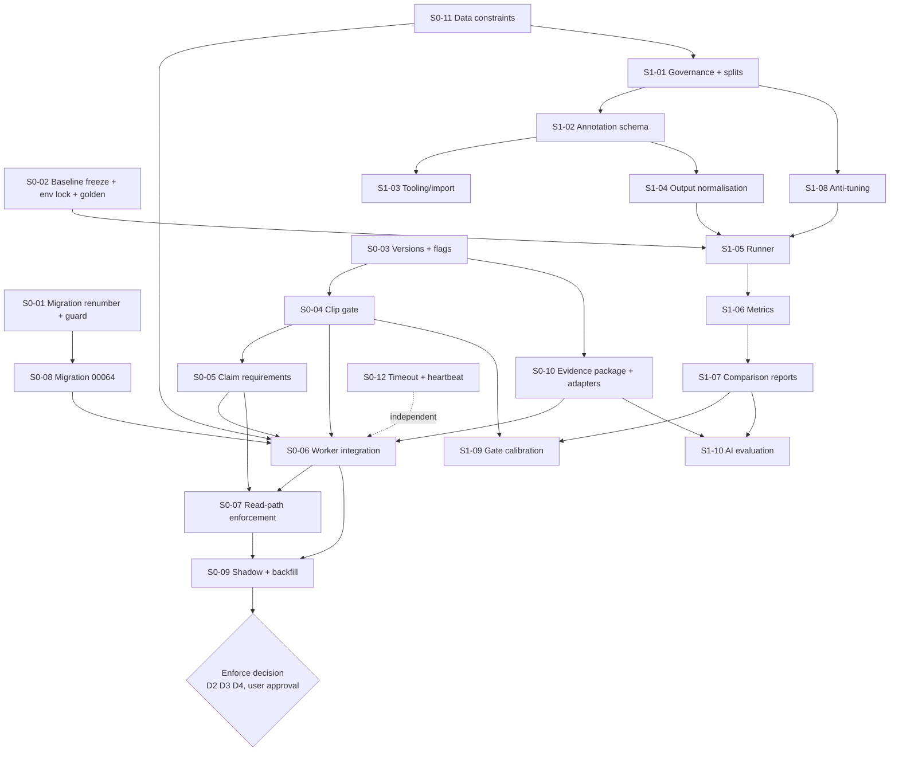

# HitterLoop Analysis Engine v2: Implementation Plan, Stages 0 and 1

- **Status:** Planning deliverable for independent architectural review. Nothing in this document has been implemented.
- **Date:** 2026-10-11
- **Repository state planned against:** `master` at `f79b09e` (pushed to `origin/master`), `package.json` `0.51.0`, working tree clean.
- **Inputs:** [`HITTERLOOP_FORENSIC_AUDIT.md`](HITTERLOOP_FORENSIC_AUDIT.md) (finding IDs `F-xx` below refer to it). The reviewer accepted Option B with eight refinements (R1-R8, Section 1).
- **Out of scope here:** any code, migration, deployment, or model change. Stages 2 and later (the CV replacements themselves) are referenced only where Stage 0/1 must prepare for them.

## Contents

1. Refinements and how this plan satisfies them
2. Current-state facts the plan depends on
3. Stage 0: Safety and baseline
4. Stage 1: Evaluation foundation
5. Dependency sequencing
6. Rollback strategy (consolidated)
7. Decisions required before implementation
8. Risks to the plan itself
9. Appendix A: proposed file map
10. Appendix B: Stage 1 exit criteria

---

## 1. Refinements and how this plan satisfies them

| # | Refinement | Where satisfied |
|---|---|---|
| R1 | Evidence quality determines whether a coaching claim can be displayed | S0-04, S0-05, S0-06, S0-07: a versioned, recorded, two-level (clip and claim) evidence gate, enforced in every parent-facing read path |
| R2 | 3D is not a prerequisite for visual-only reports | S0-04: the gate uses only 2D tracking, timing, and image-availability signals. `reconstruction_reliable`, `pose3d_coverage`, and all 3D angles are excluded from visual-claim eligibility. |
| R3 | Different claims may need different evidence | S0-05: per-concept `ClaimEvidenceRequirement` table, reusing the existing checkpoint evidence tiers (`semanticValidation.ts` `checkpointEvidence`) |
| R4 | Preserve the existing pipeline as a versioned baseline | S0-02 freezes `scripts/pose3d/` as engine `baseline-1.0.0` (tag, environment lock, model hashes, golden outputs). S1-05 runs it from a pinned worktree. |
| R5 | No new models before evaluation justifies them | Stages 0 and 1 add no model. The gate uses existing outputs only. Stage 1 produces the evidence for later model decisions. |
| R6 | Preserve original footage, accurate timestamps, provenance | S0-02, S0-08, S1-02: all ground truth and engine outputs are keyed to the **original file's presentation timestamps (PTS)** and SHA-256. Every run records engine, gate, prompt, and environment versions. |
| R7 | Multiple AI providers without coupling CV to one model | S0-10: provider-neutral `EvidencePackage` built by the engine; providers are adapters behind one `SwingReportProvider` interface |
| R8 | Reuse report schemas, consent controls, methodology | The gate wraps `assembleReport`/`shownFix`; `validateSwingAnalysisResult`, consent gates, `analysis_evidence_*` tables (00055), capture profiles (00056), and the methodology snapshot are reused unchanged |

---

## 2. Current-state facts the plan depends on

All facts were verified in source on `f79b09e`.

| Fact | Location | Consequence for the plan |
|---|---|---|
| Parent report gate = clip `ready` + LLM `confidence === "medium"` + `basis === "video"` | `supabase/functions/get-simplified-report/index.ts:366` (`qualityPassed: clip.status === "ready"`); `src/services/development/focus.ts` `shownFix`, `mechanicalFinding` | The gate must be injected here and in every other family/share path |
| Edge Functions import pure TS from `src/services/development/` | `get-simplified-report/index.ts:6-15` | A pure gate module there can be shared by the worker and the Edge Function, so the decision logic exists in one place |
| Clip is `readable` if any phase has a frame | `src/services/development/swingDetection.ts` | Gate must not rely on `readable` |
| AI receives images only; no metrics | `src/cli/analyze.ts:113-116` | Gate inputs come from pipeline JSON, not from the model |
| Batter-selection fallback is recorded | `scripts/pose3d/detect_2d.py` `build_batter_track` → `pose_2d.json.meta.bat_evidence.used_fallback` | Usable gate signal today |
| Contact confidence is recorded | `metrics.json.contact.confidence` (`metrics.py:914-931`) | Usable gate signal today |
| Per-clip quality JSON already stored | `video_clip_metrics.analysis_quality jsonb` (00026); computed by `src/services/db/analysisQuality.ts` | Stage 0 can store derived signals without a new column; the gate *decision* needs a run-scoped home (S0-08) |
| Run provenance exists | `analysis_runs`: `pipeline_version`, `prompt_version`, `analysis_policy_version`, `knowledge_version`, `input_manifest jsonb` (00028) | Extend, do not replace |
| Evidence packages, items, technical results, measurement definitions/validation decisions exist and are unused by reports | 00055 | Stage 1 calibration results and Stage 2 measurements land here |
| Capture profiles exist (game/backstop, open-side; catcher view disabled) | 00056 | Annotation `capture_profile` enum aligns with these slugs |
| No feature-flag system | — | Introduce a minimal, explicit one (S0-03) |
| Linked cloud project has migrations through 00054 applied | `NEXT_STEPS.md` ("Apply migrations 00041–00054 to the linked cloud Supabase project") | 00055-00062 are local-only; renumbering is safe for cloud |
| Two migrations share version `00062` | `00062_video_processing_progress.sql` (added `a38c99b`, 16:12) and `00062_approved_drill_library.sql` (added `f79b09e`, 18:51), both pushed | S0-01 |
| `00062_approved_drill_library.sql` sets `curation_status = 'approved'` for all 90 drills. Curator is the oldest `auth.users` row, or the fixed demo UUID `00000000-0000-4000-a000-000000000001`. | `00062_approved_drill_library.sql:12-17, 4579-4762` | [INFERENCE] This bypasses the human curation contract in `00054_drill_curation_gate.sql:35-36`. The trigger's `auth.role() <> 'service_role'` evaluates to NULL in migration context and does not raise. Approved drills appear in parent reports (`selectDrills`). Decision D1. |
| `claudeCliAnalyzer.ts` has no data-terms gate | F-21 | S0-11 |

---

## 3. Stage 0: Safety and baseline

**Goal:** no parent-facing coaching claim is shown unless the evidence it depends on passes a recorded, versioned gate. The current pipeline is frozen and reproducible as `baseline-1.0.0`. Historical reports stay readable under an explicit legacy policy.

**Non-goals:** fixing pipeline math (F-03, F-06, F-13), changing the prompt, or changing models. Those change engine behaviour and must be measured in Stage 1 first.

### S0-01: Resolve the duplicate `00062` migration numbering

**Facts:**
- Supabase CLI identifies a migration by its filename prefix before the first `_`. Both files have version `00062`.
- [INFERENCE, verify in T3] `supabase db reset` / `migration up` will fail or skip one file, because `supabase_migrations.schema_migrations.version` is the primary key.
- Neither file has been applied to the cloud project (cloud is at 00054).

**Decision:** keep `00062_video_processing_progress.sql` (earlier commit; already referenced by `src/services/db/uploadQueue.test.ts` behaviour and the `demo` schema). Renumber the drill migration.

**Tasks:**
1. Before changing anything, record the state of every local database that may have applied either file:
   ```sql
   select version, name from supabase_migrations.schema_migrations where version >= '00060' order by version;
   select count(*) from information_schema.columns where table_name='video_clips' and column_name='processing_progress';
   select curation_status, count(*) from public.drill_library group by 1;
   ```
2. `git mv supabase/migrations/00062_approved_drill_library.sql supabase/migrations/00063_approved_drill_library.sql`. Update the file's header comment and the references in `CHANGELOG.md` / `NEXT_STEPS.md`. Content changes depend on **Decision D1**. Recommended: rows insert as `curation_status = 'draft'`, with no `curated_at`/`curated_by`, so approval stays a human act through `npm run import-curated-drills -- --apply --curator-email <real reviewer>`, which records the actual reviewer.
3. Add a guard so this cannot recur. New `scripts/check-migration-versions.mjs` fails if two files under `supabase/migrations/` share a numeric prefix, or if a prefix is non-numeric. Append it to the `npm test` chain in `package.json`.
4. Local DB repair, by observed state:

| Observed local state | Action |
|---|---|
| `00062` recorded, `processing_progress` exists, drills not approved | None; the next `migration up` applies `00063` |
| `00062` recorded and the drill rows are present (drill file won) | Local only and disposable: `npx supabase db reset` (destroys local data; needs the user's go-ahead), **or** `supabase migration repair --status reverted 00062`, apply `00062_video_processing_progress.sql` manually, then `migration up` |
| Unknown or mixed | `db reset` on a disposable local stack |

**Acceptance tests:**
- T1: `node scripts/check-migration-versions.mjs` passes on the fixed tree and fails on a fixture directory containing two `00062_*` files (`scripts/check-migration-versions.test.mjs`).
- T2: `npx supabase db reset` on a clean local stack applies 00001-00063 with no error. `select version from supabase_migrations.schema_migrations` lists 00062 and 00063 exactly once.
- T3: Record the CLI's actual behaviour with the duplicate files on a scratch stack (confirms or refutes the inference above), in the PR description.
- T4: Under the recommended D1 option, `select count(*) from drill_library where curation_status='approved'` is 0 after reset, and the report shows no drills until a real curator approves.

**Rollback:** `git revert` of the rename commit. No cloud state is involved.

**Size:** S.

---

### S0-02: Freeze and reproduce the existing pipeline as `baseline-1.0.0`

**Facts:**
- `run_pipeline.py:68` stamps `pose3d-live-1.0.0`.
- There is no Python lockfile, VideoPose3D is cloned at HEAD, and weights are auto-downloaded without checksums (F-24).
- The repo itself measured batch-16 GPU inference changing keypoints by up to about 5 px on confident joints (`detect_2d.py:59-72`). Byte-identical reproduction is therefore **not** a realistic acceptance bar.

**Tasks:**

1. **Engine identity.** Define engine `baseline-1.0.0` = `scripts/pose3d/` at the tagged commit + `pose3d-live-1.0.0` metric contract + the environment lock below. Create an annotated git tag `engine-baseline-1.0.0` at the commit that lands S0-02 (tag creation needs user approval, since it is pushed to a public remote).

2. **Code freeze rule.** Record in `scripts/pose3d/README.md` and `AGENTS.md`: after the tag, `scripts/pose3d/` changes only for security or crash fixes, each bumping the baseline patch version (`baseline-1.0.1`). New engine work goes to `scripts/engine_v2/` (created in Stage 2, not here).

3. **Environment capture (no installs).** On the existing Windows GPU host where `.venv_pose3d` already works, capture:
   - `scripts/pose3d/environment/requirements.lock.txt` ← `.venv_pose3d/Scripts/python.exe -m pip freeze --all`
   - `scripts/pose3d/environment/models.lock.json`:
     ```json
     {
       "engine": "baseline-1.0.0",
       "weights": [
         {"path": "scripts/models/yolo11m-pose.pt", "sha256": "<captured>", "bytes": 0},
         {"path": "scripts/models/yolov8m.pt", "sha256": "<captured>", "bytes": 0},
         {"path": ".venv_pose3d/VideoPose3D_src/checkpoint/pretrained_h36m_detectron_coco.bin", "sha256": "<captured>", "bytes": 0}
       ],
       "repos": [{"path": ".venv_pose3d/VideoPose3D_src", "commit": "<git rev-parse HEAD>"}],
       "runtime": {"python": "<captured>", "torch": "<captured>", "cuda": "<captured>", "gpu": "<captured>", "os": "<captured>"}
     }
     ```
   - New `scripts/pose3d/environment/capture_environment.py` (stdlib + `torch` import only) produces this file. It is read-only with respect to the environment.

4. **Runtime provenance (additive, does not change outputs).** `run_pipeline.py` writes a new `engine_manifest.json` next to `metrics.json`. It contains the engine version, git SHA plus dirty flag, the `models.lock.json` hash, the actual weight hashes, the input file SHA-256, the decoded fps, the frame count, and the PTS-vs-`i/fps` maximum deviation (measured, not corrected).
   - Hash mismatch → `engine_manifest.json.integrity = "mismatch"`; the run still completes. Refusing to run is a Stage 2 choice once a hosted worker exists.
   - The worker copies the manifest into `analysis_runs.input_manifest.engine` (S0-08).

5. **Golden outputs (private).** Run baseline twice on each Stage-1 dev-split clip (S1-01; until those exist, the existing local clips with consent). Store under `$HITTERLOOP_EVAL_ROOT/golden/baseline-1.0.0/<clip_sha256>/`. The `$HITTERLOOP_EVAL_ROOT` location is outside the repo and private (see S0-11).

6. **Equivalence checker.** New `src/eval/golden/compareEngineOutputs.ts`, which compares two output directories within tolerances:
   - contact frame identical;
   - each located phase within ±1 frame;
   - per-keypoint median displacement ≤ 1 px and P99 ≤ 8 px on joints with confidence ≥ 0.5;
   - bat tip present/absent agreement ≥ 99%;
   - metrics within ±1% (or ±0.5° for angles).

   These tolerances are **provisional**. T2 measures run-to-run noise first and sets them at 2× the observed P99.

**Acceptance tests:**
- T1: `capture_environment.py` produces a schema-valid `models.lock.json` (JSON Schema at `scripts/pose3d/environment/models.lock.schema.json`, validated by `src/eval/golden/modelsLock.test.ts` against a synthetic sample).
- T2: Two consecutive baseline runs on ≥5 clips pass `compareEngineOutputs`. Record the observed noise in `docs/evaluation/baseline-determinism.md` (aggregate numbers only).
- T3: With S0-02 step 4 applied, outputs (`pose_2d.json`, `bat_path.json`, `pose_3d.json`, `metrics.json`) remain within tolerance of pre-change outputs on the same clips. This proves the provenance change is non-behavioural.
- T4: A fresh venv built only from `requirements.lock.txt` plus the hashed weights reproduces T2 within tolerance on the same host. **This is the reproducibility proof.** A second host is optional.

**Rollback:** delete `engine_manifest.json` writing (one function). The tag and lock files are inert.

**Size:** M (dominated by GPU-host access).

---

### S0-03: Analysis versions and feature flags

**Design principles:**
- Every stored analysis run says which engine, gate, and prompt produced it.
- Flags are read once per run and recorded, so behaviour is reconstructable.
- All new flags default to current behaviour.

**Version identifiers (string constants, one owner each):**

| Identifier | Owner file | Initial value | Bumped when |
|---|---|---|---|
| `ENGINE_VERSION` | `scripts/pose3d/run_pipeline.py` (baseline); `scripts/engine_v2/…` later | `baseline-1.0.0` (replaces the `pose3d-live-1.0.0` value; the old string is kept as `pipeline_version` alias) | Any change to CV outputs |
| `EVIDENCE_GATE_VERSION` | `src/services/development/evidenceGate.ts` | `gate-0.1.0` | Any threshold or rule change |
| `CLAIM_REQUIREMENTS_VERSION` | `src/services/development/claimEvidence.ts` | `claims-0.1.0` | Any concept requirement change |
| `PROMPT_VERSION` | existing `src/services/ai/analysisVersions.ts` | unchanged `policy-1.2+render-2.1` | Existing rule |
| `EVIDENCE_PACKAGE_VERSION` | `src/services/ai/evidencePackage.ts` (S0-10) | `evpkg-1.0.0` | Package shape change |

**Feature flags (environment variables, read in exactly one place):** new module `src/services/config/analysisFlags.ts`.

```ts
export type GateMode = "off" | "shadow" | "enforce";
export interface AnalysisFlags {
  /** Worker: compute and record the evidence assessment; in enforce mode skip the AI call when the clip-level gate fails. */
  evidenceGateMode: GateMode;               // EVIDENCE_GATE_MODE, default "off"
  /** Read path: how assembleReport treats runs. */
  reportGateMode: GateMode;                 // REPORT_EVIDENCE_GATE_MODE, default "off"
  /** Read path: runs with no recorded assessment (all historical runs). */
  legacyRunPolicy: "show_as_before" | "summary_only" | "withhold"; // REPORT_LEGACY_RUN_POLICY, default "show_as_before"
  /** Which engine the worker runs. Only "baseline-1.0.0" is valid in Stage 0. */
  engine: string;                           // ANALYSIS_ENGINE, default "baseline-1.0.0"
}
export function readAnalysisFlags(env: Record<string, string | undefined>): AnalysisFlags; // throws on unknown values (fail closed)
```

- Edge Functions read the same variables via `Deno.env.get`, through a tiny shim in `supabase/functions/_shared/analysisFlags.ts` that calls the pure parser (the same import pattern `get-simplified-report` already uses for `src/services/development/*`).
- **Rejected alternative:** `app_settings` rows. It is service-role-only (00018) and suitable, but it adds a DB read per report and a mutable, unaudited switch. Environment variables are deploy-time, visible in the deploy record, and require no migration.

**Mode semantics:**
- `off`: today's behaviour exactly.
- `shadow`: compute and record everything and change nothing user-visible. A log line and a recorded decision allow a "would withhold" rate to be measured.
- `enforce`: decisions apply.

**Historical reports.** A run with `evidence_assessment IS NULL` is "legacy" and is handled by `legacyRunPolicy`. Recommended progression (Decision D2):
1. Stay `show_as_before` during shadow.
2. Then backfill assessments for legacy runs whose pipeline outputs still exist on disk (S0-09).
3. Then move the remaining unassessable legacy runs to `summary_only` (strengths and summary visible, no fix, not counted toward focus).

**Acceptance tests:**
- `src/services/config/analysisFlags.test.ts`: defaults; every enum value; unknown values throw; whitespace and case handling.
- `supabase/tests/analysisFlags.test.ts` (Deno shim) returns identical parses to the Node parser for a table of inputs.

**Rollback:** unset variables. Defaults reproduce current behaviour.

**Size:** S.

---

### S0-04: Clip-level evidence assessment (pure module)

**New file:** `src/services/development/evidenceGate.ts`. It is pure (no I/O) and importable from Node and Deno.

```ts
export const EVIDENCE_GATE_VERSION = "gate-0.1.0";

/** Inputs are extracted from existing pipeline artifacts; no 3D field is accepted (R2). */
export interface ClipEvidenceSignals {
  engineVersion: string;
  /** detect_2d bat_evidence */
  batterSelection: { usedFallback: boolean; trackFrames: number; batEvidenceFrames: number };
  /** metrics.json */
  contact: { frame: number | null; confidence: "high" | "low" | null };
  phases: Partial<Record<PhaseSlug, { frame: number | null; confidence: "high" | "low" | null }>>;
  /** Computed from pose_2d.json over the swing window [load-0.1s, last phase+0.4s] (same window extract.ts uses) */
  swingWindow: {
    frames: number;
    batterTrackedFraction: number;      // frames with keypoints / frames
    identityJumpFraction: number;       // frames whose body centre jumps > MAX_JUMP * body height from the anchor (subjectBox.ts rule)
    coreKeypointFraction: number;       // frames with shoulders+hips >= 0.3 conf
    batDetectedFraction: number;        // bat_path frames with a tip
  } | null;
  /** extract.ts result */
  aiInputs: { phaseStills: string[]; zooms: string[]; sequenceFrames: number; sequenceSkipped: string | null };
  /** Capture assessment (00056), if available; informational in gate-0.1.0 */
  captureProfile: string | null;
}

export type ClipGateReason =
  | "batter_selection_fallback" | "contact_not_located" | "contact_low_confidence"
  | "batter_not_tracked_in_swing" | "possible_identity_switch" | "swing_window_unavailable"
  | "no_batter_crop" | "engine_unknown";

export interface ClipEvidenceDecision {
  gateVersion: string;
  /** "eligible": AI may run and its claims proceed to claim-level checks. "withhold": no coaching claim may be shown. */
  status: "eligible" | "withhold";
  reasons: ClipGateReason[];            // empty when eligible
  familyReason: "batter_unclear" | "swing_unclear" | null; // maps to plainFailureReason copy
  thresholds: Record<string, number>;   // the exact values applied, recorded for audit
  signals: ClipEvidenceSignals;         // recorded verbatim
}

export function assessClipEvidence(signals: ClipEvidenceSignals): ClipEvidenceDecision;
export function extractClipEvidenceSignals(args: {
  pose2d: unknown; batPath: unknown; metrics: unknown; aiInputs: ClipEvidenceSignals["aiInputs"]; captureProfile: string | null;
}): ClipEvidenceSignals;   // pure; parsing only
```

**gate-0.1.0 rules.** Values are provisional and conservative. Each is replaced by a Stage-1-calibrated value (S1-09), and none is claimed as validated.

| Rule | Withhold when | Rationale (audit ref) |
|---|---|---|
| G1 | `batterSelection.usedFallback` | F-09: the analysed person may not be the batter |
| G2 | `batEvidenceFrames < max(5, 0.02 * trackFrames)` | Same signal as `metrics.py:880-883` "likely framing issue" |
| G3 | `contact.frame == null` | Nothing anchors the stills |
| G4 | `contact.confidence !== "high"` | F-02: low-confidence contact currently flows to parents |
| G5 | `swingWindow == null` or `batterTrackedFraction < 0.9` | Stills or sequence may not show the batter |
| G6 | `identityJumpFraction > 0.05` | `subjectBox.ts:77-78` documents real identity jumps |
| G7 | `zooms` lacks `zoom_contact` | The batter could not be boxed at the anchor instant |
| G8 | `engineVersion` not in the gate's `SUPPORTED_ENGINES` list (`["baseline-1.0.0"]` in gate-0.1.0) → reason `engine_unknown` | Thresholds are only meaningful for the engine they were set on. A new engine must ship with its own gate version. |

**Explicitly not used (R2):** `reconstruction_reliable`, `pose3d_coverage`, any 3D angle, `analysis_quality.reconstruction`.

**Family-facing reasons:** G1/G2/G6/G7 → `batter_unclear` ("We couldn't find the batter clearly."). G3/G4/G5 → `swing_unclear`. Both reuse existing copy in `reportAssembly.ts` `plainFailureReason`.

**Acceptance tests** (`src/services/development/evidenceGate.test.ts`):
- One test per rule, plus combined reasons.
- Boundary values (exactly at threshold).
- Missing optional inputs fail closed (null signals → withhold with `swing_window_unavailable`).
- A 3D-only degradation (fixture with `pose3d_coverage: 0`, `reconstruction_reliable: false`) still passes. This is the R2 test.
- `extractClipEvidenceSignals` round-trips synthetic `pose_2d.json`/`bat_path.json`/`metrics.json` fixtures stored at `src/services/development/fixtures/evidence/*.json` (synthetic; no real child data).
- A determinism test: same input → identical decision object (stable reason ordering).

**Rollback:** module unused when both gate modes are `off`.

**Size:** M.

---

### S0-05: Claim-level evidence requirements

**New file:** `src/services/development/claimEvidence.ts`. It reuses the tier concept from `semanticValidation.ts` `checkpointEvidence` (R8).

```ts
export const CLAIM_REQUIREMENTS_VERSION = "claims-0.1.0";
export interface ClaimEvidenceRequirement {
  concept: Concept;
  /** Images that must have been supplied to the model for this claim to be shown. */
  requires: Array<"whole_swing_sequence" | `phase_still:${PhaseSlug}` | `zoom:${PhaseSlug}`>;
  /** Additional 2D visibility signals over the sequence window. */
  visibility?: { feetVisibleFraction?: number; headVisibleFraction?: number; batDetectedFraction?: number };
  /** Concepts not displayable in Stage 0 regardless of evidence. */
  stage0Displayable: boolean;
  rationale: string;
}
export const CLAIM_EVIDENCE: Record<Concept, ClaimEvidenceRequirement>;
export function assessClaim(concept: Concept, phase: PhaseSlug | null, clip: ClipEvidenceDecision): {
  displayable: boolean; reasons: string[]; requirementsVersion: string;
};
```

**Initial table.** This is a proposal for coach-methodology review (Decision D7). "Seq" means `whole_swing_sequence` (≥ `MIN_SWING_SEQUENCE_FRAMES` = 8).

| Concept | Requires | Visibility | Stage 0 displayable | Reason |
|---|---|---|---|---|
| `contact` | zoom:contact, phase_still:contact | — | yes | Contact is the only "high"-confidence phase |
| `extension` | Seq, zoom:extension | — | yes | Extension detector can be "high"; sequence corroborates |
| `load` | Seq | — | yes | Seen across the sequence, not one still |
| `stride_plant` | Seq | feet ≥ 0.8 | yes | Ankles must be visible |
| `hand_path` | Seq | bat ≥ 0.5 | yes | — |
| `barrel_path` | Seq | bat ≥ 0.5 | yes | — |
| `head_visual_stability` | Seq | head ≥ 0.8 | yes | — |
| `finish_balance` | Seq covering follow-through, or phase_still:follow_through | — | yes | — |
| `front_side_stability` | Seq | — | yes | — |
| `posture` | Seq | — | yes | — |
| `barrel_depth` | Seq | bat ≥ 0.5 | yes | — |
| `hip_shoulder_sequencing` | Seq | — | **no** | Depth-dominated from the backstop view (audit §6.4); revisit per capture profile in Stage 2 |
| `stance_setup` | phase_still:stance | — | **no** | `find_stance_frame` documents landing on unrelated moments (`metrics.py:620+`) |
| `timing` | — | — | **no** | Timing relative to the pitch is not visible without ball/pitch evidence |
| `swing_decision`, `pitch_location_adjustment`, `game_approach` | — | — | no (already non-mechanical in `focus.ts`) | Unchanged |

Visibility fractions are computed in `extractClipEvidenceSignals` from 2D keypoints (ankles 15/16, nose/eyes 0-2, conf ≥ 0.3) and `bat_path` over the sequence frames. These are 2D signals only (R2).

**Acceptance tests** (`claimEvidence.test.ts`):
- Every `Concept` in `CONCEPTS` has an entry (a compile-time exhaustive `Record` plus a runtime check).
- Each "no" concept is never displayable.
- Each requirement fails when its image is missing and passes when present.
- A clip-level `withhold` makes every claim non-displayable.

**Size:** S.

---

### S0-06: Worker integration (compute, record, minimise data sent)

**Changes:**
- `src/cli/processUploadQueue.ts`, after `extractAnalysisInputs` (currently `:348-357`):
  1. `signals = extractClipEvidenceSignals(...)` from the already-loaded `pose2d`, `bat_path.json`, `metrics`, the `inputs` result, and the capture assessment profile when available.
  2. `decision = assessClipEvidence(signals)`.
  3. Pass `decision` and `flags` into `analyzeAndSync` (new optional parameter, default `null`, so the CLI keeps working).
- `src/cli/analyze.ts` `analyzeAndSync`:
  - `evidenceGateMode === "enforce"` and `decision.status === "withhold"`: **do not call any provider**. Write an `analysis_runs` row with `backend = 'pose3d'` (allowed by the 00028 check), `summary = null`, `evidence_assessment = decision`, `gate_mode = 'enforce'`, and `input_manifest` built as today. Set `swing_detection_state = 'inconclusive'`. Enqueue the existing failure notification path so the family sees the plain reason.
    - This minimises child imagery sent to external providers, which is a privacy benefit as well as a cost one.
    - Decision D4 confirms whether a withheld clip should still be analysed for coach-only review.
  - Otherwise: call the provider as today. Persist `evidence_assessment = decision` and per-issue `claim_assessment = assessClaim(...)` (S0-08).
  - `reportHasShownFix(freshIssues)` in the notification must use the **gated** result, so "your report has a fix" is never sent for a withheld fix.
  - `refreshPlayerFocus` (`src/services/development/focusRepository.ts` → `focusPersistence.ts`) must count only claim-displayable findings when `reportGateMode !== "off"`, so withheld findings never drive focus or progress.
- Record `flags` (all four values) in `analysis_runs.input_manifest.flags`.

**Acceptance tests:**
- `src/cli/processUploadQueue.test.ts`: a fake provider records whether it was called. Cases:
  - enforce + withhold → not called;
  - shadow + withhold → called and recorded;
  - off → called, no assessment written.
- `src/services/db/developmentFlows.test.ts` (existing suite; real local DB): a withheld run creates no `issues`, has `summary null`, does not change `player_focus`, and enqueues no "report ready with fix" notification.
- `src/services/notifications/outbox.test.ts`: the shown-fix flag follows the gated decision.

**Rollback:** `EVIDENCE_GATE_MODE=off`.

**Size:** M.

---

### S0-07: Read-path enforcement on every parent-facing surface

**Surfaces to change** (each must apply the identical decision; a parity test enforces this):

| Surface | File | Change |
|---|---|---|
| Simplified at-bat report | `supabase/functions/get-simplified-report/index.ts` (`qualityPassed` at `:366`; issue select at `:193-195`) | Select `analysis_runs.evidence_assessment, gate_mode` and `issues.claim_assessment`; pass to `assembleReport` |
| Report assembly | `src/services/development/reportAssembly.ts` `assembleReport` | New input `evidence: { run: ClipEvidenceDecision \| null; claims: Map<issueId, ClaimDecision> }` + `flags`. `withhold` → `state: "unreadable"` with `familyReason`. Fix eligible only if `shownFix` **and** claim displayable. Legacy → `legacyRunPolicy`. |
| Feed headline | `reportAssembly.ts` `feedAnalysisPresentation` | Withheld → `unreadable` |
| Focus / progress | `src/services/development/focus.ts` `mechanicalFinding` callers in the Edge Function (`:209-227`) | Add `displayable` to `Finding`; `mechanicalFinding` requires it when `reportGateMode === "enforce"` |
| Shared links | `src/services/development/sharedSimplePayload.ts` | Uses `assembleReport` output; parity test only |
| Practice progress ("seen X of last Y") | `src/services/development/progressPractice.ts` `practiceEvidence`, called from `get-simplified-report/index.ts:244-255` | [FACT] Counts practice issues using only `hasReportEvidence`/`hasIssueEvidence`, basis, review status, and context flags. There is no confidence filter and no gate. Add `claim_assessment` and run `evidence_assessment` to the selects. Count a practice clip as readable only if its run is eligible, and count a concept only if the claim is displayable (enforce mode). Same legacy policy. |
| Notifications | `src/services/notifications/outbox.ts` `buildNotificationDeliveries` (`reportHasFix`, `focusConcept`/`focusStatus`) | `reportHasFix` is set at enqueue time (S0-06 makes it gated). Focus notifications derive from `player_focus`, which S0-06 makes gate-aware. Add an outbox test: a withheld run enqueues `analysis_failed` copy, never "1 thing to work on". |
| Family report | `supabase/functions/get-family-report/index.ts`, `supabase/functions/_shared/familyReport.ts` | [FACT] It shows "coach-reviewed findings only (issues approved/edited; drafts…excluded)" (`familyReport.ts:24`), so AI drafts do not reach it directly. Add a regression test asserting a draft issue never appears, and leave the logic as is. A coach approving a finding is an explicit human override of the gate; record this as accepted behaviour. |
| Legacy player report / share | `supabase/functions/get-player-report/*` | Audit; apply or confirm it is coach-only |
| Demo report | `supabase/functions/get-demo-player-report/index.ts` | Demo fixtures have no assessment → `legacyRunPolicy` must be `show_as_before` for the `demo` schema, or the public demo breaks. Tested explicitly. |

**Acceptance tests:**
- `src/services/development/reportAssembly.test.ts` (extend the existing test): eligible+displayable shows the fix; eligible+non-displayable shows summary and strengths with no fix; withhold → unreadable with the right reason; each legacy policy; `off` mode reproduces current output exactly (golden JSON comparison against the current implementation).
- `supabase/tests/evidenceGateParity.test.ts`: the same seeded run through `get-simplified-report`, shared-link payload, and family report yields the same fix/no-fix decision.
- `supabase/demo/demo.test.ts` still passes unchanged.
- **Visual QA:** a rendered check of the withheld state on `coach/simple.html` at mobile width (Gemini/AGY visual QA path, or **MANUAL VISUAL QA REQUIRED** if unavailable).

**Rollback:** `REPORT_EVIDENCE_GATE_MODE=off`, which reproduces current output (proven by the golden comparison test).

**Size:** M.

---

### S0-08: Schema additions (new migration, additive)

**File:** `supabase/migrations/00064_analysis_engine_versioning.sql`. The number follows S0-01's 00063.

```sql
alter table public.analysis_runs
  add column engine_version text,                 -- null = legacy (pre-v2 provenance)
  add column evidence_gate_version text,
  add column evidence_assessment jsonb
    check (evidence_assessment is null or jsonb_typeof(evidence_assessment) = 'object'),
  add column gate_mode text check (gate_mode is null or gate_mode in ('off','shadow','enforce')),
  add column provider_usage jsonb                 -- tokens/bytes/latency when the provider reports them (S0-10)
    check (provider_usage is null or jsonb_typeof(provider_usage) = 'object');
alter table public.issues
  add column claim_assessment jsonb
    check (claim_assessment is null or jsonb_typeof(claim_assessment) = 'object');
-- demo schema mirror: same nullable columns on demo.analysis_runs / demo.issues (00049 compatibility pattern)
```

**Rules:**
- All columns are nullable, with no backfill in the migration. Existing RLS policies cover the new columns, because these are new columns on existing tables.
- The service role writes them.
- Confirm that no guardian-readable projection exposes `evidence_assessment.signals`. Signals are technical; families see only `familyReason`.

**Acceptance tests:**
- `supabase/tests/engineVersioning.smoke.sql` (pattern of `simplifiedFoundations.smoke.sql`): columns exist; check constraints reject a non-object JSON; a guardian JWT cannot select `evidence_assessment` through any exposed view or RPC.
- `npm run test:demo-real-fixture` still passes (demo compatibility).

**Rollback:** the columns are additive and unused when flags are off. A down-migration is not needed. If required, a later migration drops them; no data depends on them while the flags are off.

**Size:** S.

---

### S0-09: Shadow measurement and legacy backfill

**New CLI:** `src/cli/backfillEvidenceAssessment.ts` (`npm run backfill-evidence-assessment -- --dry-run|--apply`). Pattern of `backfillSwingAttempts.ts` (dry-run first, idempotent).

For each `analysis_runs` row with `evidence_assessment is null`:
1. If `frames/<player>/<clip>/` still has `pose_2d.json`, `bat_path.json`, `metrics.json` and `phase_stills/`, compute the decision and write it with `gate_mode = 'shadow'` and `input_manifest.backfilled = true`.
2. Otherwise leave it null (stays legacy).

**Shadow report.** `src/cli/evidenceGateReport.ts` prints aggregate counts: runs assessed, withhold rate by reason, fixes that would disappear, and players whose focus would change. Output is aggregate only; no names. Run it before switching any read path to `enforce`.

**Acceptance tests:**
- Dry-run writes nothing (row counts before and after).
- Apply is idempotent (a second run updates 0 rows).
- Missing files never produce a decision.

**Gate to `enforce`.** Recommended criteria for the reviewer to confirm:
- shadow has run on all available local runs;
- the withhold rate and the "fix disappears" list have been reviewed by the product owner;
- a sample of ≥20 withheld and ≥20 passed clips has been eyeballed against the original video to confirm the reasons are real.

**Size:** S.

---

### S0-10: Provider-neutral evidence package and provider adapter boundary (no behaviour change)

**New file:** `src/services/ai/evidencePackage.ts`:

```ts
export const EVIDENCE_PACKAGE_VERSION = "evpkg-1.0.0";
export interface EvidenceImage {
  name: string;                      // e.g. "phase_contact.png"
  kind: "phase_still" | "zoom" | "swing_sequence";
  phase: PhaseSlug | null;
  sourcePtsS: number;                // original-file presentation timestamp (R6)
  sourceFrameIndex: number;          // raw presentation-order index
  orderInSwing: number;              // temporal rank across all images
  sha256: string;
  mimeType: "image/png" | "image/jpeg";
  path: string;                      // local path; adapters decide how to transmit
}
export interface EvidencePackage {
  version: string;
  engineVersion: string;
  clipSha256: string;
  images: EvidenceImage[];
  captureProfile: string | null;
  clipDecision: ClipEvidenceDecision;
  analysisInput: AnalysisInput;      // existing type (analysisContext.ts), unchanged
}
export interface ProviderResult { raw: unknown; model: string; modelVersion: string | null; usage: ProviderUsage | null }
export interface ProviderUsage { inputTokens?: number; outputTokens?: number; requestBytes?: number; latencyMs: number }
export interface SwingReportProvider {
  readonly id: "gemini" | "claude-cli" | "agy-cli" | string;
  /** Renders the package in the provider's own format; must not reorder or drop images silently. */
  analyze(pkg: EvidencePackage, render: PromptRenderer): Promise<ProviderResult>;
}
export type PromptRenderer = (pkg: EvidencePackage) => { text: string; imageOrder: string[] };
```

**Tasks:**
1. `extractAnalysisInputs` (`src/cli/extract.ts`) additionally returns the per-image PTS and raw index it already computes (`rawIndex`, `pts`), so the package can carry them. No change to the files written.
2. Wrap the three existing backends as `SwingReportProvider` adapters in `src/services/ai/providers/{gemini,claudeCli,agyCli}.ts`. **Baseline renderer `render-2.1` keeps today's alphabetical order and prompt text byte-for-byte**, so no report behaviour changes.
3. `validateSwingAnalysisResult` stays provider-independent and unchanged.
4. Record `usage` into `analysis_runs.provider_usage`. For Gemini, read `response.usageMetadata` (currently ignored, F-16) and the request byte count. Temperature stays unset in `render-2.1` (changing it is a behavioural change evaluated in S1-10).
5. Prepare, **but do not enable**, `render-2.2`: temporally ordered images with an interleaved text label (name, phase, PTS) before each image (F-10). It is selectable only by `PROMPT_RENDER_VERSION` and evaluated in S1-10 before any default change.

**Acceptance tests:**
- `src/services/ai/providers/gemini.test.ts`: with `render-2.1`, the `contents` array passed to a fake client is deep-equal to today's `analyzeSwing` output for the same inputs (golden). Usage is captured when present and null otherwise.
- `evidencePackage.test.ts`: `orderInSwing` is strictly increasing in PTS; a package with a missing PTS is rejected.
- Existing `geminiAnalyzer.test.ts`, `claudeCliAnalyzer.test.ts`, and `agyCliAnalyzer.test.ts` pass unchanged.

**Rollback:** adapters are a refactor behind the same entry points. Revert the commit.

**Size:** M.

---

### S0-11: Security and child-video data-handling constraints

These are binding constraints for every Stage 0/1 task.

| # | Constraint | Implementation |
|---|---|---|
| C1 | No child video, still, keypoint file, or annotation in the git repository, CI logs, or PR text | `.gitignore` additions: `eval-data/`, `eval-results/`, `**/golden/`. A new `scripts/check-no-media.mjs` in `npm test` fails if tracked files under `src/`, `scripts/`, `docs/`, `eval/` match media extensions (`.mp4 .mov .m4v .webm .png .jpg .jpeg`) outside an allowlist (`coach/icons`, `coach/illustrations`, `docs/design/simplified-app`, `mobile/android/app/src/main/res`). Fixtures are synthetic JSON only. |
| C2 | Evaluation data lives outside production storage | `HITTERLOOP_EVAL_ROOT` (local encrypted volume) and a separate private GCS bucket in a separate GCP project, if cloud is used (S1-01). The production bucket and Supabase project are never read by the benchmark runner. |
| C3 | Every external-AI path that can receive child imagery has an explicit data-terms gate | Add `CLAUDE_CLI_DATA_CONFIRMED === "true"` to `claudeCliAnalyzer.ts`, mirroring `requireAgyDataConfirmation` (F-21). Test in `claudeCliAnalyzer.test.ts`. |
| C4 | Enforce-mode withholding means fewer images leave the device | S0-06 skips the provider call on `withhold` |
| C5 | Logs never contain child names, signed URLs, or raw provider payloads | Review new log lines in S0-06/S0-09. Existing key redaction (`geminiAnalyzer.ts` `redactKey`) is reused for usage logging. |
| C6 | Derived local artifacts follow deletion | `purgeDeletedClips` already purges `frames/<player>/<clip>/`. Extend it to delete `engine_manifest.json` (already inside that directory) and any S0-09 backfill outputs. The eval store has its own deletion procedure (S1-01). |
| C7 | Evidence assessment signals are staff/technical only | S0-08 RLS check; families receive only `familyReason` |
| C8 | Production data never enters evaluation automatically | S1-01 consent path is the only route |
| C9 | No new model download or install in Stage 0/1 | Environment capture is read-only (S0-02) |

**Size:** S.

---

### S0-12 (recommended, small): Worker robustness fixes that do not change analysis output

- Subprocess timeout for `run_pipeline.py`: `POSE3D_TIMEOUT_MS`, default 30 min. On timeout, kill and `markClipFailed` (F-19).
- Heartbeat: `markClipProgress` also refreshes `claimed_at` (`src/services/db/uploadQueue.ts:96-99`), so a long run is not reclaimed after 15 minutes.
- Tests in `uploadQueue.test.ts` (real DB): progress refreshes `claimed_at`; a stale claim is still reclaimable when no heartbeat arrives.

**Rollback:** revert; independent of the gate.

**Size:** S.

---

### Stage 0 exit criteria

1. S0-01 merged; `npm test` includes the migration-version guard; local reset is clean.
2. Baseline tag and environment lock captured; T4 reproducibility proven on the GPU host.
3. Gate modules, worker, and read-path changes merged with all flags `off`. The `off`-mode golden test proves zero behaviour change.
4. Shadow mode run; shadow report reviewed by the product owner (D2, D3, D4 decided).
5. `REPORT_EVIDENCE_GATE_MODE=enforce` and `EVIDENCE_GATE_MODE=enforce` set for the local/release environment by explicit user approval. Visual QA of withheld states done.
6. Gemini adversarial review of the Stage 0 diff, focused on fail-closed behaviour and parity across surfaces, completed and reconciled.

---

## 4. Stage 1: Evaluation foundation

**Goal:** a consented, private, versioned evaluation set and a reproducible benchmark that measure the baseline engine and the AI report layer. Its numbers decide every Stage 2 change.

### S1-01: Data governance, sourcing, and splits

**Sources, in order of preference:**
1. **Purpose-recorded evaluation clips.** Record these with a dedicated evaluation consent (Decision D5), covering: annotation by named annotators, retention period, use for benchmarking, whether images may be sent to named external AI providers for AI-layer evaluation, and withdrawal.
2. **Production clips only by explicit, per-clip guardian opt-in.**
   - They are copied into the eval store under a new opaque ID.
   - The linkage (production clip ID ↔ eval ID) is held only in a private register for deletion propagation.
   - **Never automatic.** No code path in the worker or Edge Functions writes to the eval store.
3. **Licensed or public footage** with documented licence. Use it for the dev split only, because its capture distribution differs from the product's.

**Storage layout** (outside the repo; `HITTERLOOP_EVAL_ROOT`):

```
$HITTERLOOP_EVAL_ROOT/
  registry/clips.jsonl            # dev + validation only: eval_id, sha256, split, athlete_group, consent_ref, source_class, capture fields; plus salted test-membership hashes
  registry/consent/<consent_ref>.json   # pointer + scope only; signed artefact stored per D5
  media/<eval_id>.<ext>           # dev + validation originals, never re-encoded
  annotations/<schema_version>/<eval_id>/<annotator_id>.json
  annotations/<schema_version>/<eval_id>/adjudicated.json
  sealed/test-split.tar.age       # test media + annotations + test registry, encrypted (S1-08)
  sealed/results/<run_id>.tar.age # per-clip test results, encrypted (S1-08)
  golden/<engine_version>/<eval_id>/...
  results/<run_id>/...
```

**Splits:**
- Split by **athlete group**, not by clip. `athlete_group` is an opaque ID per athlete, so one child's swings never span splits. Where possible, group by team and game day too, to prevent background or camera leakage.
- Proportions: **dev 50% / validation 20% / test 30%** by athlete group, stratified by sport, capture profile, and age band.
- **Contamination rule:** every athlete whose clips were used to tune baseline thresholds is assigned to **dev only**, never validation or test. Per the audit, that is at least the athlete in the `Emily_C_*` clips and any other clip referenced in `scripts/pose3d/*.py` comments.
- **Minimum targets** (planning numbers, not validated): first tranche 30 swings / 10 athletes (all dev+validation), then ≥150 swings / ≥30 athletes with ≥40 test swings. Include both sports, ages 8-18, L and R batters, backstop and open-side profiles, ≥2 phone models, ≥1 non-30 fps source, and ≥10 non-swing clips (takes, walk-ups) for false-positive measurement.

**Deletion:** guardian withdrawal → remove media and annotations, mark the registry line `withdrawn`, and re-run affected aggregate reports. Results files reference `eval_id` only.

**Acceptance tests:**
- `src/eval/registry/registry.test.ts`: schema validation; no `eval_id` appears in two splits; no `athlete_group` spans two splits; contaminated athletes are dev-only; the split assignment is deterministic from a recorded seed and stable when new clips are appended.

**Size:** M (process-heavy; consent drafting needs the user and possibly counsel).

---

### S1-02: Annotation schema

**Files:**
- `eval/schema/annotation.v1.schema.json` (JSON Schema 2020-12, committed)
- `src/eval/schema/annotation.ts` (TS types + validator)
- `eval/ANNOTATION_GUIDE.md` (definitions, with synthetic diagrams only)

**Design rules:**
- **Timebase is the original file** (R6). Every temporal label carries `frame` (raw presentation-order index) **and** `pts_s` (from `ffprobe`, as `extract.ts` `probePts` does). `frame_index_basis: "presentation_order_v1"` is recorded. Engine outputs are mapped into this timebase through `src/services/pose3d/analysisWindow.ts` `rawFrameIndices` before scoring.
- **Uncertainty is first-class.** Every label has a `status` of `labeled | not_visible | ambiguous | not_applicable`, plus `uncertainty_frames` where meaningful. `ambiguous` and `not_visible` labels are excluded from accuracy denominators but counted in coverage and abstention metrics.
- **No free-text personal data.** Annotator identity is a pseudonymous `annotator_id`.

**Schema (abridged; full JSON Schema in the file):**

```ts
interface ClipAnnotation {
  schema_version: "annotation-1.0.0";
  eval_id: string;
  source_sha256: string;                 // must equal registry
  annotator_id: string; tool: { name: string; version: string }; created_at: string;
  review: { status: "draft" | "reviewed" | "adjudicated"; reviewer_id?: string };
  media: { width: number; height: number; fps_nominal: number; pts_s: number[]; vfr_max_dev_ms: number; rotation_deg: 0|90|180|270 };
  capture: {
    profile: "game_backstop" | "open_side" | "closed_side" | "catcher_view" | "other"; // aligns with 00056 capture_profiles slugs where they exist
    camera_height: "below_waist" | "waist_chest" | "head" | "elevated" | "unknown";
    distance_band: "lt_5m" | "5_10m" | "10_20m" | "gt_20m" | "unknown";
    obstruction: Array<"fence" | "net" | "glass" | "people" | "none">;
    stabilisation: "tripod" | "handheld" | "unknown";
    lighting: "day" | "dusk" | "night_lights" | "indoor" | "unknown";
    batter_height_frac_median: number | null;   // annotator-measured box height / frame height
  };
  athlete: { sport: "softball" | "baseball"; age_band: AgeBand; bats: "L" | "R" | "S" | "unknown" };
  persons: PersonTrack[];               // batter required; others optional
  swings: SwingAnnotation[];            // zero for a no-swing clip
  clip_flags: Array<"no_swing" | "multiple_swings" | "batter_leaves_frame" | "camera_moves" | "zoom_change">;
  notes?: string;                       // technical only
}
interface PersonTrack {
  track_id: string; role: "batter" | "catcher" | "umpire" | "on_deck" | "fielder" | "other";
  boxes: Array<{ frame: number; pts_s: number; xyxy: [number, number, number, number]; status: LabelStatus; occlusion: "none" | "partial" | "heavy" }>;
  // batter: every 5th raw frame in each swing window [stance_set-0.5s, finish+0.5s] and on every event frame; others: same frames when visible
}
interface SwingAnnotation {
  swing_id: string;
  intent: "conventional_full" | "slap" | "power_slap" | "bunt" | "drag_bunt" | "checked_protective" | "take" | "unknown"; // 00055 intents
  batting_side_observed: "L" | "R" | "unknown";       // ground truth for lead-side (audit F-07)
  outcome_visible: "contact_fair" | "contact_foul" | "miss" | "unknown";
  events: Record<SwingEventSlug, EventLabel>;
  bat: Array<BatLabel>;                                // dense from swing_launch-0.2s to contact+0.2s; every 3rd frame elsewhere in window
  keypoints: Array<KeypointLabel>;                     // on each event frame (+/-1 frame for contact)
  coach_observations?: CoachObservation[];             // S1-10, separate annotator pool
}
type SwingEventSlug = "stance_set" | "load_start" | "stride_foot_lift" | "foot_plant" | "swing_launch" | "contact" | "finish";
interface EventLabel {
  status: LabelStatus; frame?: number; pts_s?: number;
  uncertainty_frames?: number;            // half-width of plausible range
  evidence: Array<"visual_ball_bat" | "visual_body" | "audio" | "inferred_from_neighbours">;
  window?: { start_frame: number; end_frame: number };   // when only a range is defensible (e.g. contact hidden)
}
interface BatLabel {
  frame: number; pts_s: number;
  knob: Point | null; barrel_end: Point | null;           // null + status when not visible
  knob_status: LabelStatus; barrel_status: LabelStatus;
  blur: "none" | "moderate" | "smear";
  smear_polygon?: Array<[number, number]>;               // when blur = "smear"
}
interface KeypointLabel {
  frame: number; pts_s: number;
  coco17: Array<{ x: number; y: number; v: 0 | 1 | 2; status: LabelStatus }>; // COCO visibility semantics + status
}
interface CoachObservation {
  observer_id: string; concept: Concept; phase: PhaseSlug | null;
  verdict: "present" | "absent" | "cannot_tell"; evidence_frames: number[]; confidence: "low" | "medium" | "high";
}
type LabelStatus = "labeled" | "not_visible" | "ambiguous" | "not_applicable";
type Point = { x: number; y: number };
```

**Event definitions** (in `ANNOTATION_GUIDE.md`, binding):

| Event | Definition |
|---|---|
| `stance_set` | Last frame before any load movement once the batter is set in the box for this pitch |
| `load_start` | First frame of rearward hand or weight shift. Frequently `ambiguous`, which is allowed. |
| `stride_foot_lift` | First frame the front foot visibly leaves the ground or begins its stride slide |
| `foot_plant` | First frame the front foot's weight-bearing contact is re-established (toe or heel; record which in `evidence`) |
| `swing_launch` | First frame the hands move toward the pitcher / the barrel starts forward |
| `contact` | Ball-bat contact frame. If the ball is not visible, `window` from audio or neighbours with `evidence`. Misses use `not_applicable`. |
| `finish` | First frame of stable post-swing posture |

**Inter-annotator agreement (IAA):**
- 20% of swings are double-annotated.
- Report the event-timing absolute difference (ms), bat endpoint distance normalised by bat length, keypoint OKS, and batter-box IoU.
- Labels whose IAA exceeds the protocol tolerance go to adjudication.
- IAA bounds the best achievable error and is reported next to every engine metric.

**Acceptance tests:**
- `src/eval/schema/annotation.test.ts`: the validator accepts synthetic valid annotations and rejects every malformed case (missing PTS, frame/PTS mismatch with `media.pts_s`, `labeled` without coordinates, `swing` events out of order without an `ambiguous` flag, unknown enum).
- `eval/schema/examples/*.json` (synthetic, no real media) validate.

**Size:** M.

---

### S1-03: Annotation tooling and import

- **Decision D6:** self-hosted CVAT (open source, supports keypoints/skeletons and tracks; a new install requires approval) or a minimal custom labeller.
- The plan is tool-agnostic. `src/eval/import/fromCvat.ts` (or `fromCustom.ts`) converts exports into `ClipAnnotation`. It attaches `pts_s` from `ffprobe` on the eval original (reusing the `probePts` logic, factored from `src/cli/extract.ts` into `src/services/media/pts.ts`) and validates against the schema.
- Annotators work on original files only (no re-encode), so frame indices match.

**Acceptance tests:**
- The importer test uses a synthetic CVAT XML/JSON sample with known values and round-trips exactly.
- A PTS mismatch (annotation frame count ≠ file frame count) fails loudly.

**Size:** M.

---

### S1-04: Engine output normalisation

`src/eval/normalize/engineObservations.ts` maps any engine's outputs into one shape keyed on the original timebase:

```ts
interface EngineObservations {
  engineVersion: string; evalId: string; sourceSha256: string;
  batterBoxes: Array<{ frame: number; xyxy: [number, number, number, number] | null; trackId: string | null }>;
  keypoints: Array<{ frame: number; coco17: Array<{ x: number; y: number; conf: number }> | null }>;
  bat: Array<{ frame: number; knob: Point | null; tip: Point | null; conf: number | null }>;
  events: Partial<Record<SwingEventSlug, { frame: number | null; confidence: string | null; method: string }>>;
  leadSide: "l" | "r" | null;
  gate: ClipEvidenceDecision | null;    // from S0-04 applied to this engine's outputs
  failures: Array<{ stage: string; kind: FailureKind; detail: string }>;
  timing: { wallMs: number; perStageMs: Record<string, number> };
}
```

Baseline mapping:
- Analysed frame → raw frame via `analysisWindowForClipDir` and `rawFrameIndices`.
- Batter box from the `pose_2d.json` keypoint bbox (the same rule as `detect_2d.bbox_from_kps`).
- Bat `tip`/`knob` taken as-is.
- Events: `stance` → `stance_set`, `load` → `load_start`, `stride` → `foot_plant` (baseline's stride phase is the plant), `contact` → `contact`, `follow_through` → `finish`. Baseline has no `swing_launch`/`stride_foot_lift` → reported as "not produced" (coverage 0), never imputed.

**Acceptance tests:** a synthetic baseline output directory with known trims and decimation maps to the expected raw frames. An unmappable window yields an explicit failure, not a guess (mirrors `analysisWindowFor` fail-closed).

**Size:** M.

---

### S1-05: Reproducible benchmark runner

**CLI:** `src/eval/runBenchmark.ts` → `npm run eval:run -- --engine baseline-1.0.0 --split dev [--repeat 2] [--clips <ids>]`.

**Run procedure:**

1. **Preflight (fail closed):**
   - the git tree is clean (or `--allow-dirty` on dev only, recorded);
   - the engine worktree exists at the engine's tag: `git worktree add $EVAL_ROOT/worktrees/<engine> engine-<engine>`;
   - the venv matches `requirements.lock.txt` (via `pip freeze` diff) and the weights match `models.lock.json` hashes;
   - the eval registry and annotations validate;
   - `--split test` requires `--release-candidate` (S1-08).
2. **Execution:** for each clip, call `EngineAdapter.run(evalOriginalPath, workDir)`. `BaselineAdapter` spawns the worktree's `scripts/pose3d/run_pipeline.py`, exactly as `processUploadQueue.ts` `runPipeline` does: `pipeline_status.json` contract and `PYTHONUNBUFFERED`.
3. **Cache key:** `sha256(source_sha256 + engine_version + models.lock hash + requirements.lock hash + config hash)`. A cache hit reuses outputs; `--no-cache` forces execution.
4. **Normalise (S1-04), then score (S1-06).** Scoring is pure and needs no GPU, so scoring changes can be re-run without re-inference.
5. **Write** `$EVAL_ROOT/results/<run_id>/`:
   - `run.json`: run_id (ULID), git SHA, engine, split, clip list hash, lock hashes, hardware, start/end, runner version;
   - `per_clip.jsonl`: private;
   - `metrics.json`: aggregate;
   - `report.md`: aggregate (S1-07);
   - `failures.jsonl`: private.
6. **Determinism:** `--repeat N` runs the engine N times and reports run-to-run variance per metric, using the S0-02 tolerances.

```ts
export interface EngineAdapter {
  readonly engineVersion: string;
  preflight(): Promise<void>;                                  // lock and hash checks
  run(input: { evalId: string; path: string; sha256: string }, workDir: string): Promise<EngineRunArtifacts>;
  normalize(artifacts: EngineRunArtifacts, media: ClipAnnotation["media"]): EngineObservations;
}
```

**AI-layer runs** (S1-10) are a separate command, `npm run eval:ai`, because they send images to providers and need consent scope C3/D5. It refuses clips whose consent scope excludes external AI.

**Acceptance tests:**
- `src/eval/runBenchmark.test.ts` with a `FakeEngineAdapter` and synthetic annotations: the cache key changes when any lock hash changes; a dirty tree is refused; test split without a release candidate is refused; results contain no media paths or names (a regex check on outputs).
- An end-to-end smoke run on ≥3 dev clips on the GPU host produces `report.md`.

**Size:** L.

---

### S1-06: Metrics

All metrics are computed per clip, then aggregated with **athlete-cluster bootstrap 95% confidence intervals** (resampling athlete groups, 2,000 replicates, seed recorded). Every metric is reported **overall and by slice**: capture profile, sport, age band, fps band, batter size band, blur level. Each metric is reported with its IAA reference.

**Accuracy:**

| Area | Metric | Definition |
|---|---|---|
| Batter identity | Batter-frame precision / recall | Engine batter box IoU ≥ 0.5 with the GT batter box, over GT-labelled frames |
| | Wrong-athlete clip rate | Clips where the engine's batter track overlaps a non-batter GT track (IoU ≥ 0.5) in > 50% of matched frames |
| | Identity switches | Count of GT-batter frames whose matched engine track ID changes |
| | Fallback precision | Among clips where `used_fallback = true`: rate the batter is still correct |
| Bat | Endpoint error | `‖pred − gt‖ / L_gt` per endpoint, with `L_gt = ‖knob − barrel_end‖`; median, P90 |
| | Endpoint swap rate | Frames where the swapped assignment has lower total error |
| | PCK-bat@0.1, @0.2 | Fraction of endpoints within 0.1/0.2 · L_gt |
| | Bat angle error | `min(|θp − θg| mod 180, 180 − …)` in degrees (image plane) |
| | Recall by blur and speed | Detection rate stratified by `blur` and GT barrel speed tercile (speed from GT finite differences on PTS) |
| Events | Timing error | `|t_pred − t_gt|` in ms using PTS. For window labels, distance to the window (0 inside). Median, P90, and hit rates within ±1 frame, ±33 ms, ±66 ms |
| | Event detection rate | Engine produced the event / GT labelled it |
| | False contact rate | Contact produced on clips with `no_swing`, or on `take` swings |
| | Order violations | Produced events out of physical order |
| Keypoints | PCK@0.2 torso, OKS-AP | Per joint and per event phase; COCO OKS sigmas |
| | Left/right swap rate | Frames where swapping L/R reduces error by > 50% |
| Lead side | Accuracy | `leadSide` vs `batting_side_observed` (F-07) |
| Timebase | VFR deviation | `max |pts_i − i/fps|` per clip (F-13 exposure) |

**Coverage and abstention:**
- Output coverage per artefact (batter, contact, each event, sequence supplied).
- **Gate risk-coverage:** for each gate rule set, *coverage* = fraction of swings passing, and *unsafe-pass rate* = fraction of passing swings where the evidence is wrong. "Evidence is wrong" means any of: wrong athlete, contact error > 2 frames, or (for claim gates) a required body part not visible per GT. The plot of unsafe-pass rate against coverage across threshold settings is the main decision artefact for S1-09.
- Selective accuracy: event timing error restricted to gate-passing swings.

**Failure taxonomy** (`FailureKind`): `crash`, `timeout`, `low_quality_footage`, `no_contact`, `unmappable_window`, `wrong_athlete_detected` (gate caught it), `wrong_athlete_undetected` (gate missed it), `contact_wrong_undetected`, `provider_error`, `validator_rejected`. Report counts and rates per slice.

**Operations:**
- Wall time per clip and per stage (P50/P95).
- GPU model and memory.
- For AI runs: tokens, request bytes, latency, and estimated cost (provider price table recorded with a date in `eval/pricing.json`; marked as an estimate).

**Acceptance tests** (`src/eval/score/*.test.ts`):
- Hand-computed synthetic cases for every metric (perfect prediction → 0 error / 100%; known offsets → exact values).
- Window-label scoring.
- `ambiguous`/`not_visible` exclusion.
- Bootstrap reproducibility with a fixed seed.
- The risk-coverage curve is monotone in the thresholds.

**Size:** L.

---

### S1-07: Baseline comparison reports

**Generator:** `src/eval/report/compareRuns.ts` → `npm run eval:compare -- --base <run_id> --candidate <run_id>`. It requires the same split and clip-list hash, otherwise it refuses (prevents apples-to-oranges comparisons).

**Report** (`report.md` + `comparison.json`, aggregate only), using template `eval/templates/comparison-report.md`:
1. Header: both run records, engine versions, lock hashes, split, clip count, athlete count, IAA summary.
2. Headline table per metric: base, candidate, paired difference with athlete-cluster bootstrap 95% CI, and verdict **improved / regressed / inconclusive**. A verdict is "improved" or "regressed" only when the CI excludes 0 **and** the difference exceeds the pre-registered minimum meaningful effect (S1-08).
3. Slice table (same columns) for every slice with ≥ 5 athletes. Smaller slices are listed as "insufficient sample".
4. Gate risk-coverage curves for both runs (generated SVG; dataviz conventions) plus the selected operating point.
5. Failure taxonomy deltas.
6. Determinism (`--repeat`) variance for both runs.
7. Latency and cost deltas.
8. **Regression list:** clips whose primary metrics worsened beyond tolerance, by `eval_id` and frame numbers only. This list is private and is never written to the repo copy.
9. A "Not measured" section listing every metric the candidate does not produce (no silent omission).

**Storage:** full reports stay in `$EVAL_ROOT/results/`. A committed summary is allowed only for aggregate tables, after review: `docs/evaluation/<date>-<base>-vs-<candidate>.md`. Media, frame grabs, and clip IDs stay out.

**Acceptance tests:** compare two synthetic runs with a known injected improvement and a known regression and verify the verdicts. Mismatched clip lists are refused. The private regression list never appears in the committed-summary output mode.

**Size:** M.

---

### S1-08: Preventing tuning on evaluation footage

1. **Three-way split** (S1-01). Tune on **dev**. Choose between candidates and set thresholds on **validation**. Use **test** only for release decisions.
2. **Sealed test split (media, membership, labels, and results).** Encrypting labels alone is not enough: anyone who can see test footage or per-clip outputs can tune against it.
   - **Media and membership are sealed too.** Test media, test annotations, and the test portion of the registry live only in an encrypted archive: `sealed/test-split.tar.age`, containing `media/`, `annotations/`, and `registry-test.jsonl`. The unencrypted `registry/clips.jsonl` lists dev and validation clips only, plus a count and a salted hash of the test membership for leakage checks. The decryption key is held by the product owner, not by any engineering agent.
   - **Test runs happen in a sealed environment.** Use a separate OS user account or an ephemeral container on the GPU host that has no AI coding agent, no developer shell history, and no access to the working tree beyond the pinned engine worktree. The archive is decrypted there, evaluated, and the decrypted copy is destroyed.
   - **Only aggregates leave.** Per-clip test outputs (`per_clip.jsonl`, `failures.jsonl`, regression lists) are re-encrypted into `sealed/results/<run_id>.tar.age` before leaving the sealed environment. Only `metrics.json` and the aggregate `report.md` come out in the clear.
   - **Access is logged.** The runner reads the test split only with `--split test --release-candidate <engine_version>` inside the sealed environment. It appends a record (who, when, engine, config hash) to `registry/test-access.jsonl` and writes the record's hash to `docs/evaluation/test-access-log.md`, so test usage is publicly countable without exposing data.
3. **Test results are pass/fail, not a tuning signal.**
   - Each release candidate is judged only against its pre-registered thresholds (item 4), as pass or fail.
   - A candidate changed after its test run gets a new version, and its test result is reported alongside all earlier test runs (no cherry-picking).
   - After **3** test evaluations, rotate in fresh test athletes before the next release decision. The rotated-out test athletes move to dev.
4. **Pre-registration.** Every Stage 2 change gets a short record before it is run on validation: `docs/evaluation/preregistrations/<id>.md`, containing the hypothesis, the primary metric, the minimum meaningful effect, and the slices of interest. Example: "contact P90 error improves by ≥ 1 frame on backstop clips".
5. **Frozen configs.** Thresholds and constants for any engine live in a versioned config file, for example `scripts/engine_v2/config/<version>.json` (Stage 2). The config hash is recorded in every result. Changing a threshold means a new version.
6. **Contamination rule.** Athletes behind existing baseline tuning are dev-only (S1-01). Annotators of test clips are not engine developers.
7. **No model or agent access to test data.** AI coding agents (Claude, Gemini, AGY) are never given test-split media, labels, or per-clip results. Prompts to reviewers include aggregate numbers only.
8. **Leakage checks** in the runner: refuse if any test `source_sha256` appears in dev/validation, or any test `athlete_group` appears elsewhere. Check against the salted membership hashes in the clear registry.

**Acceptance tests:**
- Runner refusal tests (S1-05).
- Registry overlap tests (S1-01).
- The test-access log is appended exactly once per test run.
- Outside the sealed environment, no file under `$EVAL_ROOT` other than `sealed/*.age` contains a test `eval_id` (a scan test using the salted hashes).
- Test-mode runs refuse to write unencrypted per-clip outputs.

**Size:** S (process) + covered by S1-05 code.

---

### S1-09: Calibrating Stage 0 gate thresholds

**Process:**
1. Run baseline on **dev**.
2. Compute the risk-coverage curves for gate rules G1-G7 and the claim visibility thresholds.
3. Choose operating points on **validation**. Target: unsafe-pass rate ≤ a product-owner-chosen bound (Decision D8; suggested starting bound 5%) at maximum coverage.
4. The result is `gate-0.2.0` with recorded thresholds.
5. Write it as a `measurement_definitions`-style governed record (00055: `source_class = 'video_estimated'`, `uncertainty_method` = "athlete-cluster bootstrap on validation split", `limitations` text) with a `measurement_validation_decisions` row `validated_internal` signed by a named reviewer.
6. Measure the final unsafe-pass rate on test **once**, for the release decision.

This is the first point where the gate's numbers may be called "validated (internal)". Until then, the plan, code comments, and UI copy call them provisional.

**Size:** M.

---

### S1-10: AI report layer evaluation (provider-independent)

- **Inputs:** the gate-passing dev/validation swings with `coach_observations` from ≥2 qualified coaches (Phase 0 reviewer naming is an open decision in `docs/ANALYSIS_DEPTH_PHASE_0.md`). Each coach is blind to the AI output.
- **Arms**, each a recorded `(provider, model, prompt render version, temperature)` tuple:
  - baseline `render-2.1`, temperature unset (today);
  - `render-2.1` with fixed temperature;
  - `render-2.2` (ordered + labelled).
  - Additional providers are run only where the consent scope allows (C3/D5).
- **Metrics:**
  - shown-fix precision (coach verdict `present` for the AI's displayable fix);
  - unsupported-claim rate (coach `absent` or `cannot_tell`);
  - phase-attribution accuracy;
  - numeric-claim rate (regex audit, F-17);
  - rerun agreement (same arm, 3 runs: identical displayable concept);
  - validator rejection rate;
  - tokens, bytes, latency, and cost per swing;
  - coach-coach κ as the ceiling.
- **Output:** a comparison report via S1-07 with the AI arm as the "engine". **No default prompt or provider change is made in Stage 1**; the report informs a Stage 2 decision.

**Size:** L (dominated by coach time).

---

### Stage 1 exit criteria

See Appendix B.

---

## 5. Dependency sequencing



**Critical path:** S0-03 → S0-04 → S0-05 → S0-06 → S0-07 → S0-09 → enforce. In parallel: S0-01, S0-02, S0-11, then S1-01 → S1-02 → S1-04 → S1-05 → S1-06 → S1-07 → S1-09.

Consent drafting (S1-01/D5) has the longest lead time and should start immediately.

**Suggested PR boundaries** (each independently revertable):

| PR | Tasks |
|---|---|
| 1 | S0-01 |
| 2 | S0-11 C1/C3 + S0-12 |
| 3 | S0-03 + S0-04 + S0-05 (pure modules, flags off) |
| 4 | S0-08 |
| 5 | S0-10 (refactor, golden-equal) |
| 6 | S0-06 + S0-07 (flags off; `off`-mode golden test) |
| 7 | S0-09 |
| 8 | S0-02 artefacts (from the GPU host) |
| 9-14 | S1-02, S1-04, S1-05, S1-06, S1-07, S1-03 |

Per repository rules, every PR runs `npm test`, the orchestrated Gemini review, and (for UI-visible changes) visual QA, and is committed only on explicit user approval.

---

## 6. Rollback strategy (consolidated)

| Layer | Mechanism | Time to roll back | Data impact |
|---|---|---|---|
| Report display | `REPORT_EVIDENCE_GATE_MODE=off` (Edge Function secret) | One redeploy of secrets | None. Assessments stay stored. |
| Worker gating | `EVIDENCE_GATE_MODE=off` | Worker restart | Clips processed in enforce mode with withheld AI can be re-analysed: re-queue (`status='pending'`), or run `npm run analyze` for those clip IDs (listed by `evidence_assessment->>'status' = 'withhold'`) |
| Legacy reports | `REPORT_LEGACY_RUN_POLICY=show_as_before` | Secret update | None |
| Schema | Additive nullable columns (00064) | Not needed; ignored when flags are off | None |
| Migration renumber | `git revert`; local reset | Minutes | Local only |
| Provider refactor | Revert PR 5; golden test guarantees equivalence | Minutes | None |
| Engine | `ANALYSIS_ENGINE=baseline-1.0.0` is the only value in Stage 0; tagged and locked | — | — |
| Evaluation | Entirely outside the product path | — | — |

**Invariant:** with every new flag at its default, the product behaves exactly as at `f79b09e`. This is proven by the `off`-mode golden tests in S0-07 and S0-10.

---

## 7. Decisions required before implementation

| ID | Decision | Recommendation | Blocks |
|---|---|---|---|
| D1 | `00062_approved_drill_library.sql` auto-approves 90 drills with a non-human curator identity. Keep the auto-approval in the renumbered migration, or insert as draft and approve through the CLI with a real reviewer? | Insert as draft; approve through `import-curated-drills --apply --curator-email` with a named reviewer | S0-01 |
| D2 | Legacy run policy after shadow: `show_as_before`, `summary_only`, or `withhold` | Backfill, then `summary_only` for the unassessable remainder | S0-07 enforce |
| D3 | When the clip-level gate withholds: hide the entire AI report, or show summary/strengths without a fix? | Hide entirely for identity failures (G1/G2/G6/G7). For timing failures (G3-G5), also hide, because summary prose may describe the wrong instant. | S0-07 |
| D4 | In enforce mode, skip the provider call for withheld clips (privacy/cost), or call it for coach-only review? | Skip | S0-06 |
| D5 | Evaluation consent: scope, retention, external-AI permission, who signs; production opt-in flow | Draft with counsel; separate from product consent | S1-01 |
| D6 | Annotation tool: self-hosted CVAT (install) or a custom labeller | CVAT, local only, behind the eval store | S1-03 |
| D7 | Concept-to-evidence table (S0-05) sign-off by a named softball/baseball reviewer | Required before enforce | S0-05 enforce |
| D8 | Maximum acceptable unsafe-pass rate for the gate | Start at 5% and revisit with data | S1-09 |
| D9 | Push of tag `engine-baseline-1.0.0` and lock files to the public repo (lock files contain no secrets; weights are not committed) | Yes | S0-02 |

---

## 8. Risks to the plan itself

| Risk | Effect | Mitigation |
|---|---|---|
| The enforce gate withholds most reports (contact "high" may be rare) | Product looks broken | Shadow first (S0-09). D3/D8 are explicit. Calibrate in S1-09 rather than loosening thresholds by intuition. |
| Consent for evaluation data is slow or unavailable | Stage 1 stalls | Start D5 immediately. Begin the schema, runner, and metrics against synthetic fixtures. The first tranche can use already-consented local clips for **dev only**. |
| Annotation cost is underestimated | Fewer swings | Dense bat labels only around launch-contact. Keypoints only on event frames. Planning estimate (unvalidated): 20-40 annotator-minutes per swing. Measure on the first 10 swings and re-plan. |
| GPU-host nondeterminism exceeds tolerances | Reproducibility claim weakens | Measure (S0-02 T2), report honestly, and set tolerances from the data |
| Gate signals are computed from the same pipeline they judge | Correlated failure (e.g. a confidently wrong contact) | That is exactly what the unsafe-pass rate measures. A gate that cannot reach the D8 bound triggers Stage 2 replacement of the signal source. |
| Edge-function and worker code drift | Inconsistent decisions | A single pure module shared by both; the parity test in S0-07 |
| Another session edits the same files concurrently (observed during the audit) | Merge conflicts or untracked collisions such as the duplicate `00062` | Small PRs; the migration-version guard; check `git status` before each task |

---

## 9. Appendix A: Proposed file map

New files (all proposals):

```
scripts/check-migration-versions.mjs                         S0-01
scripts/check-migration-versions.test.mjs                    S0-01
scripts/check-no-media.mjs                                   S0-11
scripts/pose3d/environment/capture_environment.py           S0-02
scripts/pose3d/environment/requirements.lock.txt             S0-02 (captured)
scripts/pose3d/environment/models.lock.json                  S0-02 (captured)
scripts/pose3d/environment/models.lock.schema.json           S0-02
src/services/config/analysisFlags.ts (+ .test.ts)            S0-03
supabase/functions/_shared/analysisFlags.ts                  S0-03
src/services/development/evidenceGate.ts (+ .test.ts)        S0-04
src/services/development/claimEvidence.ts (+ .test.ts)       S0-05
src/services/development/fixtures/evidence/*.json            S0-04 (synthetic)
src/services/ai/evidencePackage.ts (+ .test.ts)              S0-10
src/services/ai/providers/{gemini,claudeCli,agyCli}.ts       S0-10
src/services/media/pts.ts                                    S1-03 (factored from extract.ts)
src/cli/backfillEvidenceAssessment.ts                        S0-09
src/cli/evidenceGateReport.ts                                S0-09
supabase/migrations/00063_approved_drill_library.sql         S0-01 (renamed)
supabase/migrations/00064_analysis_engine_versioning.sql     S0-08
supabase/tests/engineVersioning.smoke.sql                    S0-08
supabase/tests/evidenceGateParity.test.ts                    S0-07
src/eval/golden/compareEngineOutputs.ts                      S0-02
src/eval/registry/registry.ts (+ .test.ts)                   S1-01
src/eval/schema/annotation.ts (+ .test.ts)                   S1-02
src/eval/import/fromCvat.ts (+ .test.ts)                     S1-03
src/eval/normalize/engineObservations.ts (+ .test.ts)        S1-04
src/eval/adapters/baselineAdapter.ts                         S1-05
src/eval/runBenchmark.ts (+ .test.ts)                        S1-05
src/eval/score/{identity,bat,events,keypoints,gate,ops}.ts   S1-06
src/eval/report/compareRuns.ts (+ .test.ts)                  S1-07
eval/schema/annotation.v1.schema.json                        S1-02
eval/schema/examples/*.json                                  S1-02 (synthetic)
eval/ANNOTATION_GUIDE.md                                     S1-02
eval/templates/comparison-report.md                          S1-07
eval/pricing.json                                            S1-06
docs/evaluation/baseline-determinism.md                      S0-02 (aggregate)
docs/evaluation/preregistrations/                            S1-08
docs/evaluation/test-access-log.md                           S1-08
```

Modified files: `package.json` (scripts), `.gitignore`, `scripts/pose3d/run_pipeline.py` (manifest only), `src/cli/processUploadQueue.ts`, `src/cli/analyze.ts`, `src/cli/extract.ts` (return PTS), `src/services/ai/claudeCliAnalyzer.ts` (C3), `src/services/db/uploadQueue.ts` (S0-12), `src/services/development/{reportAssembly,focus,focusPersistence}.ts`, `supabase/functions/get-simplified-report/index.ts`, `src/cli/purgeDeletedClips.ts` (C6), `scripts/pose3d/README.md` and `AGENTS.md` (freeze rule), `CHANGELOG.md`/`NEXT_STEPS.md`, and the version files (per `CLAUDE.md` versioning; Stage 0 is a MINOR bump).

`tsconfig.json` `include: src/**/*.ts` already covers `src/eval/`. The `npm test` glob `dist/**/*.test.js` picks up new tests after build.

---

## 10. Appendix B: Stage 1 exit criteria

1. ≥150 annotated swings from ≥30 athletes, meeting the S1-01 strata, with IAA reported on ≥20% double-annotated. The test split is sealed.
2. Baseline `baseline-1.0.0` benchmarked on dev and validation with `--repeat 2`. A comparison report is produced against itself (determinism) and reviewed.
3. Every metric in S1-06 is either reported with a CI or listed under "Not measured" with a reason.
4. `gate-0.2.0` calibrated on validation, recorded as a governed measurement decision, and its unsafe-pass rate measured once on test.
5. The AI-layer baseline (S1-10) is measured for at least the current Gemini arm and one alternative render.
6. A written Stage 2 proposal, ranked by measured error contribution (identity, bat, contact, events), with a pre-registration for each first experiment.
7. No media, child identifiers, or per-clip results in the repository (`check-no-media` passes; a manual review of `docs/evaluation/` passes).
