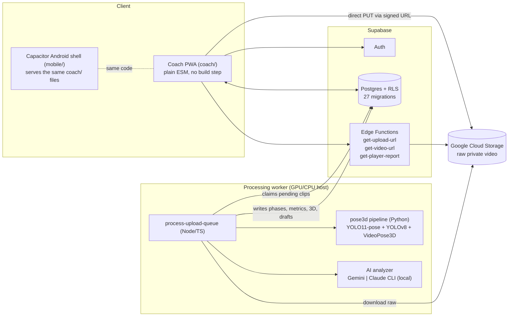

# HitterLoop

**Video-based swing analysis and player development for youth baseball and softball.**

HitterLoop helps coaches and hitters break down real swings, identify what to work on next, assign
drills, and track whether improvements carry from practice into games. A coach films real at-bats and
practice swings on a phone; HitterLoop locates the swing, reconstructs the batter in 3D, and drafts a
review that the coach approves, edits or rejects.
Approved observations become **priorities** with drills, follow-ups and evidence over time. The
product is a coaching loop, not a one-off report: *see it, name it, assign a drill, check whether
it transferred to games.*

- Current version: **0.18.0** (see [CHANGELOG.md](CHANGELOG.md))
- Coach app: installable PWA (`coach/`) plus a Capacitor Android shell (`mobile/`)
- Backend: Supabase (Postgres + Auth + RLS + Edge Functions), Google Cloud Storage for video
- Processing: a Node worker driving an isolated Python pose pipeline (YOLO11-pose, YOLOv8 bat
  detection, VideoPose3D)
- Currently used by one real team (Latham Lady Bison White 10U). A fictional "Thunder 10U" team
  exists for local dev only.

> **Read this first: what is and isn't live.** Nothing is deployed. There is no hosted Supabase
> project or Cloud Run job. Everything runs against a local Supabase stack and a locally run
> worker. Details in [Project status](#project-status-and-known-gaps).

---

## Table of contents

1. [Product principles](#product-principles)
2. [What a coach can do](#what-a-coach-can-do)
3. [Screens and UX](#screens-and-ux)
4. [Architecture](#architecture)
5. [The processing pipeline](#the-processing-pipeline)
6. [Metrics, and how much to trust them](#metrics-and-how-much-to-trust-them)
7. [AI diagnosis](#ai-diagnosis)
8. [The 3D swing viewer](#the-3d-swing-viewer)
9. [Data model](#data-model)
10. [Security model](#security-model)
11. [Getting started](#getting-started)
12. [Command reference](#command-reference)
13. [Filming guidance](#filming-guidance)
14. [Repository layout](#repository-layout)
15. [Development conventions](#development-conventions)
16. [Project status and known gaps](#project-status-and-known-gaps)

---

## Product principles

The approved simplified direction is in [docs/SIMPLIFIED_APP_SPEC.md](docs/SIMPLIFIED_APP_SPEC.md).
The app is being refactored in stages; the older workflows described below remain in the current
screens until their replacements are ready.

These principles govern the replacement experience:

1. **The video is the evidence.** Automatic reports are shown to parents and coaches only when
   the video supports them. A report shows at most one fix; either reader can hide a fix that
   does not look right. The coach owns the team and roster.
2. **The original video is the source of truth.** The 3D avatar is an explanatory aid, not
   evidence. The AI prompt forbids resting a conclusion on the avatar alone.
3. **Never fabricate precision or progress.** No unsupported outcomes, physical-unit estimates,
   invented drills, or progress inferred from a single swing appear in reports.
4. **Patterns need repeated game swings.** Fewer than three readable game at-bats means an
   early read without a current focus.
5. **Games and practice stay separate.** Practice can inform its own line, while game swings
   determine current focus and status.
6. **Built for a phone at a ball field.** Large targets, high contrast, and short paths from
   recording to reading a report.

---

## What a coach can do

**Capture**
- Sign up, create a team (with an access code), and add players. No admin step is needed.
- Log a game **at-bat** with opponent, pitch-by-pitch detail (9-zone location picker, outcome,
  count) and attach one or more video clips **per pitch**.
- Log a **practice session** (goal, focus priority, drill, reps grouped as baseline / drill /
  post-drill / free swing) and attach a clip per rep.
- Upload from the phone. Pitch recording and player-page capture open the rear camera directly
  (`capture="environment"`); practice supports the existing multi-file picker. The upload goes
  directly to cloud storage, and processing starts automatically.

**Review**
- Work through a team-wide queue of distinct swings with pending findings; only the next finding is
  actionable and the queue advances only after an explicit coach decision.
- Open a swing on the simplified review page and read four things: *what I see*, *what to work on*,
  *what to look for next time*, *track progress*. **Approve**, **Edit** or **Reject** each AI issue.
- Watch the original video with phase markers (stance, load, stride, contact, extension,
  follow-through) that seek the video, and open the 3D reconstruction on demand.
- Read collapsed technical detail if wanted: analysis quality, swing metrics, the 11-checkpoint
  checklist.

**Develop**
- **Promote** an issue to a **priority** (for example "Front-side stability", "Hand path", "Head
  movement"). Assign drills from a curated library, set a follow-up (by date or by swing count),
  and log coach observations with an outcome: improving, unchanged, worse, resolved or unclear.
- See per-player development: active priorities with evidence, game-transfer check, coaching-loop
  step, next focus, chronological timeline, and measured metric trends.
- **Compare any two swings** from suggested before/after pairs or a manual picker in synchronized
  Video, same-phase Frames, coach-authored Progress, robust Metrics, or optional explanatory 3D.

**Share**
- Generate a revocable, 90-day **read-only report link** for a parent or recruiter. No account is
  needed. It shows coach-confirmed content only.

**Manage a team**
- A team dashboard shows what needs review, follow-ups due, active priorities, and recent progress,
  practice and game swings.
- The roster filters by *Needs Review*, *Priority Flaws* and *Early Read*.
- Team-wide focus areas are flagged when a checkpoint's team average falls below 2.0.

---

## Screens and UX

The coach app is plain static HTML plus ES modules with no build step. Pages are in `coach/`.

| Page | Purpose |
|---|---|
| `index.html` | Login, account creation, "My Teams" picker, create-team form (access-code gated) |
| `team.html` | Roster with confirmation progress, filter chips, team dashboard, add player |
| `player.html` | The player hub: priorities up top, diagnosis and comps, drill recommendations, follow-up, **Game Log**, **Practice Log**, collapsed advanced checklist, and a "Manage Player" drawer (share links, delete) |
| `queue.html` | Team review queue: pending swings grouped by player plus recent reviewed swings |
| `atbat.html` | Quick pitch logging/recording, derived count and swing/take, evidence status, facts-only summary |
| `session.html` | One practice session: goal, focus priority, drill, rep grouping, usable/rejected reps, baseline vs post-drill comparison, coach outcome |
| `review.html?clip=&phase=&queue=1` | Video-first swing review; queue mode exposes one finding decision at a time and an explicit Next swing action |
| `development.html` | Longitudinal development view for one player |
| `compare.html` | Suggested/manual two-swing comparison: Video, Frames, coach Progress, Metrics, optional 3D |
| `report.html?token=` | Public read-only player/parent report containing coach-confirmed content only |

### Design system

- **Palette:** dark slate background `#121418`, clay/terracotta accent `#C2593F`, sand text
  `#F4EFEA`. Chosen for legibility in direct sunlight. Dark only: there is no light-mode toggle.
- **Touch targets:** a 48 px minimum on interactive elements, for one-handed use behind a backstop.
- **Navigation:** a 56dp app bar, compact player tabs, and Team / Add / Review bottom navigation.
- **One-tap scoring:** a 1-2-3 stepper (1 = Needs work, 2 = Developing, 3 = Solid) that upserts
  immediately. No dropdowns or sub-menus.
- **Explicit provenance badges:** *🤖 AI Draft* vs *✓ Coach Reviewed*, with score history (for
  example "2 → 3") and per-checkpoint progress sparklines once a checkpoint has two or more real
  changes.
- **Honest empty and error states:** a failed checklist load disables scoring instead of showing a
  blank row a coach could accidentally overwrite. Low-reliability 3D frames show an explicit
  "less reliable" caveat.
- **Progressive disclosure:** the review page keeps the four coaching questions on top. Metrics,
  3D, quality and the detailed checklist sit in collapsed drawers.
- **Filming coaching in-app:** upload entry points remind the coach to film from directly behind
  home plate.
- **PWA:** installable, portrait, with an offline shell (`coach/sw.js`). Cached data shows offline,
  but live edits and uploads need a connection.

---

## Architecture



### Components

**Coach app (`coach/`).** Static HTML and vanilla ES modules. `@supabase/supabase-js` and Three.js
(pinned to 0.185.1) load from `esm.sh`. There is no bundler, so the code that is tested is the
code that ships. Business logic that needs tests (`developmentLogic.js`) is deliberately kept free
of the DOM and of Supabase. Config is resolved in `coach/config.js` in three tiers: hosted
`PROD_*` constants if filled in, otherwise the browser's own hostname on port 54321, otherwise the
gitignored `coach/config.local.js` LAN host for the native shell.

**Android shell (`mobile/`).** Capacitor 6.2.1 with `appId com.hitterloop.coach`. `webDir` points at
`../coach`, so there is no duplicated code. It is installed as a debug APK. The iOS project is
scaffolded but has not been built.

**Supabase.** Postgres 17 with team-scoped RLS on everything, Supabase Auth for coaches, and three
Deno Edge Functions:

| Function | Caller | Job |
|---|---|---|
| `get-upload-url` | authenticated coach | Authorizes an upload (RLS decides access, never a client-supplied slug) and returns a v4 signed PUT URL (or the emulator URL locally) |
| `get-video-url` | authenticated coach | Returns a 15-minute signed read URL for a private raw clip |
| `get-player-report` | anonymous, share token | The only public read path. Validates the token (not revoked, not expired), then reads with `service_role` and returns a whitelisted, coach-confirmed report shape. Serves video only for clips a coach linked as evidence |

**Storage.** Raw video lives in a private GCS bucket. Locally, `fake-gcs-server` plus an nginx CORS
proxy (`docker/gcs-cors-proxy.conf`) stand in for it. The emulator alone omits the
`Access-Control-Allow-Methods` header on preflight, which real browsers require.

**Processing worker (`src/cli/processUploadQueue.ts`).** A long-running poller (10 s interval).
It has to run on a host with the Python venv (torch, YOLO, VideoPose3D). It cannot run in a
browser, an Edge Function or any lightweight serverless runtime.
- Clips are claimed by an atomic conditional `UPDATE`, so multiple workers can run against one
  queue with no code change.
- A clip stuck in `processing` past `UPLOAD_QUEUE_STALE_CLAIM_MINUTES` (default 15) is reclaimed.
- A failed clip auto-retries up to 3 times with 2 / 10 / 30 minute backoff, then waits for the
  manual **Retry** button in the app.
- Node and Python communicate through a `pipeline_status.json` contract rather than exit codes, since
  a real post-completion CUDA teardown crash had already made exit codes unreliable.

**Python pipeline (`scripts/pose3d/`).** Runs in an isolated `.venv_pose3d`. See the next section.

**AI (`src/services/ai/`).** Two interchangeable backends behind one shared prompt and schema.

---

## The processing pipeline

Everything below happens automatically after a coach uploads a clip.

```
Phone ──PUT──▶ GCS (private raw video)
   └─ insert video_clips row (status=pending), linked to a pitch or practice rep
                            │
   worker claims clip (atomic) ──▶ downloads raw video
                            │
   ┌────────────────────────▼─────────────────────────────┐
   │ Python: scripts/pose3d/run_pipeline.py               │
   │  0    locate_swing.py   (clips > 60 s) audio bat-crack │
   │       onset → ~12 s window; ranked candidates, tries   │
   │       up to 3; never guesses a window                  │
   │  0.5  decimate.py       (> 120 fps) → ~30 fps          │
   │  1    detect_2d.py      YOLO11-pose + YOLOv8 bat +     │
   │       ByteTrack; whole-clip person tracks; batter =    │
   │       track with strongest cumulative bat-holding      │
   │       evidence; One-Euro smoothing; trackability gate  │
   │  2    lift_3d.py        VideoPose3D COCO-17 → H36M-17  │
   │       + correct_limb_depth.py (reprojection-based      │
   │       depth correction, 2-bone IK on a shared grip)    │
   │  3    metrics.py        contact instant, summary       │
   │       metrics, 6 swing phases, movement flags          │
   │  3.5  refine_bat_speed.py  full-rate re-measure at     │
   │       contact (only if decimated)                      │
   │  4    overlay.mp4       annotated QA video             │
   └────────────────────────┬─────────────────────────────┘
                            │  pose_2d/pose_3d/bat_path/metrics.json
   Node: ingestPhases ─▶ video_clips, swing_phases, video_clip_metrics
                         + analysis_quality (Good / Limited / Poor)
   Node: smoothJoints → rigidifySkeleton → video_clip_pose3d
         (packed float32 binary; longest tracked run only)
   markClipReady                       ◀── from here the clip is usable
                            │
   extract one still per located phase ─▶ AI analyzer ─▶ drafts
   (own try/catch: a diagnosis failure never fails the clip)
```

Design notes:

- **Batter identity** is decided across the *whole clip*, not one frame. Earlier single-frame
  heuristics locked onto the umpire, then the catcher. The current approach builds persistent
  tracks for every person and picks the one with the strongest aggregate evidence of holding the
  bat. Bat tracking locks onto a ByteTrack ID and only reacquires when the track is lost, which
  stopped a single false-positive detection producing an impossible bat-speed spike.
- **Contact** is the frame where bat speed *and* front-knee extension are both elevated (argmax of
  their normalized product). Full at-bat clips are mostly dead time, so one signal alone is
  unsafe. `confidence: "high"` is reported only when the frame is near the top of both signals
  individually. The other five phases each have their own detector, are capped at low confidence or
  return `null` with a reason, and are never fabricated.
- **Fast-fail:** before a full per-frame pass, the pipeline samples about 30 frames and exits in
  seconds with an actionable message if nobody is clearly trackable (usually a bad camera angle).
- **Graceful degradation:** a 3D failure is non-blocking. The coach still gets video plus 2D
  phases. Optional `ffmpeg`/`ffprobe` stages no longer crash the visual pipeline when the binaries
  are missing.
- **Overlay QA:** `overlay.mp4` is a required output. Several real bugs (wrong person tracked,
  bat teleporting) produced well-formed JSON and were only caught by looking at the overlay.
- **Validation runner:** `npm run validate:swings` runs five labeled clips deterministically
  (SHA-256 video IDs, private diagnostic videos, quality gates, regression metadata). Videos and
  outputs are gitignored.
- **Legacy path:** `scripts/pose_analyze.py` and friends (MediaPipe) are the original prototype,
  kept only for side-by-side comparison via `run_pose3d.ps1 -LegacyMediapipe`. Do not build on them.
- **Why YOLO11 + VideoPose3D instead of RTMPose + MotionBERT:** the originally specified stack was
  not installable here (no `mmcv` wheel for the torch build; MotionBERT's checkpoint sits behind an
  interactive auth wall). Full rationale in [scripts/pose3d/README.md](scripts/pose3d/README.md).

For a full audit of what is stable, unstable and missing, see
[docs/PIPELINE_AUDIT.md](docs/PIPELINE_AUDIT.md).

---

## Metrics, and how much to trust them

| Metric | Unit | Basis |
|---|---|---|
| Peak bat speed | shoulder-widths / sec | Video-derived (2D) |
| Attack angle | degrees | Video-derived |
| Stride length | hip-widths | Video-derived |
| Hip-shoulder separation at contact | degrees | 3D reconstructed estimate |
| Lead-elbow angle at contact | degrees | 3D reconstructed estimate |
| Torso / pelvis tilt | degrees | 3D reconstructed estimate, **not reliable** (see below) |
| Movement flags (lateral sway, knee- vs hip-dominant, wrist-lead timing) | flag | Heuristics on existing signals |

**Analysis quality** (stored per clip, shown as Good / Limited / Poor): 2D pose coverage, bat
coverage, 3D coverage, contact confidence, reconstruction, occlusion and handedness. Anything the
pipeline cannot know is stored as `null` and shown as "Not measured". Handedness is only ever a
heuristic ("whichever ankle sits lower in frame is the front leg"), so it is capped at "limited".

**Why no absolute numbers:** monocular phone video has no camera intrinsics, extrinsics or scale.
VideoPose3D was not trained on softball. H36M has no feet, toes or fingers. The bat's 3D endpoints
come from 2D boxes. The experience is designed to preserve **timing and gross pose for
explanation**, not laboratory biomechanics.

**Known defect:** `lift_3d.py` applies one fixed `WORLD_ROTATION` (borrowed from VideoPose3D's
visualizer code) to every clip. For some camera angles this produced implausible torso tilt
(48–70° on a batter who was upright throughout). The viewer works around it with a display-level
per-clip "auto-level" transform. The stored tilt metrics do not have an equivalent fix, so treat
stored tilt values as unreliable.

---

## AI diagnosis

Runs automatically after a clip is ready, on one still per located swing phase plus the pitch
context (location and result).

- **Backends** (same prompt and schema, `swingAnalysisShared.ts`):
  - `gemini`: the intended production path (`GEMINI_API_KEY`, `@google/genai`).
  - `claude-cli`: local testing only. It shells out to the `claude` CLI and reuses the developer's
    own login, with the prompt piped over stdin. Enable with `AI_ANALYZER=claude-cli`. Never set it
    in a real deployment.
- **Outputs:** scores for all 11 checkpoints, drafted issues, drill recommendations, and reference
  comps (only when genuinely apt).
- **Each issue is structured:** observation, evidence (which frame or phase), why it may matter,
  coaching cue, suggested drill, what to look for next time, and confidence (low whenever it rests
  on one swing or frame).
- **Hard constraints in the prompt:** video stills outrank all pose data. No exact joint angles,
  bat speeds or real-world distances unless calibrated data was supplied. Reconstruction-derived
  claims must be phrased "the reconstruction suggests" and keep their caveat.
- **Overwrite protection:** re-runs clear only *unreviewed* drafts. Coach-reviewed scores and issues
  are never overwritten without an explicit `--force`, and this is covered by integration tests.
  Drill and comp tables have no reviewed-by concept, so they are replaced wholesale on each run.
- **Provenance:** drafts are tagged `gemini`, `pose3d` or `claude`, so a disagreement between the
  AI and the measured-angle read stays visible.
- **Comp bank:** softball only, six top-end hitters (Alo, Chamberlain, Chidester, Romero, Watley,
  McCleney), each tied to a specific sourced trait. There is deliberately no baseball or MLB comp.
  The list was fact-checked in two passes, and one unsourced claim was removed.

### The 11 checkpoints

Stance & setup · Load · Stride / front-foot plant · Hip-shoulder separation · Hand path to ball ·
Bat path through zone · Contact point · Extension · Head/eyes · Follow-through & finish · Swing
decisions (pitch selection). Each has its own reference illustration in `coach/illustrations/`.

---

## The 3D swing viewer

`coach/components/skeletonScene.js` (Three.js/WebGL) drives a rigged, skinned Mixamo humanoid
(`coach/assets/models/batter.fbx`) from the player's own tracked H36M joints via bone retargeting.
It is not a canned animation or a stick figure.

- **Retargeting:** roughly 20 posable bones. A full two-vector hip/spine basis preserves real
  hip-shoulder separation twist. Limbs use single-vector aim alignment. Fingers, toes and clavicles
  stay at rest, since H36M has no data for them. The head follows the torso because the raw
  neck/head estimates were measurably unreliable. Shoulder width is scaled to the tracked player.
- **Consistent skeleton:** joint output is smoothed and rigidified to a median bone length. Both
  hands are constrained to a shared grip point via 2-bone IK, and a synthetic bat attaches to both
  hands.
- **Controls:** drag to orbit (polar angle clamped to avoid degenerate top-down views), play and
  scrub, frame-step, **camera presets** (Source, Front, Side, Rear, Pitcher, Batter), phase
  checkpoints, and optional **motion trails** (hands, bat barrel, pelvis, sternum) plus
  shoulder/hip axis overlays.
- **Side by side:** compare mode links two viewers to a shared viewpoint (3D A | 3D B).
- **Original-video review:** the 3D view sits next to the private original video, sharing a frame
  timeline.
- **Coordinates:** canonical HitterLoop axes are X = batter left/right, Y = vertical, Z = toward
  pitcher. Units are normalized body units.

---

## Data model

Postgres, in `supabase/migrations/` (27 migrations, applied in order). Every table has RLS.

| Area | Tables |
|---|---|
| Identity and access | `teams`, `coach_team_access` (role: `coach` / `head_coach`), `coach_profiles`, `app_settings` (service-role only), `team_creation_attempts` |
| Roster | `players` |
| Games and practice | `game_log_entries` (`session_type` = `game` or `practice`), `at_bat_pitches`, `practice_sessions`, `practice_repetitions` |
| Video and reconstruction | `video_clips` (queue status, retry state), `swing_phases` (with `reconstruction_reliable`), `video_clip_metrics` (with `analysis_quality`), `video_clip_pose3d` (packed binary joints, lead side) |
| Checklist | `checkpoints`, `swing_phase_types` (both read-only reference tables), `checklist_scores` (score, `ai_draft`, `source`, `reviewed_by`), `checklist_score_history` (trigger-populated audit trail) |
| AI output | `issues` (`review_status`, draft source), `comp_recommendations`, `comp_notes`, `drill_recommendations` |
| Development | `player_priorities`, `player_priority_status_history`, `player_priority_observations`, `player_priority_drills`, `drill_library` (7 curated drills) |
| Sharing | `player_share_links` (token, revocable, `expires_at`) |
| View | `team_summary_stats` |

Notable behaviors:
- Video clips link to exactly one of a pitch, a practice rep or a legacy at-bat. This is enforced by
  a trigger, and older flows are kept consistent by triggers that create the pitch or rep.
- Priority status changes are logged to history by trigger, and follow-ups are stamped
  automatically. A priority can only belong to its own player's team.
- Priority categories: front-side stability, hand path, timing vs inside pitch, head movement,
  stride consistency, ball flight (too much loft), load / timing, balance & finish, other.
- 0.14.0's migration moved existing clips onto "Pitch 1" or a practice rep with no data loss.

---

## Security model

- **RLS is the security boundary, not key secrecy.** The Supabase URL and anon key ship in the app
  by design. A coach can read and write a team's data only through a `coach_team_access` row.
  `anon` gets nothing, anywhere.
- **The one public read path** is the `get-player-report` Edge Function. The share token is the
  whole authorization boundary. Revoked, expired and nonexistent tokens return the same error. The
  response comes from a whitelist (`shape.ts`) of coach-confirmed content only: no AI drafts, no
  internal diagnostics.
- **Private video.** Raw clips are never public. Coaches get 15-minute signed URLs, and share-link
  viewers get video only for clips a coach linked as evidence.
- **Reference tables** (`checkpoints`, `swing_phase_types`) are read-only to clients. An earlier
  version had RLS disabled on them, which let any signed-up coach rewrite shared checklist data. That
  hole was found, proven and fixed in 0.8.0.
- **Team creation** requires an access code (`app_settings`, checked inside the `create_team()`
  RPC), rate-limited to 5 attempts per 15 minutes per coach.
- **XSS:** all coach-entered text passes through `escapeHtml()` at every `innerHTML` injection.
- **The service-role key** is used only by server-side CLIs, the worker and Edge Functions. Never
  put it in `coach/`.
- **The service worker never caches** Supabase or GCS traffic, and never intercepts non-GET
  requests (it used to crash the WebView on large uploads).

---

## Getting started

### Prerequisites

- Node 20+ and Docker (for Supabase and the GCS emulator)
- For real processing: a Python venv `.venv_pose3d` with torch, Ultralytics, and a cloned
  VideoPose3D plus its checkpoint. See [scripts/pose3d/README.md](scripts/pose3d/README.md).
  A GPU makes a 40 s clip finish in well under a minute, and a CPU runs the same code much slower.
- `ffmpeg` on `PATH`
- For the Android build: the Android SDK and an emulator or device

> **Platform caveat.** The worker was built and run on Windows. `processUploadQueue.ts` hardcodes
> the venv interpreter at `.venv_pose3d/Scripts/python.exe` (Windows layout), several scripts are
> PowerShell, and the emulator flow assumes `gradlew.bat` and `C:\Android`. On macOS or Linux the
> interpreter path (`.venv_pose3d/bin/python`) needs adapting before the worker will run. That has
> not been done or tested.

### Local setup

```bash
npm install
npx supabase start                  # Postgres, Auth, Studio via Docker; prints URL and keys
cp .env.example .env                # paste the URL/keys that `supabase start` printed
npx supabase db reset               # applies supabase/migrations/ + seed.sql
docker compose up -d gcs-cors-proxy # GCS emulator + CORS proxy (starts gcs-emulator too)
npm run process-upload-queue        # leave running: polls for pending clips
```

Serve `coach/` with any static server and open it in a browser. Locally, `coach/config.js` finds
Supabase at `<your hostname>:54321`, so it works from a phone on your LAN too.

For the **native shell** (its WebView reports `localhost`):

```bash
cp coach/config.local.example.js coach/config.local.js   # gitignored: set your machine's LAN IP
```

Bring `gcs-cors-proxy` up, not `gcs-emulator` directly.

### Environment (`.env`)

| Variable | Purpose |
|---|---|
| `SUPABASE_URL`, `SUPABASE_ANON_KEY`, `SUPABASE_SERVICE_ROLE_KEY` | From `supabase start`. The service role bypasses RLS: server-side only |
| `GCP_PROJECT_ID`, `GCS_BUCKET_NAME` | Storage bucket (`softball-scouting-media` by default) |
| `GCS_EMULATOR_HOST` | Set for local dev to use fake-gcs-server |
| `GEMINI_API_KEY` | AI Studio key for the Gemini backend |
| `AI_ANALYZER` | `gemini` (default) or `claude-cli` (local testing only) |
| `UPLOAD_QUEUE_STALE_CLAIM_MINUTES` | Optional, default 15 |

### Accounts and teams

Coaches can self-register in the app and create a team with the access code. Locally, the seeded
code is a placeholder (`LOCAL-DEV-ONLY-CHANGE-ME`). **Change it before real coaches use signup:**
`update app_settings set value = '...' where key = 'team_creation_code';`

There is also an admin path:

```bash
npm run provision-coach -- --email coach@example.com --password "..." \
  --displayName "Coach Kayla" --team latham-lady-bison-white-10u
```

(That script's own docstring still says signup does not exist. It is out of date. The script works.)

### Building the Android app

```powershell
cd mobile && npx cap sync android
cd android && .\gradlew.bat assembleDebug
adb -s emulator-5554 install -r app\build\outputs\apk\debug\app-debug.apk
```

`npx cap run android` does not work reliably in the Windows setup this was built in, so drive
Gradle and `adb` directly. Distribution is by APK. It is not on the Play Store.

---

## Command reference

| Command | What it does |
|---|---|
| `npm run process-upload-queue` | The worker: claim, download, pipeline, ingest, AI diagnosis. Ctrl-C to stop |
| `npm run reconcile-uploads` | Report GCS objects with no `video_clips` row. Add `-- --delete-older-than-days 7` to clean up |
| `npm run extract` | Extract frames from a video (fluent-ffmpeg) |
| `npm run ingest` | Load `pose3d_to_checklist.py` output as `source='pose3d'` drafts |
| `npm run ingest-phases` | Load a clip's phases, metrics and quality into Supabase |
| `npm run ingest-pose3d-frames` | Load a clip's smoothed 3D frames (for onboarding already-processed clips) |
| `npm run analyze` | Run AI analysis over a directory of stills. `--claudeDraft <path>` loads a pre-written draft |
| `npm run backfill-analysis-quality` | Compute `analysis_quality` for clips ingested before it existed |
| `npm run validate:swings` | Deterministic five-clip validation batch |
| `npm run provision-coach` | Admin: create a coach and grant team access |
| `npm run coach:bump-cache` | Rewrite the service-worker cache key and `coach.css` cache-buster hash |
| `npm run db:migrate` / `db:reset` | Push migrations / rebuild the local DB |
| `npm test` | Node tests (see below) |
| `./scripts/run_pose3d.ps1 -VideoPath ... -PlayerName ...` | Run the pose pipeline directly on one clip |

**Tests:** `npm test` runs `tsx --test src/**/*.test.ts` plus the coach-logic tests
(`developmentLogic.test.mjs`, `pages.test.mjs`). The DB tests are real integration tests against
local Supabase (queue claim races, coach-review overwrite protection, RLS on the development
tables, the public report whitelist), so `supabase start` must be running. Reconstruction math also
has unit tests.

---

## Filming guidance

Bad camera angle is the most confirmed cause of bad data in this pipeline.

- Film **every at-bat**, not just the good or bad ones.
- Shoot from **directly behind home plate or the backstop**, and use the same spot each game. There
  is no camera calibration, so consistency matters more than it seems. A clip filmed parallel to
  first base tracked the person fine but found almost no bat, and the pipeline reports that specific
  cause.
- Start recording as the pitcher begins her windup, not when the bat moves.
- Prefer **240 fps (1/8 speed)** when light allows. At dusk or under weak lights drop to 120 fps
  or normal speed, because dim 240 fps clips come out dark and noisy. Many phones cap resolution at
  240 fps, which can hurt tracking, so frame tighter to compensate.
- Long full-at-bat uploads are fine. The pipeline finds the swing from audio.

---

## Repository layout

```
coach/                 Coach PWA: pages, components/, coach.css, sw.js, illustrations/, assets/models/
  components/          skeletonScene/Comparison (3D), developmentLogic (pure, tested), stepper,
                       videoUpload, compModal, teamDashboard, devUi/devActions, trendChart, ...
mobile/                Capacitor shell (android/ project; ios/ not built)
src/
  cli/                 Node CLIs: worker, ingest*, analyze, extract, provisionCoach, reconcile, ...
  services/
    ai/                Gemini + Claude CLI analyzers, shared prompt/schema
    db/                Supabase helpers: queue, upserts, analysis quality, tests
    pose3d/            Joint smoothing, rigidification, tracked-run extraction
    reconstruction/    Canonical coordinates/stabilization math + tests (see status)
    storage/gcs.ts     GCS upload/download (emulator-aware)
  types/scouting.ts    Domain types and thresholds
scripts/
  pose3d/              The Python pipeline (detect, lift, metrics, overlay, validation)
  pose_*.py            Legacy MediaPipe prototype (comparison only)
  process-validation-batch.ts, bump-coach-cache.mjs, run_pose3d.ps1
supabase/
  migrations/          00001 … 00027
  functions/           get-upload-url, get-video-url, get-player-report
  seed.sql
docs/PIPELINE_AUDIT.md Reconstruction audit
docker/, docker-compose.yml, Dockerfile   GCS emulator + CORS proxy; Node CLI image
CHANGELOG.md, CLAUDE.md
```

### Upgrading from BarrelIQ

The product was renamed from BarrelIQ to BarrelTrace in 0.14.1, including internal identifiers.
Things that need a one-time action on an existing machine or device:

- **Android:** the application ID changed from `com.barreliq.coach` to `com.barreltrace.coach`, so
  Android treats it as a different app. Uninstall the old "BarrelIQ" app from each device or emulator
  (`adb uninstall com.barreliq.coach`) and install the new build; local app data is not carried over.
- **Local config:** if you have a gitignored `coach/config.local.js`, rename its global from
  `window.__BARRELIQ_LOCAL_CONFIG__` to `window.__BARRELTRACE_LOCAL_CONFIG__` (see
  `coach/config.local.example.js`).
- **Emulator name:** an AVD created as `BarrelIQ_Test` keeps that name (it lives on your machine).
- **Generated data:** new pipeline/validation output is stamped `barreltrace-reconstruction-v1` and
  `barreltrace-x-right-y-up-z-pitcher`. Output generated before the rename keeps the old strings; nothing
  in the repo reads them back.
- **Local permission approvals:** `.claude/settings.json` still lists `adb` approvals for the old
  package name; new-name commands will simply prompt once.

No domain, email address, database object, bucket or function ever used the old name. When a HitterLoop
domain is chosen it will need to go in `PROD_SUPABASE_URL` and any share-link base URL.

### Upgrading from BarrelTrace

The product was renamed from BarrelTrace to HitterLoop in 0.18.2. This was a brand migration only: no
behavior, schema, RLS, pipeline or AI change. One-time actions on an existing machine or device:

- **Android:** the application ID changed from `com.barreltrace.coach` to `com.hitterloop.coach`. These are
  separate Android app identities, not an in-place upgrade: an existing BarrelTrace install keeps its name and
  data and coexists with the new app until you uninstall it (`adb uninstall com.barreltrace.coach`). Local app
  data is not carried over. Any store or distribution implications are separate release work.
- **Local config:** if you have a gitignored `coach/config.local.js`, rename its global from
  `window.__BARRELTRACE_LOCAL_CONFIG__` to `window.__HITTERLOOP_LOCAL_CONFIG__` (see
  `coach/config.local.example.js`).
- **PWA caches:** cache names now start with `hitterloop-coach-`; the service worker's activate step deletes
  the old ones, so installed apps refetch the shell (and the Three.js CDN cache once) on next load.
- **Persisted format identifiers kept:** stored reconstructions and pipeline/validation output are stamped
  `barreltrace-reconstruction-v1` and `barreltrace-x-right-y-up-z-pitcher`, and the animation loader validates
  the coordinate-system value. They are format identifiers rather than branding, so they were deliberately not
  renamed; renaming would make existing stored animations fail that check.
- **Local permission approvals:** `.claude/settings.json` still lists `adb` approvals for the old package
  name; new-name commands will simply prompt once.
- **Emulator name:** an AVD created as `BarrelIQ_Test` keeps that name (it lives on your machine).

---

## Development conventions

- **Versioning:** semantic, pre-1.0 pragmatism. Keep `package.json`, `mobile/package.json` and
  `mobile/android/app/build.gradle` (`versionName`, plus `versionCode` +1) in sync.
- **Changelog:** update [CHANGELOG.md](CHANGELOG.md) whenever the version bumps, in Keep a
  Changelog format.
- **PWA cache busting:** any change to a cached coach asset needs the service-worker cache key and
  the `coach.css?v=` hash bumped in every page. Run `npm run coach:bump-cache`. Skipping this makes
  a fix look like it never landed.
- **Commits:** one commit per work session's output, with a body focused on *why*, real numbers and
  what broke. Push to `origin master` only. Never commit `.claude/settings.json` as part of a
  feature.
- See [CLAUDE.md](CLAUDE.md) for the full rules.

---

## Project status and known gaps

| Area | State |
|---|---|
| Coach PWA + Android APK | Working against local dev stack, verified on an emulator |
| Upload → automatic processing → AI draft | Working locally end to end |
| Development system, review, compare, share links | Shipped in 0.14.0 |
| Hosted Supabase project | **Not created.** `PROD_SUPABASE_URL/KEY` in `coach/config.js` are blank |
| Cloud processing (Cloud Run / GPU) | **Not deployed.** The worker needs a GPU-capable host with the Python venv. The Dockerfile only covers the Node CLIs, not the pipeline |
| Gemini backend | Wired as the production default, but not confirmed against a live key in the docs. The Claude CLI backend is the one verified end to end |
| Email confirmation for signup | Off locally. Needs real SMTP before public exposure |
| Coach invites to an existing team | Not built |
| iOS | Scaffolded only (needs Xcode) |
| Play Store / billing / benchmarking / parent accounts | Not built. The parent view is a share link only |
| Stored tilt metrics | Unreliable (fixed `WORLD_ROTATION`). Only the viewer is corrected |
| `src/services/reconstruction/*` | Implemented and unit-tested (coordinates, interpolation, foot-plant, handedness, serialization), but **not imported by the live pipeline**. The worker uses `smoothJoints` + `rigidifySkeleton`. Foot-plant correction and the canonical animation format described in `docs/PIPELINE_AUDIT.md` are not active in production processing |
| Cross-platform worker | Windows venv path is hardcoded (see Getting started) |
| Stale docs and config | `Dockerfile` and `docker-compose.yml` still mention/mount the removed `reports/` directory. `NEXT_STEPS.md` is tracked in git but deleted in the working tree |
| Sample size | One real team, so every threshold is tuned on very little data |

This repository is public. Do not commit real keys, the team-creation code, video or frames
(`videos/*` and `frames/*` are gitignored).
